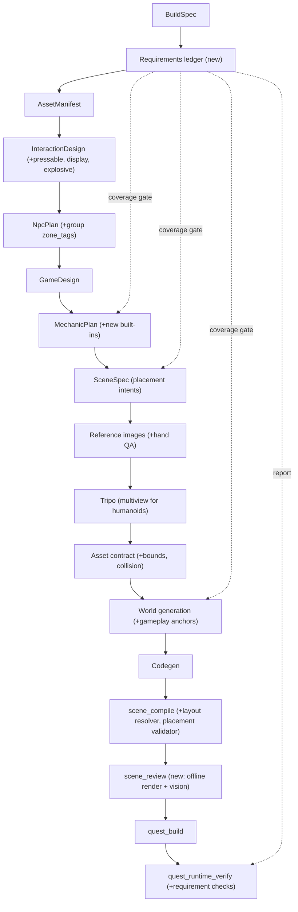

# Engine update: grounded NPCs, body physics, world-aware placement, prompt fidelity

## What is actually broken (from the artifacts and the headset logs)

- **No GLB prop ever gets a collider from its mesh.** In [PhysicsWorld.cpp](engine/runtime/src/physics/PhysicsWorld.cpp) `add_body_for`, `"mesh"` only handles inline world meshes. Every Tripo prop falls through to a fixed box of half-extent `0.25*scale` (0.5 m wide) or a sphere of radius `0.5*scale`, centred on the origin. With scale 1, the 9 cm grenade is a 1 m ball, the 1.8 m table is a 0.5 m cube, and every NPC rifle is a 0.5 m box. This one defect feeds most of the visible problems.
- **Tripo GLBs are centred on their origin.** The table spans Y -0.37 to +0.38 in unit space. Everything is still placed by its origin at floor or table height, so every prop sinks by half its height.
- **Shooting-range goblins are sunk by exactly half their height** (-0.71, -1.00 and -1.23 m for heights 1.4, 2.0 and 2.46 m). They are `stationary`, so they get no `builtin.character_locomotion`. The encounter director spawns them at the zone's floor Y and relies on a ground snap that never runs.
- **Navy SEAL NPCs climb into the sky.** The floor probe (`probe_floor` in [CharacterLocomotionMechanic.cpp](engine/runtime/src/mechanics/builtin/character_locomotion/CharacterLocomotionMechanic.cpp)) ignores the NPC itself and all capsules, but not the rifle attached at `hand_r`, which carries the 0.5 m fallback box. The snap therefore rises 0.35 m every frame: `insurgent_standard_01` goes from Y 104 to 885 m in 20 s while reporting "grounded". The telemetry probe in [Application.cpp](engine/runtime/src/core/Application.cpp) hits the same rifle, so verification reported a fake, constant -0.63 m.
- **The player body pushes grabbables.**
  - Two player colliders sit on the `MOVING` layer and collide with everything: the `CharacterVirtual` (radius 0.22, with no contact listener, so Jolt's defaults `mCanReceiveImpulses = true` and `mCanPushCharacter = true` apply) and a kinematic capsule of radius `0.17*height` (about 0.29 m).
  - The 1 m prop colliders make it far worse.
  - The hands themselves have no colliders, so a real hand can never nudge anything.
- **Gameplay layout ignores the world.**
  - `scene_spec` lays everything out around the spawn point with no knowledge of the world.
  - The world builder in fact built most of what the prompt asked for: per-weapon pads at Y 0.88 on two tables, a lane-2 console with a red halo, a lane-2 HUD backplate, 18 challenge pads, carriage rails with red drop rods, and 14 lane-1 breakable targets.
  - `scene_compile` merged both layers rigidly. The result was duplicate tables, guns placed beside the wrong tables, and lane-2 targets spawned at gameplay's own positions, out on the floor.
- **Missing mechanics.**
  - The plan had no lane-1 destroy mechanic and no frag-grenade detonation.
  - The red button waits for `ctx.contacts->began(button, hand)`, which can never fire because the hands have no colliders.
  - The lane-2 HUD was mapped to the wrist-only `builtin.game_hud` and then stripped by [game_flow_scene.py](apps/orchestrator/ptv_orchestrator/pipeline/game_flow_scene.py).
  - The world's breakables use the state key `broken`; the destroy logic expects `destroyed`.
  - The encounter director ignores zone tags, so it disregards the world's `front_band`, `middle_band` and `back_band` zones.
- **Avatar hands.** The reference image is 1024x1024 and in T-pose, so each hand is about 60 px wide at the edge of the frame. The gloves are fingerless and the fingers are pressed together. Tripo's single-image reconstruction had nothing to work from.

## Pipeline shape after the update (stage order is unchanged)

## Foundation: measured colliders for every GLB (fixes part of every problem)

- In `asset_optimization`, extend `ptv_glb_optimize` with a `--collision` output per asset, in unit space:
  - the local AABB (min and max, including the centre offset);
  - a convex hull of at most 64 points taken from LOD3;
  - a static collision mesh `<id>_collision.glb` of at most about 2k triangles.
- `scene_compile` emits `mesh.collision {aabb_min, aabb_max, hull_points, mesh_path}` in metres. This change touches the schema, the JSON schema, `Scene.h` and `SceneLoader`, as the coding rules require.
- In `PhysicsWorld::add_body_for`, each shape is built from that data:
  - static GLB with `"mesh"`: a Jolt `MeshShape` loaded through `IAssetSource`;
  - dynamic or kinematic: a `ConvexHullShape`;
  - `"aabb"`: a `BoxShape` wrapped in a `RotatedTranslatedShape` so it sits on the AABB centre;
  - `"sphere"`: a sphere sized from the measured bounds.
- The `0.25*scale` fallback stays only for legacy entities without a mesh, and logs a warning when used.
- Mass comes from the interaction design's real-world dimensions.

## Problem 1: NPCs not standing on the ground

- **Floor probes.** Floors come from the `STATIC` layer plus bodies tagged `walkable`. Probes ignore the NPC's whole attachment family (held, worn and attached items, via `ctx.attach`). The ray starts at sole height plus the maximum step (not at the chest), and a "floor" higher than one step above the current soles is rejected. This applies to locomotion, telemetry, encounter spawns and fly/hover.
- **Held and attached items** move to a new `HELD` object layer. They never collide with their holder and are never treated as floor.
- **One ground writer for every skinned NPC.** [encounters.py](apps/orchestrator/ptv_orchestrator/pipeline/encounters.py) binds `builtin.character_locomotion` for `stationary` NPCs too, with zero speed but ground snap, foot planting and an optional face target, so stationary goblins turn toward the player. The director (`spawn_one` in [EncounterDirectorMechanic.cpp](engine/runtime/src/mechanics/builtin/encounter/EncounterDirectorMechanic.cpp)) and `SceneLoader` place every NPC at `floor + foot_offset_m` explicitly instead of relying on the snap.
- **Telemetry and verification** measure the true floor with a static-only probe cast from above, and add per-NPC checks for no vertical drift and for staying inside the assigned band. A runaway climb can no longer hide behind a probe that is hitting the NPC's own rifle.

## Problem 2: the invisible player body pushes grabbables

- **Object layers:** `STATIC`, `MOVING` (NPCs and kinematic world), `PROP` (dynamic props), `HELD`, `PLAYER_BODY`, `PLAYER_PART`, `SENSOR`, `DEBRIS`. The pair table is documented. `PLAYER_BODY` does not collide with `PROP`, `HELD` or `DEBRIS`.
- **Contact listener.** Add a `JPH::CharacterContactListener` to the player's `CharacterVirtual`. `OnContactValidate` rejects light props. `OnContactAdded` and `OnContactPersisted` set `mCanReceiveImpulses = false` and `mCanPushCharacter = false` for props heavier than about 25 kg, which still block the player but are never shoved.
- **Body radius from the real body.**
  - Full avatar: the torso half-width measured in the asset contract's model frame, clamped to 0.15–0.25 m.
  - Hands only: 0.18 m.
  - The kinematic contact capsule uses the same radius, replacing `0.17*height`.
- **Body-part colliders** on `PLAYER_PART`, moved with `MoveKinematic` under a velocity clamp:
  - Hands only: a palm box plus finger capsules that follow the drawn engine hands.
  - Full avatar: hands, forearms and shins/feet, taken from the avatar's joints through `BodySlots`.
  - These push props realistically; this is the "real hands collide" behaviour you described.
- **Grab-friendly approach.** While the grip is open, a hand's parts ignore the hovered grab candidate through a body-pair contact filter, so reaching never knocks the target away. Grab distance is measured from the palm to the closest point of the item's collider, not to its origin.
- **Dynamic props** start asleep and settled at load.

## Problem 3: realize the shooting-range prompt (each fix is an engine-wide system)

### 3a. World-aware placement (tables, guns on tables, button stand, lane-1 posts, lane-2 hanging targets, HUD mount, grenade table)

- **Base alignment is the default.** A placement position means where the bottom rests. `align: base|center|top` can be set explicitly. `place_object` in [WorldGen.cpp](engine/worldgen/src/WorldGen.cpp) and all gameplay placement use the measured bounds. `WorldContext` gains `asset_size(id)` so builders can compute support heights.
- **New `EntitySpec.placement`** in [scene_spec.py](packages/schemas/ptv_schemas/scene_spec.py):
  - `relation`: `on_floor`, `on_surface`, `hang_from`, `mount_on_wall`, `at_anchor` or `free`;
  - `anchor`, `group` and `facing`.
  - The `scene_spec` prompt describes where things go and requests anchors, and never invents coordinates for things that rest on world furniture.
- **Ownership is decided deterministically.** Static, non-interactive assets belong to the world (tables, consoles, posts). Interactive items belong to gameplay, and the world must declare an anchor for each one. A duplicate placement is a validation error; the old 0.5 m dedupe is replaced.
- **The world fulfils placement requests.** `world_generation` receives the requests (entity, asset, measured size, relation, group and prompt quote) and must call a new `WorldContext::gameplay_anchor(...)` for each one, plus `anchor_set(...)` for runtime spawn sets such as the hang points under the lane-2 drop rods. A validator in the same style as the navigation validator checks three things, and failures go back into the existing compile-and-repair loop:
  - every request is satisfied;
  - each anchor sits on, or hangs under, real geometry (within 1 cm);
  - the item's size fits its pad.
- **Layout resolver.** A new `placement_resolve.py` in `scene_compile` computes the final transform from the anchor, the relation, the measured bounds and the rotation, then writes `placement_report.json`. The rigid spawn-delta relocation in [gameplay_relocation.py](apps/orchestrator/ptv_orchestrator/pipeline/gameplay_relocation.py) only applies to legacy specs.
- **Placement validator (fails loudly)** on any of:
  - an item sunk more than 2 cm below its support;
  - an `on_surface` or `on_floor` item more than 3 cm above its support;
  - an unsupported dynamic prop;
  - two props interpenetrating;
  - a `hang_from` with nothing above it;
  - an item outside its group's region.
- **Runtime `ctx.anchors` (`IAnchors`).** Built-ins and generated code look anchor sets up by tag and never hard-code coordinates.

### 3b. Red button that does nothing

- **Interaction design:** `ItemUsage.pressable` with a `press` spec (press with poke, grip, trigger or any; 7 mm travel), plus a new `press_surface` socket kind found by socket generation. Add `ItemUsage.display` for screens.
- **`builtin.press_button`**, following Meta's poke model:
  - the index fingertip crossing the cap plane along its normal between frames;
  - a hit target of at least 22 mm;
  - 7 mm of travel with recoil animation, a haptic tick and a hover highlight;
  - trigger or grip within reach also works, for controller players.
  - The fingertip comes from a new `IHands::fingertip_world(hand, finger)` (the distal `index_3` slot plus the measured tip length).
- **New engine services:** `ctx.signals` (named events with sequence numbers: `emit` and `fired_since`) and `ctx.vars` (a transient value board with sequence numbers). Together they wire built-ins and generated code to each other without generated glue code.

### 3c. Timed challenge and lane-2 hanging targets

- **`builtin.target_challenge`** (generic timed or score challenge):
  - started by a signal, with a configurable duration (20 s here);
  - a spawner with templates, an anchor-set tag, a relation (`hang_from`, `on_floor` or `mount`), a maximum number active and a spawn pattern;
  - scoring from destroy and hit events;
  - states idle, countdown, running and finished;
  - publishes `<id>.time_left`, `score`, `best` and `state` to `ctx.vars`;
  - despawns on finish and is restartable from the button.
- The mechanic-plan reconcile maps timed challenges, score attacks and target spawners to `builtin+config` of this built-in.
- Lane-2 targets spawn with their top hanging from world-declared hang points under the red drop rods.

### 3d. timed_challenge_hud floating with no function

- **`builtin.world_display`** draws text lines with `ctx.text` on the display's front face (taken from its bounds or a `screen` socket), using templates over `ctx.vars` such as `{lane2.time_left:0.0}s  Hits {lane2.score}`. It is mounted with `mount_on_wall` or `at_anchor` (here, the world's HUD backplate).
- A mechanic-plan rule: world-space scoreboards, timers and screens go to `builtin.world_display`. `game_hud` is only the wrist HUD.
- Entities with displays or bindings are never `static_batch`.

### 3e. Lane-1 targets (posted up, destructible by bullets and grenades)

- **`builtin.destructible`**, unified and based on `CHealth`:
  - takes all `ctx.combat` damage, including explosions;
  - on destruction: hide or swap, debris VFX and impulses, interactive state `destroyed` (`broken` is normalized at world compile time), an optional `respawn_after_s`, and a `destroyed` signal;
  - `builtin.breakable` becomes an alias.
- Posts or stands are world-owned and declare `mount` anchors at their tops.

### 3f. Grenade and flashbang (never exploded, not on a table, too small, pushed away)

- **Interaction design:** an `explosive` spec on thrown items:
  - kind: frag, flash, smoke, impact or sticky;
  - activation;
  - fuse;
  - radius;
  - damage and falloff;
  - flash radius and stun time.
  Each value is explicit or inferred.
- **`builtin.explosive`**:
  - arming while held (the trigger pulls the pin), with a haptic and pin VFX;
  - throwing through `builtin.grab` release velocity;
  - fuse or impact detonation;
  - frag: radial `ctx.combat` damage with a line-of-sight raycast and falloff, impulses on dynamic bodies, explosion VFX and a light flash;
  - flash: a white-out for the player through `ctx.comfort`, scaled by view angle and distance, plus a perception stun on NPCs.
  - One-shot effects are pooled.
- **Weapon reconcile.** [weapon_plan.py](apps/orchestrator/ptv_orchestrator/pipeline/weapon_plan.py) maps `fire_system: thrown` to `builtin.explosive`, adding `builtin.item_source` for resupply, and removes generated explosive tasks.
- **Handheld size floor in VR.** In [interaction_rules.py](apps/orchestrator/ptv_orchestrator/pipeline/interaction_rules.py), held and thrown items get a longest axis of at least `vr_min_handheld_size_m` (default 0.12 m). The grenade goes from 0.09 to 0.12 m, and the real dimensions are kept in metadata.
- Grenades rest on the explosives-table anchors (3a), use hull colliders (Foundation) and are never pushed by the body (Problem 2).

### 3g. Goblin bands and group respawn

- Add `EncounterGroup.zone_tags` and a `zone_visibility: any|prefer_hidden` setting. The director only spawns a group inside zones carrying its tags.
- The NPC-plan validator requires zone tags whenever the prompt places groups, and the world receives them as zone tags it must declare.
- "All respawn when all are dead" becomes waves mode with `repeat: true`.

### 3h. Malformed avatar hands

- **Hand clause in the reference prompt.** Change `_T_POSE_CLAUSE` in [stage_reference_images.py](apps/orchestrator/ptv_orchestrator/pipeline/stage_reference_images.py):
  - keep the T-pose, with palms facing forward;
  - all five fingers extended and spread with visible gaps;
  - full-finger gloves only, hands not cropped and with margin around them.
  - Negatives: fingerless gloves, fists, mittens, fingers together.
  - Request `image_config(image_size="2K")` (4K for the player avatar) so each hand is at least about 150 px wide.
- **Vision QA on the image** with `gemini-3.8-flash` (Interactions API, structured output): both hands visible, open, and showing five separate fingers each. Up to 2 regenerations, each given the critique.
- **Humanoid characters go multi-view on Tripo.** Use `POST /v3/generation/image-to-multiview` (about 10 credits), check the hands in the four views, then `POST /v3/generation/multiview-to-model` with that `task_id` (textured, PBR, `texture_alignment="original_image"`, V3). Parameters are re-checked against the live docs before the client is written (rule 9).
- **Mesh hand QA.** After rigging, `ptv_glb_views` renders hand close-ups for a vision check. Your choice applies: regenerate up to 2 times, then keep the best-scoring attempt and warn loudly in the stage report and the UI.

## New system: Prompt Requirements Ledger and verification

- **New `requirements` stage after `build_spec`.**
  - It extracts atomic requirements from the prompt, each with a verbatim quote that is checked.
  - Each requirement has a kind (asset, placement, interaction, mechanic, rule, count or visual) and machine-checkable criteria where possible, for example "glock_pistol on_surface firearms_table" or "lane2 duration 20 s".
  - It is written to `requirements.json`, with a schema and JSON schema.
- **Planning stages claim requirement ids** (`satisfies`): the manifest, interaction design, NPC plan, game design, mechanic plan, scene spec placements and world anchors.
- **Deterministic coverage gate** after each stage. An unclaimed requirement triggers a repair round; if it is still unclaimed, the stage fails and lists it. This gate would have caught the missing lane-1 destruction and frag detonation.
- **New `scene_review` stage.** A new `ptv_scene_views` tool reuses the CPU rasteriser in [glb_views.cpp](engine/tools/glb_views.cpp) to render the whole `scene.json` from the spawn point and from each requirement's viewpoint. Deterministic checks run first, then Gemini vision checks each layout requirement ("four guns resting on the left table", "lane-2 targets hanging under red poles"). Issues get one resolver or world repair round; anything left is flagged.
- **`quest_runtime_verify` additions:**
  - NPC static-floor gap, drift and band checks;
  - prop settle: displacement under 3 cm after 3 s;
  - a scripted walk into every grabbable, which must move it by less than 1 cm;
  - a scripted reach-and-grab of every grabbable, grenades included;
  - a scripted poke on every `press_button`;
  - the challenge running end to end (spawns at anchors, display text changes);
  - a scripted throw, detonation and damage;
  - screenshots at requirement viewpoints.
  - All of this goes into `requirements_report.json` (pass, fail or unverified per requirement) and is shown in the UI.
- **Codegen contract v6** ([codegen_contracts.py](apps/orchestrator/ptv_orchestrator/pipeline/codegen_contracts.py) and the `.cursor/rules` files) rejects:
  - presses by hand contact;
  - private fuse or detonation logic;
  - hard-coded spawn coordinates when anchors exist;
  - private HUD text for world displays.

## Docs and tests

- **New docs:** `docs/physics.md` (layers, colliders, player body, hands), `docs/placement.md` (intents, anchors, resolver, validator), `docs/interactions.md` (buttons, signals, vars, challenge, displays, destructibles, explosives) and `docs/requirements.md`.
- **Updated docs:** npc-and-ai, weapons, sockets, game-flow, world-generation, `engine/world_author_guide.md`, architecture, AGENTS.md, troubleshooting.
- **Tests:**
  - `smoke.cpp`: hull sizes; the probe ignores attachments; no climb with a held rifle; the body does not push props; hands ignore the hover target; button poke; explosive radial damage.
  - Orchestrator tests: the resolver, ownership rules, the coverage gate, the size floor, explosive mapping, zone tags and the hands QA flow.
  - A worldgen test for the anchor validator.

## Device runs

- With the headset connected, run `scene_compile`, `quest_build` and verification again on the existing Navy SEAL and shooting-range projects. This measures the engine-only fixes (grounding, colliders, body push) on device.
- Then do the full rerun of [prompt.txt](projects/20261110-141830-sample-shooting-range-game/prompt.txt) as a **new project** (quest, full_avatar, same as the original), install it, verify it, look at the captures, and report against every requirement in the ledger. The old project stays untouched for comparison.