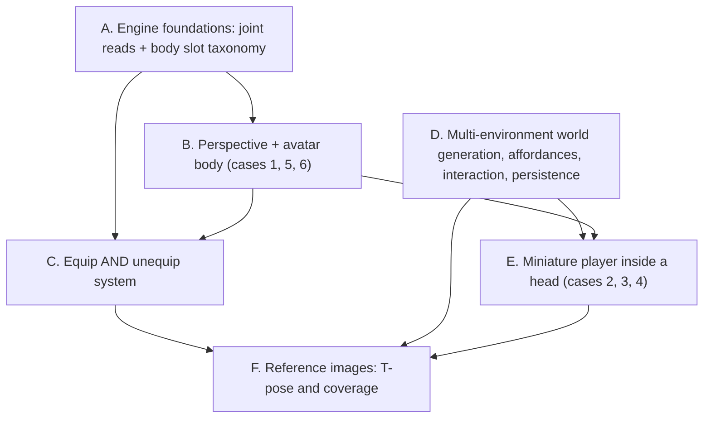

# Player perspective, avatar body, equip/unequip, and T-pose reference images

Six phases, executed strictly in order, each verified before the next starts. Later phases depend on earlier ones: the equip system needs the body-slot taxonomy and a real avatar to equip to, the miniature-player perspectives need world generation to be able to emit a second environment, and the reference-image stage needs to know what kind of avatar the game asked for — and which things are environments rather than assets — before it can write the right prompt.

## Why this is bigger than one mechanic

The Iron Man case in [Prebuilt Equip Mechanic Details.md](Helper_Folder/GLB_Edditing_Updates/NPC/Prebuilt%20Equip%20Mechanic%20Details.md) requires a gauntlet to sit from fingertips to elbow on the player's own arm. Today that is impossible, for three concrete reasons in the code:

- `IAttach::attach` in [engine/runtime/include/ptv/api/MechanicContext.h](engine/runtime/include/ptv/api/MechanicContext.h) resolves one anchor (socket, exact joint, or loose alias `hand_r`/`head`/`spine`) with a fixed local offset. There is no span, no fit, and no body-part vocabulary.
- `ISkeleton` exposes `joint_index`, `set_joint_rotation`, `play_clip` — but **no way to read a joint's world transform**, so a fingertip-to-elbow span cannot be measured.
- `Application::create_player_body()` creates `__player` as a **kinematic capsule with `CTag{"player"}`, no `CMesh`, no `CSkeleton`**. `create_hand_entities()` loads `hand_left.glb`/`hand_right.glb` (16 joints, `mixamorig:` prefix). There is no torso, no arms, and no elbow to equip anything to.

And the three review files remove three assumptions the previous plan had baked in: that a `hide_head` boolean is an acceptable model of VR perspective, that equipping is a one-way operation, and that a game has exactly one VR environment produced by exactly one world-architect agent.



---

# Phase A. Skeleton read API + canonical body-slot taxonomy

Extend `ISkeleton` in [engine/runtime/include/ptv/api/MechanicContext.h](engine/runtime/include/ptv/api/MechanicContext.h), implemented in the nested class in [engine/runtime/src/core/Application.cpp](engine/runtime/src/core/Application.cpp), which already owns the palette behind `ISockets::socket_world`:

```cpp
virtual Mat4 joint_world(std::uint32_t entity, int joint) const = 0;
virtual int  joint_parent(std::uint32_t entity, int joint) const = 0;
virtual int  joint_for_slot(std::uint32_t entity, const char* slot) const = 0;
virtual int  joint_subtree(std::uint32_t entity, int root,
                           int* out, int max_out) const = 0;
```

`joint_for_slot` is the single resolver the built-ins and generated code share, so slot names are never re-invented per game. `joint_subtree` exists because Phase B needs every joint under `head` (head, hair, jaw, eyes) in one call.

New `engine/runtime/include/ptv/api/BodySlots.h` + `engine/runtime/src/animation/BodySlots.cpp` holds one table mapping each canonical slot to ordered candidate joint names, matched case-insensitively with the `mixamorig:` prefix optional. Grounded on the Mixamo 65-bone standard (`Hips`, `Spine`, `Spine1`, `Spine2`, `Neck`, `Head`, `LeftShoulder`, `LeftArm`, `LeftForeArm`, `LeftHand`, `LeftHandIndex1..3`, `LeftUpLeg`, `LeftLeg`, `LeftFoot`, `LeftToeBase`) plus Tripo-spec and loose fallbacks, which matters now that the pipeline produces both Mixamo-spec and Tripo-spec rigs.

Slots: `head`, `face`, `eyes`, `nose`, `ears`, `neck`, `chest`, `spine`, `waist`, `back`, and sided `shoulder`, `upper_arm`, `elbow`, `forearm`, `wrist`, `hand`, `thumb|index|middle|ring|pinky` (+ `_tip`), `thigh`, `knee`, `shin`, `ankle`, `foot`, `toes` (`_l`/`_r`).

Reuse the table in [HandPoseMechanic.cpp](engine/runtime/src/mechanics/builtin/hand_pose/HandPoseMechanic.cpp), which hard-codes `kBonePrefix = "mixamorig:"`, so a Tripo-named avatar rig poses correctly too.

**Verify A:** new `smoke.cpp` cases for slot resolution across Mixamo and Tripo naming, `joint_subtree` returning the head chain on the hand fixture's rig, and `hand_pose` still passing its existing finger-curl case.

---

# Phase B. Perspective and avatar body — replacing `hide_head`

`hide_head` was wrong in two ways at once: it hid the head from *every* view (so a mirror would show a headless avatar), and it implied that `false` means "camera inside the skull", which conflates head *visibility* with camera *placement*. Those are independent, and [builtin.avatar_body.md](Helper_Folder/GLB_Edditing_Updates/NPC/Plan%20Redesign/builtin.avatar_body.md) requires six configurations, not two.

The boolean is deleted and replaced by three orthogonal concepts:

- **Where the camera sits** — at the avatar's eyes, or inside the head as a separate miniature player.
- **Whether the head renders in the player's own view** — independent of whether it renders in a mirror.
- **What the asset actually contains** — a full body with a head, or a neck-down suit.

## B1. Prompt-driven perspective in the schema

Add a `player_avatar` block plus `player_perspective` to [packages/schemas/ptv_schemas/build_spec.py](packages/schemas/ptv_schemas/build_spec.py), which is already where prompt interpretation lands (it holds `player_height_meters`, `locomotion`, `comfort`), and re-export `build_spec.schema.json`.

`PlayerPerspective`:
- `first_person_avatar` (default) — camera at the avatar's eyes. Cases 1, 5, 6.
- `inside_head_free_look` — miniature player inside their own avatar's head; physical head rotation looks around the skull and does NOT rotate the host; controllers drive the host. Case 2.
- `inside_head_npc_host` — miniature player inside an autonomous NPC's head; controllers drive the miniature player, not the NPC. Case 3.
- `inside_head_piloted` — miniature player inside their own larger avatar's head, but HMD rotation drives the host's head and the sticks drive the host's locomotion and turning. Case 4, the robot cockpit.

`PlayerAvatarSpec`:
- `coverage`: `full_body` (default) | `neck_down` | `hands_only`
- `head_visibility`: `hidden_in_self_view` (default) | `always_visible` | `toggleable`
- `leg_animation`: bool, default true
- `needs_mirror`: bool — set when the prompt asks for a mirror, customization, or reflection

**The default that answers the open question in the review file.** The user was unsure whether a neck-down prompt should generate a headless asset or a full character with the head hidden downstream. The answer this plan commits to: **always generate a full body with a head unless the prompt explicitly asks for a body-only avatar**, and treat head visibility as a runtime concern. Case 6 says the engine should "mostly all the time by default create the 3D Avatars with heads", and a head that exists can always be hidden, while a head that was never generated cannot be shown. `coverage: neck_down` is therefore reserved for prompts that explicitly say "feet to the neck", like the case 5 example.

Prompt inference rules go into `BUILD_SPEC_SYSTEM` in [prompts.py](apps/orchestrator/ptv_orchestrator/pipeline/prompts.py): a mirror, customization, or reflection request sets `needs_mirror` and `head_visibility: always_visible` (or `toggleable` when the prompt asks for a show/hide button, exactly the second Green Lantern example); "I don't want my avatar's legs to move" sets `leg_animation: false`; an explicit "inside the head" prompt selects the matching `inside_head_*` perspective.

## B2. Self-view head suppression, done per draw copy

The engine builds ONE `DrawItem` list per frame in `Renderer::build_items_from_world` and renders it to both eyes, with `push_joint_palette` accepting an arbitrary palette per item:

```46:64:engine/runtime/include/ptv/render/Renderer.h
    struct DrawItem {
        Mat4 model{1.0f};
        Vec4 color{0.8f, 0.8f, 0.82f, 1.0f};
        float material_id{0.0f};
        int mesh_slot{-1};
        int joint_base{-1};
        int joint_count{0};
    };
```

That makes the industry-standard approach a natural fit. VRM's `thirdPersonOnly` flag and VRChat's Head Chop both solve this by rendering the avatar differently per view rather than deleting the head globally — VRChat literally renders a mirror clone with the head at full scale alongside a local clone with head bones scaled down. Ready Player Me's Unity guidance is the same idea via per-camera layer culling.

So: add a `CSelfViewHide` component listing joint indices plus a scale factor. When the avatar is emitted for the **player's own view**, push a modified palette with those joints collapsed; the mirror pass in B3 pushes the **unmodified** palette. No layer system, no per-view masking machinery, no extra pass for the self view, and one extra palette copy per frame for one entity.

- The joint list comes from `joint_subtree(avatar, joint_for_slot(avatar, "head"))`, so hair and jaw go with the head instead of floating.
- `head_visibility: toggleable` is a runtime scale factor on the same component, which is how case 6's show/hide button works, and mirrors VRChat's global scale factor.
- Items **equipped to a head slot** (hat, helmet, mask) are suppressed in self view too, because VRM classifies them as view-blocking for the same reason. Phase C's equip service is what makes that list knowable.
- `coverage: neck_down` makes suppression a harmless no-op, so both asset shapes share one code path.

## B3. `builtin.mirror_surface` — a Quest-safe mirror

Cases 1 and 6 both hinge on seeing yourself, and equip Examples 1 and 16 need a full-body wardrobe mirror. The engine has no reflection support today: `Renderer` owns only swapchain framebuffers and a depth image, with no offscreen target.

**Decision: stencil-masked mirrored geometry, not render-to-texture.** On the tile-based GPU in a Quest, rendering into a texture forces a GMEM round-trip to system memory and back, and bandwidth is the bottleneck; drawing geometry twice directly into the output buffer is comparatively cheap. Meta's own mobile-VR guidance says the simplest mirror is a reflected copy of the geometry. Published Quest 3 measurements put a full-scene stereo mirror at roughly 2.5-3.5 ms of frame time, which is why the reflected set here is deliberately tiny.

New module `engine/runtime/src/mechanics/builtin/mirror_surface/`, bound to a mirror entity:

- Reflect a **restricted draw set** only: the player avatar, its equipped items, and entities tagged `mirror_visible`. Never the whole scene.
- Mirrored items are the same mesh and the same joint palette with `model` premultiplied by the plane-reflection matrix, so the reflection is animated and shows the head for free.
- Reflection flips triangle winding, so mirrored items need front-face culling instead of back-face. The renderer already builds a `VK_CULL_MODE_NONE` pipeline variant at [Renderer.cpp:821](engine/runtime/src/render/Renderer.cpp), so a cull-mode variant is precedented rather than novel.
- A stencil mask from the mirror quad keeps the reflection inside the mirror and out of the wall behind it.
- One active mirror at a time (nearest within `max_active_distance_m`), plus a draw-set cap, reported on the existing per-second `perf:` line so a mirror cannot silently eat the frame budget.
- Params: `plane_normal`, `size_m`, `max_active_distance_m`, `reflect_tags`.

## B4. `builtin.avatar_body` — rewritten

New module `engine/runtime/src/mechanics/builtin/avatar_body/`, `MechanicScope::Player`, `MechanicPhase::Simulate`, following the `BuiltinMechanicBase` + `configure(params)` pattern used by [ThrowMechanic.cpp](engine/runtime/src/mechanics/builtin/throw/ThrowMechanic.cpp).

- Root follows the `PlayerRig` (position + yaw, feet on floor), so the body travels with locomotion.
- Params mirror `PlayerAvatarSpec`: `coverage`, `head_visibility`, `leg_animation`, plus `eye_height_offset_m` for trimming where the camera sits relative to the rig's `head` joint. No `hide_head`.
- **Camera placement**: in `first_person_avatar` the camera stays at the XR rig's tracked head pose and the avatar's `head`/`neck` joints are driven to match, so the body agrees with where the player is actually looking. The camera is never parented inside the skull in this mode — that only happens in Phase D, and only when the prompt asks for it.
- **Arms**: two-bone analytic IK (law of cosines) per arm, `shoulder -> elbow -> wrist`, target = the controller grip pose from `InputSnapshot::HandState::hand_position/rotation`. Pole hint biased down-and-back, extension clamped near 170 degrees to avoid singularity flicker, and the wrist is **never** distance-clamped: at full reach the chain simply straightens. All three rules come from shipped VR avatar IK practice, and they are what keeps a forearm-mounted gauntlet visually attached. The solver lives in a pure-math header so it is unit-testable without the engine.
- **Legs**: `leg_animation` plays idle/walk/run from achieved rig speed, with clip playback scaled to distance covered. Extract the selection logic from [CharacterLocomotionMechanic.cpp](engine/runtime/src/mechanics/builtin/character_locomotion/CharacterLocomotionMechanic.cpp) into a shared `LocomotionClipSelector.h` so there is one implementation rather than two that drift. `leg_animation: false` is the "just slide" case.
- Fingers stay owned by `builtin.hand_pose` — no second writer.
- Auto-bind in `Application::ensure_player_locomotion_bindings()` when a `player_avatar`-tagged entity exists, exactly as `builtin.hand_pose` is bound today.

**Verify B:** `smoke.cpp` cases for the IK solver (reach, full extension, pole side, degenerate input), head-subtree suppression producing a collapsed palette while the unmodified palette is unchanged, mirror reflection matrix math, and the toggle changing only the self-view copy. Python tests for `PlayerAvatarSpec`/`PlayerPerspective` round-trip and for the BuildSpec prompt rules. Then `cmake --build`, `ctest`, and `pytest`.

---

# Phase C. Equip AND unequip

[builtin.equip.md](Helper_Folder/GLB_Edditing_Updates/NPC/Plan%20Redesign/builtin.equip.md) is explicit that the previous plan had a design hole, not a documentation gap: it had `equip_on` with no `unequip_on`, and a single `lock` parameter that conflated two different ideas. Its 18 examples also show that equip state has to be queryable and runtime-mutable, not just a tag.

## C1. The semantic split

`lock` is deleted and replaced by three independent flags:

- `passive_grab_protection` (default `true`) — brushing a hand past the gauntlet must not rip it off.
- `removable` (default `true`) — whether intentional removal is currently allowed. **Runtime-mutable**, because Examples 2, 4, 10 and 17 all change it mid-game (in flight, mid-experiment, outside the airlock, cursed until a quest completes) without destroying and recreating the item.
- `re_equippable` (default `true`) — whether this specific instance may be equipped again. **Runtime-mutable**, for the contaminated glove in Example 12 and the escape-room devices in Example 8.

## C2. `IEquip` — an engine-owned service, not just a mechanic

Examples 1, 3, 13, 15, 16 and 18 all drive equip from something other than a hand: a menu button, sitting in a seat, a pickup collision, a 30-second timer. Those cannot work if equip state lives in a tag and a `CAttachment`, so equip ships as a service on `MechanicContext` alongside `ISockets` and `ISkeleton`:

```cpp
class IEquip {
public:
    virtual bool equip(std::uint32_t item, std::uint32_t wearer,
                       const char* slot) = 0;
    virtual bool unequip(std::uint32_t item) = 0;
    virtual const char* slot_of(std::uint32_t item) const = 0;
    virtual std::uint32_t equipped_at(std::uint32_t wearer,
                                      const char* slot) const = 0;
    virtual int equipped_items(std::uint32_t wearer, std::uint32_t* out,
                              int max_out) const = 0;
    virtual bool slot_exists(std::uint32_t wearer, const char* slot) const = 0;
    virtual void set_removable(std::uint32_t item, bool removable) = 0;
    virtual void set_equippable(std::uint32_t item, bool equippable) = 0;
    virtual bool is_removable(std::uint32_t item) const = 0;
    virtual void set_offset(std::uint32_t item, const Vec3& position,
                            const Quat& rotation) = 0;
};
```

`set_offset` is what lets Example 15's night-vision goggles swing between raised and lowered without ever being unequipped, and it keeps generated code from writing `CTransform` on an attached item.

New components:

- `CEquipSlots` on a wearer: each slot is a name, an owner (a `BodySlots` anatomical slot on this entity, or a socket on another **equipped item**), a local offset, a snap radius, an `exclusive` flag, and a compatible-tag list.
- `CEquipped` on an item: wearer, slot, the three flags above, group id, and current offset.

Two consequences worth calling out. First, **custom named slots** come from scene params, because anatomy alone cannot express "sword sheath on the left hip", "hammer loop on the tool belt", or "back sling" (Examples 6, 11, 15). Second, **a slot can be owned by an equipped item**, which is how a breathing mask connects to a back-mounted oxygen tank and how goggles mount on a helmet (Examples 9, 15) — and because `CAttachment` already chains, the geometry follows for free.

The service works on any rigged entity, not just the player, so the goblin-with-a-rifle case in [docs/npc-and-ai.md](docs/npc-and-ai.md) becomes the same code path.

## C3. `builtin.equip` — parameters

New module `engine/runtime/src/mechanics/builtin/equip/`, registered with `PTV_REGISTER_MECHANIC("builtin.equip", ...)` plus a link anchor in [BuiltinMechanics.cpp](engine/runtime/src/mechanics/BuiltinMechanics.cpp). Empty params means "equippable anywhere on the body", per the freedom-first default in the original spec.

Placement:
- `slots`: allowed slot names, e.g. `["hand_l","hand_r"]` for gloves. Empty means any slot.
- `coverage_start` / `coverage_end`: slot names bounding a span, e.g. `index_tip_r` to `elbow_r` for the gauntlet.
- `fit_to_span` (default `true` when coverage is set): uniform scale so the object's long axis matches the measured span.
- `rest_slots`: extra contact points that refine orientation — how glasses sit on `nose` plus both `ears` while anchored at `face`.
- `rotation_offset_deg`, `position_offset_m`, `auto_side` (default `true`), `snap_radius_m`.

Triggers, deliberately independent so equip-only and unequip-only games are pure config:
- `equip_on`: `grab_release` (default) | `button` | `contact` | `api` | `scene_start` | `never`
- `unequip_on`: `grab_pull` (default) | `button` | `api` | `never`
- `unequip_requires_free_hand` (default `true`) and `unequip_with_other_hand_only` (default `true`) — the second is not a nicety: a glove equipped on `hand_r` cannot be grabbed by `hand_r`, and Example 12 makes that rule explicit for surgical gloves.

Occupancy:
- `exclusive` (default `true`): equipping into an occupied exclusive slot auto-unequips the incumbent rather than stacking two objects in one place.
- `on_replace`: `to_hand` (default) | `drop` | `despawn` | `inventory` — Examples 3, 14 and 16 each want a different disposition for the displaced item.
- `group`: outfit-set id, so one button equips or removes several coordinated pieces while leaving unrelated accessories alone (Example 16).
- `requires`: slots that must already be filled, which is what lets Examples 4, 9 and 10 gate an activity on the full safety set being worn.

The default gesture is grab-to-pull-off: reach to the equipped item with the other hand and squeeze grip, and it detaches directly into that hand. It is the natural inverse of `equip_on: grab_release`, spends no new button budget (grips are already grab/throw), reuses the proximity search in `find_grabbable`, and flows straight into `builtin.throw` because you end up holding the thing.

Attach math is unchanged from the previous plan: resolve the span-root joint (the parent-most of start/end via `joint_parent`), read both endpoints with `joint_world`, read the object's own axis from its derived `mount_base`/`mount_tip` sockets, then compute local offset, rotation and scale and call `ctx.attach->attach(...)`. Rigid single-parent attachment is deliberate — `tick_attachments` runs after the pose system, so the item swings with the animated arm for free.

Grab interoperability: `builtin.grab` skips items whose `passive_grab_protection` is set, except for a deliberate `grab_pull` on a `removable` item.

## C4. `builtin.ui_panel` — because four examples need a menu

Examples 1, 3, 15 and 16 all want a virtual panel that distinguishes a *selected* item from an *equipped* one and has Equip/Unequip buttons. Generated code currently has no way to build one: there is no UI system on `MechanicContext`, only debug draw and raycast.

The engine already proves the pattern, though. `Application.cpp` carries a working world-anchored locomotion menu — pages, per-hand `prev_trigger` edge detection, `confirm_cooldown_s`, and an anchor placed in front of the user at eye height following Meta's comfort guidance. That code is hard-coded in the application layer rather than reusable.

Generalize it into `builtin.ui_panel` plus a pointer: config-driven rows (label, optional thumbnail mesh, enabled/selected/marked state), a laser from a chosen hand, trigger to click, and a small event queue generated code polls. Paired with `IEquip`, a wardrobe menu, a loadout screen, or a dress-up panel becomes thin generated code over engine-owned truth instead of a from-scratch reimplementation. This pays off far beyond equip — inventories, settings, and dialogue choices all need it.

## C5. How the 18 examples map

Each example is config over C1-C4, not new engine code:
- Equip-only (7) is `unequip_on: never`; unequip-only (8) is `equip_on: never` plus `scene_start` pre-equipping and per-item `set_equippable(false)` after removal.
- State-gated removal (2, 4, 10, 17) is `set_removable` toggled by generated game logic.
- Replacement (3, 14, 16) is `exclusive` plus `on_replace`.
- Nested equipment (9, 15) is slots owned by equipped items.
- Non-hand triggers (13, 18) are `equip_on: api` / `unequip_on: button` driven by generated code and timers.
- Custom holsters and tool belts (6, 11) are scene-declared custom slots with `snap_radius_m`.

The plan explicitly does **not** claim every example is achievable with zero generated code. Per the review file, the goal is a solid base that a code-edit or a generated mechanic can build on, and `builtin+config_code_edit` remains available by adding equip to `_MODULE_FOR_ID` in [builtin_source.py](apps/orchestrator/ptv_orchestrator/pipeline/builtin_source.py).

**Verify C:** `smoke.cpp` cases for equip/unequip round trip, other-hand-only enforcement, `passive_grab_protection` versus a deliberate pull, `set_removable(false)` refusing removal then allowing it after re-enabling, exclusive-slot replacement with each `on_replace` disposition, a nested slot on an equipped item, and group equip/unequip. Python tests for equip params reaching `scene.json`. Then `cmake --build`, `ctest`, `pytest`.

---

# Phase D. Multi-environment world generation

[D3_Update.md](Helper_Folder/GLB_Edditing_Updates/NPC/Plan%20Redesign/World_Gen_Update/D3_Update.md) corrects a real error in the previous plan and then generalizes it into something much larger: world generation must produce **N environments**, not one.

## D0. Why the interior shell cannot be a Gemini/Tripo asset

The previous plan sent the head interior through image-to-3D. That was wrong, for the reason the review file gives: image-to-3D reconstructs **a single object seen from outside**. A 360-degree enclosure you stand *inside* has no outside silhouette to photograph, so a reference image cannot describe it. Tripo would return a closed lump with an arbitrary exterior, no interior volume, no apertures where the eyes belong, and no walkable floor.

The pipeline's own contracts confirm the mismatch. `orientation: align_image` and `texture_alignment: original_image` exist specifically to make a mesh match a photographed front view, and `asset_optimization` decimates toward a silhouette-preserving triangle budget. All three are correct for a prop and meaningless for a room.

An interior is an **environment**, and this repo already has exactly one correct producer of environments: the world-generation stage, which writes `IWorldBuilder` C++ compiled and run offline in `ptv_worldgen`. So the fix is not a better image prompt — it is making world generation able to emit more than one environment.

## D1. Answers to the four questions in the review file

**Will two agents writing C++ simultaneously collide?** Yes, as the code stands today, and the collision is at compile time rather than anywhere subtle. Every world file for a project lands in one flat directory and the host's CMake globs all of it into a single binary:

```34:38:engine/worldgen/CMakeLists.txt
if(DEFINED PTV_WORLD_PROJECT_ID AND NOT "${PTV_WORLD_PROJECT_ID}" STREQUAL "")
  file(GLOB_RECURSE PTV_WORLD_GENERATED CONFIGURE_DEPENDS
    "${PTV_ENGINE_DIR}/generated/world/${PTV_WORLD_PROJECT_ID}/*.cpp")
  list(APPEND PTV_WORLDGEN_SOURCES ${PTV_WORLD_GENERATED})
endif()
```

Two agents would fight over identical flat filenames, duplicate helper type names at namespace scope, and a single shared builder id. Worse, they would share one translation-unit set, so a syntax error from the interior would fail the compile for the main world and burn its repair budget on someone else's mistake.

The fix is isolation by construction, not coordination:
- **Per-environment directory**: `engine/generated/world/<project_id>/<env_id>/`.
- **Per-environment builder id**: `generated.world.<project_id>.<env_id>`.
- **Mandatory per-environment namespace** (`namespace ptv_world_<env_id> { ... }`), enforced by the same bounds validator that already rejects bad includes.
- **Per-environment build directory** and its own `ptv_worldgen` binary, selected by a new `PTV_WORLD_ENV_ID` cache variable that narrows the glob to one subdirectory. This is affordable precisely because the host links almost nothing — only `nlohmann_json` plus optional `glm`, with no Vulkan, OpenXR, Jolt, renderer or ECS — so a configure-and-build is cheap and N of them in parallel are cheap.

**Will parallel generation corrupt the nav-space declarations?** No, and the reason is structural. `nav_region` / `nav_link` are declared inside a builder and serialized into that builder's own document, and `_validate_navigation` already runs per document. Each nav graph is self-contained, so one agent cannot reach into another's. The genuine hazard is different: a link that names a region in *another* environment. That is not a nav link at all — it is a transition between environments — so the validator gains a rule that nav links may only reference regions declared in the same environment, and transitions use the portal API in D5.

**Is it a problem if the interior is generated before the main world?** No, because there is no data dependency between builders — each writes its own document. What the interior does need is knowledge of its *contract* (that it is nested inside a head, and how much room it has). That is a contract problem, not an ordering problem.

**How do the agents collaborate correctly?** They do not talk to each other. Every environment's brief is computed **deterministically before any agent starts**, so each agent has everything it needs up front and the results cannot disagree. This is the same principle `AGENTS.md` already applies to parallel code generation, where "no agent-to-agent chat exists; the board is the single source of truth". Cross-environment consistency is then checked deterministically after the fact (D8), never negotiated.

## D2. What already works today, and the four precise gaps

Before designing anything, one finding reframes the whole problem: **generated mechanics can already reach world-generated geometry, through tags.**

`builtin.grab` does not use bindings. It scans:

```42:52:engine/runtime/src/mechanics/builtin/grab/GrabMechanic.cpp
/** Nearest entity tagged "grabbable" within ``max_dist`` of ``pos``. */
std::uint32_t find_grabbable(World& world, const Vec3& pos, float max_dist) {
    auto view = world.registry().view<const CTransform, const CTag>();
    for (auto e : view) {
        const auto& tags = view.get<const CTag>(e).tags;
        ...
            if (t == "grabbable") {
```

`SceneLoader` turns JSON `tags` into `CTag` (and already parses per-entity `mechanic_bindings`), and every world-generated entity already carries a `tags` array:

```251:257:engine/worldgen/src/WorldGen.cpp
    nlohmann::json base_entity(const std::string& name,
                               const std::vector<std::string>& tags) {
        nlohmann::json e{
            {"id", "env_" + std::to_string(entity_count_++)},
            {"name", name},
            {"tags", tags},
        };
```

The ground already ships `{"ground", "teleport_target"}`, which both teleport and the renderer read. So a world builder writing `p.tags = {"grabbable"}` produces an object the player can pick up **with no engine change at all**. The seam exists; it is simply undocumented and unused — `WORLD_BUILDER_SYSTEM` never mentions `grabbable`.

**But tags do not attach mechanics, and that distinction decides the whole design.** There are two different mechanisms:

- **Player-scoped searching mechanics.** `builtin.grab` is bound once to the player and *discovers* candidates by tag. Its own `on_attach` even adds the tag to whatever it is bound to, deliberately unifying the two notions: "Previously the engine had two disagreeing notions -- a CGrabbable component that nothing read, and a 'grabbable' tag that the search actually used. Unify on the tag." Nothing is attached to the box.
- **Entity-scoped mechanics.** `builtin.throw`, `builtin.recoil`, and every affordance built-in added in D12 must be **bound to the specific entity**, because each instance needs its own parameters — *this* door's hinge point, axis and 0-110 degree limit; *this* light's initial state. A tag is a bare string and cannot carry a hinge axis.

So the four gaps are narrow and precise:

1. **Entity ids are positional.** `"env_" + entity_count_++` means inserting one `spawn_primitive` call shifts every later id. Any persistence key built on those silently points at the wrong object after a regeneration. This is the highest-severity item in the phase and everything else depends on fixing it.
2. **No state is declared.** Nothing in `WorldContext` expresses open/closed/on/off, so navigation cannot gate on a door and persistence has no pristine baseline to diff against.
3. **No interaction parameters and no way to emit bindings.** `WorldContext` can emit tags but not `mechanic_bindings`, even though `SceneLoader` already parses them.
4. **Ordering.** World generation runs after code generation, so generated mechanics cannot reference environment ids that do not exist yet.

## D3. Pipeline order: world generation moves before code generation

World generation consumes the BuildSpec, the engine guide and the object asset ids. It does **not** consume code-generation output, so nothing blocks the reorder, and the benefit is large: the codegen agents get the real environment — actual ids, actual layout, actual affordance registry — instead of a promise about it. It also moves an expensive stage earlier, so its failures surface sooner.

New order for the affected span: `asset_contract` -> **`world_generation`** -> `code_generation` -> `asset_optimization` -> `scene_compile`. Update the stage list in [orchestrator.py](apps/orchestrator/ptv_orchestrator/pipeline/orchestrator.py) and the pipeline order documented in `AGENTS.md` and [docs/overview.md](docs/overview.md).

`CODEGEN_SYSTEM` then gains the environment as context: the interactive registry for every scene, so a generated mechanic can name a real `door_bedroom_1` instead of inventing an identifier and hoping.

## D4. Environments in the schema

`BuildSpec.scenes` already allows up to 50 entries with an `entry_point` flag, and `scene_spec` already fans them out in parallel. That is the right rail to ride rather than inventing a parallel artifact, so extend `SceneEntry` in [packages/schemas/ptv_schemas/build_spec.py](packages/schemas/ptv_schemas/build_spec.py) and re-export `build_spec.schema.json`:

- `environment_mode`: `exclusive` (default) | `nested`
- `kind`: `standalone` | `hub` | `mission` | `chapter` | `interior`
- `host`: nested only — the host `asset_id` or entity plus an anchor slot (`head`), and `fit_to_host_extent_m`
- `authoring_scale`: what scale the agent should author at (see D6)
- `links`: `List[SceneLink]` — `{ to_scene, kind: menu_select | trigger_volume | portal | vehicle | story_next, spawn_point_id, return_spawn_point_id }`
- `needs_unique_environment`: bool, default true — lets several scenes share one generated environment instead of paying for a duplicate
- `reuse_environment_from`: `<scene_id>` — required when `needs_unique_environment` is false. Without it that flag is ambiguous: it says a scene borrows an environment but never which one.

Also add `interaction_rules` to `BuildSpec`: per-scene allow/deny overrides keyed by affordance kind or tag, e.g. deny `harvestable` in `hub`. This is the mechanism for prompt-specified divergence, and D9 explains why it belongs in the schema rather than in an agent's judgement.

This single addition covers every shape in the review file: a star graph for the hub examples (shooter base, carrier, apartment, classroom, fire station, museum, garage, town, spacecraft, lobby, chamber, training center, theme park), a linear chain for Example 8's Motel → Hospital → Laboratory, an arbitrary graph for Example 16's teleport device, and `nested` for the head interior and Example 14's spacecraft computer core. Nothing hard-codes three maps; the list is however long the prompt implies, capped by `world_max_environments`.

`BUILD_SPEC_SYSTEM` gains the inference rules: separate named locations the player travels between become separate scenes; a persistent location the player keeps returning to is `kind: hub`; "trapped inside the head of" is a `nested` scene hosted on that character.

## D5. `IWorldBuilder` additions

An environment that is one of many needs to declare its exits, which the current interface cannot express. Add to `WorldContext` in [engine/runtime/include/ptv/api/IWorldBuilder.h](engine/runtime/include/ptv/api/IWorldBuilder.h):

```cpp
struct SpawnPointDesc {
    std::string id;      // "mission_start", "returned_from_hospital"
    Vec3 position{};
    Vec3 facing{0.0f, 0.0f, -1.0f};
};

struct PortalDesc {
    std::string id;
    std::string to_scene;        // target environment id
    std::string target_spawn_id; // named spawn in the target
    Vec3 position{};
    Vec3 size{1.0f, 2.0f, 0.5f}; // trigger volume
    bool requires_interaction{true};
};

virtual void spawn_point(const SpawnPointDesc& desc) = 0;
virtual void portal(const PortalDesc& desc) = 0;
```

Named spawn points are what make Examples 6 and 15 work — returning from a historical exhibit or a theme-park attraction has to put the player back at the door they entered, not at the world origin. `portal` is what the world author places (the gate, the doorway, the fire truck) and the engine wires to a transition; a mission selected from a menu instead uses a `menu_select` link and needs no portal geometry.

### Stable entity ids

`base_entity` must stop numbering positionally. The `id` becomes the author-supplied `name`, slugified, with a deterministic suffix only when a name repeats (`wall`, `wall_2`, `wall_3`). Anything declared interactive must carry an explicit unique `id` and the validator rejects duplicates outright, because that string is the persistence key for the life of the project. Positional `env_N` ids are what make persistence silently wrong after any regeneration, so this is a prerequisite for D11, not a nicety.

### Declared state and interaction

State is declared separately from identity. Encoding it in the name (`door_closed_1`) is the wrong shape: the name is the persistence key, so an opened `door_closed_1` becomes a key that contradicts reality; it forces string-parsing to recover state; and it cannot express a door at 45 degrees, a dimmer at 60 percent, or an elevator that is simultaneously on floor 1, doors closed, and idle. [World_State_Examples.md](Helper_Folder/GLB_Edditing_Updates/NPC/Plan%20Redesign/World_Gen_Update/D9_and_more_update/World_State_Examples.md) already separates the two everywhere it writes `window_1: closed` or `conveyor_1: running`; this makes that separation formal.

```cpp
// bool | number | named enum | vector -- a traffic light is enumerated, a
// door is continuous, an elevator is a named position.
struct StateValue {
    enum class Type : std::uint8_t { Bool, Number, Name, Vector };
    Type type{Type::Bool};
    bool b{false};
    float number{0.0f};
    std::string name;   // "closed", "green", "floor_3"
    Vec3 vector{};
};

struct InteractiveDesc {
    std::string id;    // stable, unique, author-chosen -- the persistence key
    std::string kind;  // door | switchable | container | mover | breakable
                       // | harvestable | movable
    std::vector<std::pair<std::string, StateValue>> initial_state;

    // Kind-specific parameters; only the relevant ones are read.
    Vec3 hinge_point{};
    Vec3 hinge_axis{0.0f, 1.0f, 0.0f};
    float min_angle_deg{0.0f};
    float max_angle_deg{90.0f};
    Vec3 slide_axis{};
    float slide_distance_m{0.0f};
    std::vector<std::string> positions;  // mover: "floor_1", "floor_2"
    std::string yields_asset_id;         // harvestable: what one pick spawns
    bool locked{false};                  // a modifier, not a kind
    std::vector<std::string> tags;
};

virtual void interactive(const InteractiveDesc& desc) = 0;
```

`locked` is deliberately a modifier rather than a kind, because `restricted_gate: closed + locked` is one gate in two states — the same shape as `removable` in Phase C.

`PrimitiveDesc`, `MeshDesc` and `ObjectPlacement` each gain an optional `interactive` field carrying the same descriptor, so an affordance attaches to geometry the world builder authored **or** to a Tripo GLB it placed. Affordances are declared independently of who produced the geometry, which is what keeps the answer from being either/or: procedural C++ is right for doors, drawers, switches and gates (a hinge is a pivot, an axis and two limits — Meta's own SDK models a door as a constrained rotate transformer with min/max), while Tripo remains right for hero props inspected up close.

`WorldGen.cpp` serializes spawn points, portals and interactives into the emitted document, and `world_author_guide.md` documents all three.

### Navigation that respects state

`NavLinkDesc` gains `gated_by` (an interactive id) plus the state that permits passage, so a closed door actually blocks routing instead of nav asserting an unconditional crossing. `INavigation` re-evaluates gated links when the registry reports a state change, which is what stops an NPC from walking through a door the player just shut.

## D6. The nested interior, authored sanely

A real skull is about 22 cm across. Asking an agent to author a walkable level inside a 0.22 m box would produce garbage geometry and unusable nav regions.

So a nested environment is **authored at human scale** — the interior of a head is written as a real room, tens of metres across, with a brain as a landmark, curved skull walls, a floor, nav regions, and two eye apertures — and the nested attachment applies a uniform downscale to fit `fit_to_host_extent_m` while the player is scaled by the same factor. Proportions are preserved exactly, the agent gets to build a genuine level, and the player perceives themselves as tiny, which is precisely what the review file describes.

The eye apertures need no rendering feature: because the interior is real geometry sitting inside the host's head in the same world, looking through a hole in the shell shows the actual outside environment with correct parallax, for zero extra cost. This is the same reasoning that ruled out render-to-texture for the mirror in B3.

## D7. The stage: parallel world architects

Rework [stage_world_generation.py](apps/orchestrator/ptv_orchestrator/pipeline/stage_world_generation.py) from one architect to a worker pool, mirroring the pattern `scene_spec` already proves:

```302:312:apps/orchestrator/ptv_orchestrator/pipeline/stage_scene_spec.py
    try:
        with ThreadPoolExecutor(max_workers=max_workers) as pool:
            futures = [
                pool.submit(_do_one, i, scene)
                for i, scene in enumerate(build_spec.scenes)
            ]
            for fut in futures:
                job = fut.result()
                results[job.index] = job
```

Per environment: its own `WorldArchitect` with a unique `session_id=f"ptv-world-{project_id}-{env_id}"`, its own compile-and-repair loop, its own build directory, its own output `world.<env_id>.scene.json`, and its own deterministic fallback so one exhausted budget cannot take down the whole game. Failures are per environment and reported per environment.

New settings in [settings.py](apps/orchestrator/ptv_orchestrator/settings.py) alongside the existing `world_*` block: `world_max_parallel_workers` (default 3, ge 1 le 16, matching `scene_spec_max_parallel_workers`) and `world_max_environments` (default 12, ge 1 le 50) as a cost guard, since each environment is an `xhigh`-reasoning agent with web search and a compile loop.

### System prompt changes

`WORLD_BUILDER_SYSTEM` needs substantial additions, since the architect is now responsible for far more than geometry:

- **Per-environment brief**: which environment this is, its `kind`, its links and the spawn points it must declare, its host and extent when nested, and an explicit instruction that it authors **only** this environment and must never reference another environment's regions.
- **Stable naming contract**: every entity gets a meaningful `name`; anything interactive gets an explicit unique `id`, and that id is permanent because saves are keyed on it.
- **The affordance vocabulary**: the seven kinds from D12 with their parameters, plus the tag vocabulary the engine already reads (`grabbable`, `ground`, `teleport_target`, `trigger`) — none of which the prompt mentions today, which is why the existing seam has gone unused.
- **What to declare and what not to.** Declare state only for objects whose configuration can change or that gameplay can touch. Static scenery stays plain geometry. This is the rule [World_State_Examples.md](Helper_Folder/GLB_Edditing_Updates/NPC/Plan%20Redesign/World_Gen_Update/D9_and_more_update/World_State_Examples.md) already states — "not verbose descriptions of every static chair, but objects whose initial configuration can matter" — and it is what keeps the declaration count sane against a `world_max_interactives_per_env` cap (default 512) and Meta's Quest 3 budget of 200-300 draw calls in a busy scene.
- **Never declare thousands of small interactives.** Dense per-instance foliage is measurably fatal: a VR vegetation study recorded under 10 FPS on both Quest 2 and Quest 3 for roughly 2,025 individually placed plants at 45 cm spacing. A grass field is batched visual geometry plus **one** `harvestable` region whose `yields_asset_id` spawns a single blade when picked.
- **Every interactive must have real geometry**, so nothing lands in the renderer's placeholder-cube path.
- **Declare `gated_by` on any nav link a door, gate, bridge or blockage controls.**

## D8. Deterministic cross-environment validation

Per environment, the existing checks stay as they are (ground present, spawn present, entity cap, nav regions sane, links crossing real openings, every region reachable from spawn). New global checks run after all environments finish, because they are the ones no single agent can see:

- every `SceneLink.to_scene` names a real scene
- every portal's `target_spawn_id` exists in the target environment
- every named spawn point sits inside a nav region of its own environment, so a transition cannot drop the player inside a wall
- the environment graph is connected from the entry point, so no environment is unreachable
- a `nested` environment's authored extent fits its `fit_to_host_extent_m` after scaling, and its host exists
- nav links never cross environments

Plus the rules the interactive registry makes possible, all of which fail loudly:

- **entity ids are unique within an environment**, and every interactive id is explicitly authored rather than derived positionally
- **every declared interactive has real geometry** (a primitive, an inline mesh, or a placed GLB). Without this a door with an affordance and no mesh silently renders as a small grey placeholder cube and ships that way
- **every `gated_by` names a real interactive**, and the permitting state is one the declared `kind` can actually reach
- **`reuse_environment_from` names a real sibling** whenever `needs_unique_environment` is false
- **interactive counts stay under the per-environment cap**
- **no unexplained divergence**: if the same affordance kind is bound differently across two environments in the same project without an `interaction_rules` entry authorizing it, the stage reports it. This is the deterministic guard for the cross-environment consistency requirement — grass that is grabbable in the hub cannot silently stop being grabbable in a mission

Each failure is attributed to the environment that caused it and fed back to that environment's own agent session.

## D9. Scene compile: one environment per scene, plus the affordance binder

[stage_scene_compile.py](apps/orchestrator/ptv_orchestrator/pipeline/stage_scene_compile.py) currently merges the single world into the entry scene only:

```870:874:apps/orchestrator/ptv_orchestrator/pipeline/stage_scene_compile.py
        if world_doc is not None and scene_entry.id == entry_id:
            doc = _merge_world_into_scene(
                doc, world_doc, normalization, asset_contract
            )
```

That becomes a per-scene lookup of `world.<scene_id>.scene.json`, so every scene gets its own environment merged in, with `needs_unique_environment: false` scenes reusing the document named by `reuse_environment_from`. Portals, spawn points, interactives and the scene graph are emitted into each compiled document, and the canonical `scene.json` remains the entry point so nothing about launching changes.

The merge must also stop discarding provenance. Today it copies entities, sky, lights and spawn but drops `builder_id`, so a compiled scene has no record of where its environment came from. With N environments that is the difference between debugging and guessing, so every compiled scene records the builder id and the source world document.

### The affordance binder — deterministic, not another agent

An affordance declaration is turned into a real `mechanic_bindings` entry by a **deterministic table** in scene compile: `kind: door` binds `builtin.door` with that instance's hinge point, axis and limits; `kind: switchable` binds `builtin.switchable` with its state list; `harvestable` binds `builtin.harvestable` with its `yields_asset_id`; `movable` needs no binding at all, only the tag `builtin.grab` already reads.

This is deliberately not a fourth LLM stage. A `world_and_mechanics_configuration` agent reading every environment and every mechanic would be the single most likely source of exactly the inconsistency the review file warns about — wiring grass in the hub and forgetting it in the mission. Uniform application of one table cannot forget, so **cross-environment consistency becomes a property of the algorithm rather than of agent diligence.**

Intentional divergence comes from `interaction_rules` in the BuildSpec, applied as overrides by the same binder. The hub-forbids-grass case is one row: the player performs the identical grab gesture in both environments, and the policy decides whether it succeeds — which is precisely how the review file frames it. Anything the policy denies is also suppressed from the affordance cue in D13, because advertising an interaction that will be refused is worse than showing no cue at all.

## D10. Runtime environment switching

This is the largest engine addition in the phase, because the runtime loads one scene once and never lets go of it. `resolve_scene_path` runs in `initialize`, `ApplySceneToWorld` only ever adds entities, and `mechanics_.detach_all` exists solely on the shutdown path.

New `IEnvironment` service on `MechanicContext`:

```cpp
class IEnvironment {
public:
    virtual bool transition(const char* scene_id, const char* spawn_id) = 0;
    virtual const char* active_scene() const = 0;
    virtual bool load_nested(const char* scene_id, std::uint32_t host,
                             const char* anchor) = 0;
    virtual void unload_nested(const char* scene_id) = 0;
    virtual bool is_transitioning() const = 0;
};
```

An exclusive transition performs, in order: fade to black, `detach_all` mechanics for the outgoing environment, destroy its entities while preserving anything tagged `persistent` (the player, its avatar, equipped items), release its physics bodies, load the target document, apply it, rebuild physics and the nav graph, re-attach mechanic bindings, re-bind skeletons, restore the interactive registry and persisted deltas, place the player at the named spawn, stream the new meshes, then fade in. Fading is not cosmetic — an instant world swap in VR is disorienting, and the fade also hides the streaming window.

**Dedupe rule.** A preserved entity must suppress the target document's own copy of the same id, with the preserved instance winning. Without this rule you walk into the hospital carrying your flashlight and find a second flashlight spawned from the hospital's scene. `ApplySceneToWorld` only ever adds entities today, so this check has to be explicit rather than assumed.

Two existing details become load-bearing and need attention:
- `ScenePerformance::evict_when_over_budget` defaults to **false** today, and environment meshes must be evictable for a transition to reclaim memory. The scene compiler turns it on for multi-environment projects.
- Rigged meshes are deliberately pinned non-evictable (`gm.evictable = false`) because a skeleton outliving its geometry silently stops drawing. Transition teardown must therefore drop skeletons before evicting their meshes, in that order.

A nested load is much cheaper and never unloads its host: it applies the target document under an **environment root entity** whose transform is attached to the host's anchor joint, so the whole interior inherits the host's motion through the existing `CAttachment` chain. Giving every loaded environment a root entity — identity for exclusive, host-attached for nested — is what keeps the two modes on one code path.

## D11. Interactive state, and what survives a transition

Almost every example in the review files requires this: loadout and outfit carried into a mission, a flashlight carried between horror chapters, a temple door that stays open, a generator that stays on, puzzle doors that show completion, museum and theme-park return points, educational progress.

### One registry, not save code in every mechanic

The tempting design — each mechanic writes its own save calls — is wrong. It would mean eleven built-ins plus every generated mechanic inventing a key format, and any mechanic that forgot would silently lose state.

Instead the engine owns an interactive-state registry, and mechanics mutate state **through** it:

```cpp
class IInteractive {
public:
    virtual bool exists(const char* id) const = 0;
    virtual std::uint32_t entity_of(const char* id) const = 0;
    virtual const char* id_of(std::uint32_t entity) const = 0;
    virtual const char* kind_of(const char* id) const = 0;
    virtual StateValue get_state(const char* id, const char* key) const = 0;
    virtual void set_state(const char* id, const char* key,
                           const StateValue& value) = 0;
    virtual bool is_locked(const char* id) const = 0;
    virtual void set_locked(const char* id, bool locked) = 0;
    virtual bool interaction_allowed(const char* id) const = 0;
    virtual int find_by_kind(const char* kind, const char** out,
                             int max_out) const = 0;
};
```

Persistence is then automatic, because the registry holds both the pristine declared value from the world document and the current one. The door mechanic calls `ctx.interactive->set_state(id, "angle", 45.0f)` and never touches a save file; at a transition the registry diffs against pristine and writes only the delta. `interaction_allowed` is where the `interaction_rules` policy lands, so a policy-denied object refuses interaction and suppresses its cue through one shared check.

Answering the review file's question directly: **no, the existing built-ins do not each get save code.** They get one service call that already implies persistence.

### Transform state, and what `SaveSystem` already does

The glass-bottle case (grab moves an object and the new position must persist) is the same principle on a different channel. An object declared `movable` has its transform diffed against the pristine document value and persisted when it differs beyond an epsilon. `builtin.grab` needs no save code whatsoever.

`SaveSystem::save_world` is already most of the way there — it walks every `CTransform` and writes position, rotation and scale. Two things are wrong with it: it keys on the raw entt entity id, which is not stable across a reload, and it stores everything rather than deltas. Fix the key to the stable string id from D5, add the diff, and complete the `load_world` stub, whose "reload the scene, then overlay" design is already correct:

```10:16:engine/runtime/include/ptv/save/SaveSystem.h
/** Minimal save / load facade.
 *
 * Built-in mechanics register entries into the returned JSON object in
 * ``save_world`` and read them back in ``load_world``. We intentionally do
 * not persist the ECS layout; instead we rely on the scene being reloaded
 * from ``scene.json`` and then overlaying any persisted per-entity state.
 */
```

### Abstract game facts

`IPersistence` provides a global key-value store plus a per-scene one for facts that are not the state of any object: `mission_complete`, `score`, `chapter_2_complete`, which exhibit the player entered from. These are the **only** persistence calls generated code writes by hand, and they need no naming contract with world generation because there is no object to name. Generated mechanics persist entity state exactly as built-ins do — through the registry — so nothing distinguishes them at that seam.

### Storage

JSON, not SQLite. The engine already links `nlohmann_json` and `SaveSystem` already reads and writes JSON; SQLite would add a vcpkg dependency and an NDK build surface on the Quest APK path for no benefit at this volume (hundreds of small keys written at transitions and checkpoints, not thousands of writes per second). One versioned file per project in the app's writable data directory, written atomically via temp-file-plus-rename so a crash mid-save cannot corrupt it. `IPersistence` hides the backing store, so replacing it later stays contained.

## D12. The affordance built-ins

Seven kinds cover all 28 examples in [World_State_Examples.md](Helper_Folder/GLB_Edditing_Updates/NPC/Plan%20Redesign/World_Gen_Update/D9_and_more_update/World_State_Examples.md), each a normal `IMechanic` bound per entity by the D9 binder and mutating state through `IInteractive`:

- **`builtin.door`** — hinged or sliding, grabbed by the handle and driven continuously between `min_angle_deg` and `max_angle_deg`. Covers doors, gates, windows, garage doors and trapdoors. Meta's SDK models exactly this as a constrained rotate transformer about a pivot with min/max limits, so the parameter set is the established one rather than an invention.
- **`builtin.switchable`** — enumerated states. Lights, switches, faucets, televisions, fireplaces, steam vents, conveyors, and traffic lights (which is why states are enumerated rather than boolean).
- **`builtin.container`** — drawers, cabinets and chests: a slide or hinge, plus a distinction between the container's own state and whether its contents are still present.
- **`builtin.mover`** — named positions. Elevators (`floor_1`), drawbridges, barrier arms, retractable stairs, folding bunks, curtains and blinds, and stored versus deployed ladders.
- **`builtin.breakable`** — `intact` to `destroyed`, for glass, destructible walls and rock blockages. Pairs with `gated_by` so destroying a blockage opens a route.
- **`builtin.harvestable`** — a region that yields an instance on grab, spawned through the existing `ctx.spawn` template-clone path. This is the Quest-safe answer to grass, flowers, rubble, coins and berries, and the only viable one given the foliage measurements in D7.
- **`movable`** — not a mechanic at all, just a declaration that an object's transform should persist. `builtin.grab` already handles the interaction by tag.

Composite objects carry several affordances at once: the review file's car is a `door` plus a `switchable` engine plus `movable`, which Meta's SDK also supports since "you can have multiple Interactables for a given object."

Interactive geometry with collision is created as a **kinematic** body and driven with `move_kinematic`, exactly as `builtin.grab` drives held objects. A door whose visual mesh swings while its collider stays put would block nothing and read as broken.

Each is added to `engine_catalog.py`, `BUILTIN_MECHANIC_IDS` and `_MODULE_FOR_ID`, so the planner can reference them and a `builtin+config_code_edit` task can copy one.

## D13. Affordance cues and the interaction candidate query

Players need to know what is interactable. Meta's interaction lifecycle makes this explicit — Hover fires before Select precisely so an application can communicate interactability — and the engine currently has only an ad-hoc tint:

```1984:1987:engine/runtime/src/render/Renderer.cpp
                            if (tag == "grabbable") {
                                // Slight pop so prop grabs read in VR.
                                it.color = Vec4{1.05f, 1.02f, 0.98f, 1.0f};
                                break;
                            }
```

Replace that single case with a cue driven by the interactive registry on hover, so it scales to all seven affordance kinds automatically. Two constraints make it correct rather than decorative:

- **The cue and the interaction must share one candidate query.** If the highlight runs its own proximity test while `find_grabbable` runs another, they drift and objects glow that cannot be touched.
- **The cue respects `interaction_allowed`**, so a policy-denied object stays dark. Advertising an interaction the policy will refuse is worse than showing no cue.

Deliberately **not** in scope: a general refactor of the renderer's tag handling. The `ground` / `teleport_target` check selects the grid material and belongs where it is, and the tag-sized debug cubes only run for entities with no geometry at all — which the D8 validator now forbids for interactives. Adding affordances requires no other renderer change.

Finally, the candidate query itself needs work. `find_grabbable` is a linear scan over every tagged entity, per hand, per frame, and environments that now declare hundreds of interactives make that a real cost while also feeding the cue. Give it a spatial index (or at minimum a bounded candidate set) and have both interaction and cue read from it.

## D14. Quest packaging

[stage_quest_build.py](apps/orchestrator/ptv_orchestrator/pipeline/stage_quest_build.py) packages a single `scene.json` (it already copies every project GLB). It must package every `builds/scene/*.scene.json` plus the scene graph, because transitions now happen inside one process on the headset. `AndroidMain.cpp` keeps loading `scene.json` as the entry point.

**Verify D:**

Python tests: parallel world workers producing N distinct `world.<env_id>.scene.json` files with distinct builder ids and directories; per-environment failure isolation (one bad environment falls back without harming the others); the namespace and per-environment include bounds; stable-id generation and duplicate-id rejection; every global validation rule, including a portal pointing at a missing spawn, a nav link crossing environments, a `gated_by` naming a missing interactive, an interactive with no geometry, `reuse_environment_from` naming a missing sibling, and an over-cap interactive count; the affordance binder producing **identical** bindings for equivalent objects in two different environments; an `interaction_rules` override suppressing one of them; the unexplained-divergence report firing when an override is absent; `builder_id` provenance landing in every compiled scene; and the reordered stage list.

C++ `smoke.cpp` cases: a full exclusive transition (entities replaced, `persistent` entities preserved, physics and nav rebuilt, mechanics re-attached); the dedupe rule suppressing a duplicate of a preserved entity; nested load under a host anchor with the interior inheriting host motion; mesh eviction ordering with a rigged mesh present; registry restore and delta persistence round-trip across a transition; a door changing state re-gating a nav link so a route closes and reopens; each affordance built-in reaching its declared states; a kinematic door collider actually blocking movement; the harvestable region spawning exactly one instance per pick; the affordance cue staying dark on a policy-blocked object; and the cue and interaction agreeing on the same candidate.

Then `cmake --build --preset vs2026-x64-release`, `ctest --preset vs2026-x64-release`, and `pytest`.

---

# Phase E. Miniature player inside a head (cases 2, 3, 4)

Phase D supplies the interior **environment**; this phase supplies the player's relationship to it. The player is genuinely shrunk and the interior is real nested geometry, so there are no portals and no render-to-texture anywhere in this path.

## E1. Player reference frame and player scale

`PlayerRig` is world-space today:

```179:186:engine/runtime/include/ptv/core/Application.h
    struct PlayerRig {
        float pos_x{0.0f};
        float pos_y{0.0f};
        float pos_z{0.0f};
```

Add an optional parent (entity + anchor joint) and a scale, compose them in `rig_mat`, and expose `set_reference_frame(entity, anchor)`, `clear_reference_frame()` and `set_player_scale(float)` on `ILocomotion`. Near-plane and head/hand offsets scale with the player so a few-centimetre-tall player still renders correctly.

This is deliberately generic rather than head-specific: a rig parented to a moving anchor is also how vehicles, elevators, boats and moving platforms work, all of which "any type of VR game" will need. Case 3's requirement that the NPC carries the whole interior while the player's local position inside it stays put is exactly this feature.

## E2. `builtin.head_interior`

Bound to the host entity (the player's own avatar or an NPC), it asks `ctx.environment->load_nested(...)` for the interior scene authored in Phase D, anchored to the host's `head` joint, and sets the player's reference frame and scale to match. Its params must **name the interior's scene id explicitly** — the `world.<scene_id>` convention cannot be inferred here, because a nested interior does not merge into a scene of its own; it is loaded at runtime against a host. Two routing params cover the three cases:

- `head_tracking`: `decoupled` (cases 2 and 3 — physical head rotation looks around the skull and never rotates the host) or `drives_host_head` (case 4 — HMD rotation drives the host's neck/head joints).
- `control_routing`: `host_locomotion` (case 2 — sticks move and turn the host), `self_locomotion` (case 3 — sticks move the miniature player inside the head while the NPC lives its own life), or `host_piloted` (case 4 — sticks drive the host's locomotion and snap/smooth turning).

Case 3 needs nothing extra from the AI system: the host stays a normal NPC with `builtin.character_locomotion` and its own behaviours, and the interior travels with it because its environment root is attached to the host's head. Case 4's host head rotation writes through `ISkeleton::set_joint_rotation`, so it composes with the animation system instead of fighting it.

The miniature player can have its own body by binding a second, scaled `builtin.avatar_body` — the review file asks for the tiny player to have their own hands and possibly a small body, and Phase B already provides that.

## E3. The interior is a generated environment, not an asset

The interior shell is produced by Phase D as a `nested` scene with its own `IWorldBuilder` C++, authored at human scale and downscaled to fit the host's head. There is no `head_interior` asset role, no reference image, and no Tripo call anywhere in this path — D0 explains why image-to-3D cannot describe an enclosure you stand inside.

Concretely, for the classroom example the BuildSpec carries two scenes: `classroom` (`kind: standalone`) and `npc_head_interior` (`kind: interior`, `environment_mode: nested`, hosted on the student character's `head`). Two world architects run in parallel, each emitting its own document, and `SCENE_SPEC_SYSTEM` binds `builtin.head_interior` on the host with the interior's scene id. Case 4's robot swaps the skull interior for a mechanical cockpit — same mechanism, different prompt, no new engine code.

**Verify E:** `smoke.cpp` cases for reference-frame composition (host moves, player local position preserved), player scale affecting head and hand offsets, each `control_routing` mode routing stick input to the right entity, and a nested interior staying attached through a host walk cycle. Python tests for perspective inference and for the interior scene being emitted as a nested environment rather than an asset.

---

# Phase F. Reference images: T-pose and coverage

`stage_reference_images` currently composes only `reference.prompt` + `style_notes` and never looks at `category`, `rigged`, or `npc_plan.json`:

```114:118:apps/orchestrator/ptv_orchestrator/pipeline/stage_reference_images.py
def _compose_prompt(item) -> str:
    base = item.reference.prompt.strip()
    if item.style_notes:
        return f"{base}\nStyle: {item.style_notes.strip()}"
    return base
```

## F1. A deterministic pose and coverage decision

Add to `ReferenceImageRequest`:
- `pose`: `natural` (default) | `t_pose` | `neutral_quadruped`
- `coverage`: `full_body` (default) | `neck_down`

The manifest agent proposes both; a deterministic reconciliation pass then decides, which is what makes this reliable rather than prompt-dependent. `npc_plan` is stage 3 and `reference_images` is stage 6 in [orchestrator.py](apps/orchestrator/ptv_orchestrator/pipeline/orchestrator.py), so the NPC decision is already on disk when images are generated.

Rules, in order:
- `character_role == player_avatar` -> character pose, and `coverage` copied from `PlayerAvatarSpec.coverage` decided in B1. This is the case `npc_plan` deliberately ignores, since it plans non-player characters only.
- asset appears in `npc_plan.npcs` -> character pose, **including** `movement_style: slide_no_animation`. The stated goal is reusing the GLB in other 3D software, which wants T-pose regardless of whether this game animates it.
- everything else, including a `category: character` duck used as a grabbable prop -> `natural`. This is the prop-duck versus NPC-duck distinction in [NPC-Avatar Edits.md](Helper_Folder/GLB_Edditing_Updates/NPC/NPC-Avatar%20Edits.md).

Interiors are deliberately absent from this list: after Phase D they are generated environments, so they never reach the reference-image stage at all.

Character pose resolves to `t_pose` for anything humanoid or bipedal (the cartoon duck with wings-as-arms included, as in the run already done), and `neutral_quadruped` for genuine four-legged, serpentine or aquatic creatures, where a T-pose is meaningless and a legs-separated neutral stance is the correct analogue. The manifest agent supplies the shape hint; `t_pose` is the default when it is silent.

Also add `AssetItem.character_role: none | npc | player_avatar` and re-export `asset_manifest.schema.json`. [stage_scene_compile.py](apps/orchestrator/ptv_orchestrator/pipeline/stage_scene_compile.py) currently infers the player avatar from `style_notes` substrings in `_character_role()`; that becomes the fallback for old artifacts only.

## F2. Prompt composition

`_compose_prompt` gains a deterministic pose clause and a matching negative fold-in. Keep the wording close to what actually worked in the duck and Red Lantern run recorded in `3D object Test/_work/generate_assets.py`: arms straight out to the sides, legs straight and slightly apart, facing camera, orthographic front view, isolated on a neutral background, with `sitting, A-pose, crossed arms, action pose, side view` in the avoid list. Negatives are folded into the text by `_compose_gemini_prompt`, since Gemini image models have no `negative_prompt` field.

`coverage: neck_down` adds its own clause — outfit or suit from the feet up to the neck, clean flat neck opening, no head, no face, no neck stump detail — and pushes `head, face, helmet` into the avoid list. This is the case 5 requirement, and it is the only path that produces a headless asset; every other avatar keeps its head and hides it at runtime per B1.

Also update the reference-image rules in `ASSET_MANIFEST_SYSTEM` ([prompts.py](apps/orchestrator/ptv_orchestrator/pipeline/prompts.py) lines 115-131) so base prompts are written pose-aware and coverage-aware from the start, and the deterministic clause reinforces rather than contradicts them.

**Verify F:** new tests for `_compose_prompt` (the stage has zero coverage today): NPC gets the T-pose clause, prop duck does not, player avatar does, `neck_down` gets the coverage clause and the head negatives, quadruped gets the quadruped clause, and negatives are appended once. A `_compose_gemini_prompt` test in [test_providers.py](packages/provider-clients/tests/test_providers.py), which has none. Full `pytest` and `ctest`. Then a live check: regenerate the duck as an NPC and as a prop from the same base description, confirm only the NPC comes back T-posed, and rig-check both.

---

# Cross-cutting pipeline, catalog and docs work

Done incrementally at the end of each phase, not saved up:

- **Catalog and planner.** Add `builtin.avatar_body`, `builtin.mirror_surface`, `builtin.equip`, `builtin.ui_panel`, `builtin.head_interior`, `builtin.environment_portal`, and the six affordance built-ins (`builtin.door`, `builtin.switchable`, `builtin.container`, `builtin.mover`, `builtin.breakable`, `builtin.harvestable`) to `_BUILTINS` in [engine_catalog.py](apps/orchestrator/ptv_orchestrator/engine_catalog.py) with full param docs; sync the stale `BUILTIN_MECHANIC_IDS` in [mechanic_plan.py](packages/schemas/ptv_schemas/mechanic_plan.py) (also missing `builtin.character_locomotion` today); add each to `_MODULE_FOR_ID` in [builtin_source.py](apps/orchestrator/ptv_orchestrator/pipeline/builtin_source.py). `builtin.environment_portal` is the small input-driven mechanic that turns a declared portal or a menu selection into `ctx.environment->transition(...)`, so hub-and-spoke games need no generated code for travel at all.
- **Mount sockets.** Extend `ptv_glb_sockets` (already principal-axis PCA plus mass asymmetry) to derive `mount_base`/`mount_tip` in unit space so the span fit survives the LOD chain. Teach `ASSET_MANIFEST_SYSTEM` to add those `socket_hints` for wearables, and fail loudly at scene compile when an equip binding sets `coverage_*` but the asset has no mount sockets, reusing the `SocketContractError` pattern in `_check_required_sockets`.
- **Prompts.** `MECHANIC_PLAN_SYSTEM` gains equip guidance (glove = `slots`; gauntlet = `coverage_start`/`coverage_end`; equip-only and unequip-only games are `equip_on`/`unequip_on`, still `builtin+config`, not `generate`) and perspective guidance. `SCENE_SPEC_SYSTEM` wires equip onto wearables, `avatar_body` onto the `player_avatar` entity, `mirror_surface` onto mirrors, `head_interior` onto the host (naming the interior scene id), and `environment_portal` onto portal volumes and mission-select panels.

  **Agent system prompts that change in this update**, all in [prompts.py](apps/orchestrator/ptv_orchestrator/pipeline/prompts.py):
  - `WORLD_BUILDER_SYSTEM` — the largest change. Per-environment brief, stable-id contract, the affordance vocabulary and its parameters, the engine's existing gameplay tag vocabulary, the declare-only-what-is-stateful rule and its cap, the no-thousands-of-interactives rule, geometry required on interactives, and `gated_by` on controlled nav links. Detailed in D7.
  - `BUILD_SPEC_SYSTEM` — scene decomposition into environments, `kind`/`environment_mode`/`links`/`reuse_environment_from`, plus `interaction_rules` for prompt-specified per-scene interaction differences, and the player perspective and avatar fields from B1.
  - `CODEGEN_SYSTEM` — now runs after world generation, so it receives each scene's interactive registry and must address real declared ids instead of inventing them; plus the rule that entity state is mutated through `ctx.interactive` and abstract game facts through `ctx.persistence`, never by hand-rolled save code.
  - `MECHANIC_PLAN_SYSTEM` — the six affordance built-ins as reuse targets, so an "openable door" resolves to `builtin.door` with config rather than a generated mechanic.
  - `SCENE_SPEC_SYSTEM` — as above.
  - `NPC_PLAN_SYSTEM` — unchanged, but worth re-reading against gated nav so patrol routes are not planned through doors that start closed.
- **Docs.** [docs/input-and-bindings.md](docs/input-and-bindings.md) gains equip/unequip (including the default gesture), avatar body, ui_panel, and the six affordance built-ins in the existing per-mechanic format. New `docs/player-avatar-and-perspective.md` covers the six cases, the self-view/mirror split, and the mirror budget. New `docs/environments.md` covers the multi-environment model: scene kinds, exclusive versus nested, portals and named spawn points, parallel world architects and their isolation rules, the cross-environment validation rules, runtime transitions, and persistence. New `docs/environment-interaction.md` covers the affordance model end to end: stable ids, declared state and the variant type, the affordance kinds, the deterministic binder, `interaction_rules` policy, affordance cues, gated navigation, and how state persists without any mechanic writing save code. [docs/world-generation.md](docs/world-generation.md) is rewritten from one world per project to N and gains the interactive-declaration contract. [docs/navigation.md](docs/navigation.md) states that nav graphs are per environment, that crossing environments is a portal rather than a link, and that links can be gated by interactive state. [docs/npc-and-ai.md](docs/npc-and-ai.md) reconciles its "Equipping: two shapes" section with `IEquip`. [docs/codegen-agents.md](docs/codegen-agents.md) loses its "Equip on body slots | Stub" row and documents the environment context codegen now receives. [docs/rendering.md](docs/rendering.md) documents the mirror, self-view suppression, the eviction-ordering rule for transitions, and the affordance cue. [docs/quest-build.md](docs/quest-build.md) documents packaging every scene. [docs/prompt-schema.md](docs/prompt-schema.md) gets the new schema fields and a corrected builtin id list. `AGENTS.md` and [docs/overview.md](docs/overview.md) get the reordered pipeline.

---

## Constraints honored throughout

- No new top-level dependencies: IK, span fit, reflection matrices and slot resolution are plain `glm` plus std, so the Quest APK path is unaffected.
- Everything new is hand-authored engine code under `engine/runtime/src/mechanics/builtin/`, `engine/runtime/src/animation/`, and a contained set of renderer additions (one palette variant, one cull-mode variant, one stencil mask). Nothing lands in `engine/generated/`.
- No built-in is modified in place beyond the `LocomotionClipSelector` extraction, the `hand_pose` slot-table reuse, and the grab protection check.
- Quest budget is explicit rather than assumed: one extra skinned rig for the avatar, two analytic IK solves, one extra palette copy for self-view suppression, and one avatar-only mirror pass capped to a single active mirror and measured on the existing `perf:` telemetry line.
- No hard-coded perspective assumption anywhere: head existence, head visibility, camera placement, head tracking coupling, and control routing are five independent decisions driven by the prompt, which is the core requirement of [builtin.avatar_body.md](Helper_Folder/GLB_Edditing_Updates/NPC/Plan%20Redesign/builtin.avatar_body.md).
- No hard-coded environment count: the number of environments comes from the prompt, capped only by `world_max_environments`. Nothing in the design assumes three maps, a hub, or even a fixed topology — star, chain and arbitrary graph are all just `SceneLink` rows.
- Environments stay isolated by construction rather than by convention: separate directories, separate builder ids, separate namespaces, separate build trees, separate repair budgets, and nav graphs that cannot reference each other. Parallel architects never negotiate; they read one deterministic brief and are checked deterministically afterwards.
- Quest memory is respected: exclusive environments are never co-resident, `evict_when_over_budget` is switched on for multi-environment projects, skeletons are dropped before their meshes, and nested interiors are bounded by `fit_to_host_extent_m` so the only co-resident pair is one large environment plus one small one.
- Quest frame budget is respected in the interaction layer too: interactive declarations are capped per environment, dense per-instance foliage is refused in favour of harvestable regions (Meta's own figures put a busy Quest 3 scene at 200-300 draw calls, and measured VR foliage tests fall under 10 FPS at ~2,000 plant instances), and the interaction candidate query gains a spatial index rather than staying a per-hand linear scan.
- No mechanic writes persistence code. Entity state flows through `IInteractive` and abstract facts through `IPersistence`, so a built-in and a generated mechanic are indistinguishable at that seam and neither can forget to save.
- Consistency across environments is structural, not aspirational: one deterministic binder applied uniformly means equivalent objects behave the same everywhere, and divergence requires an explicit `interaction_rules` entry that a validator checks for.
