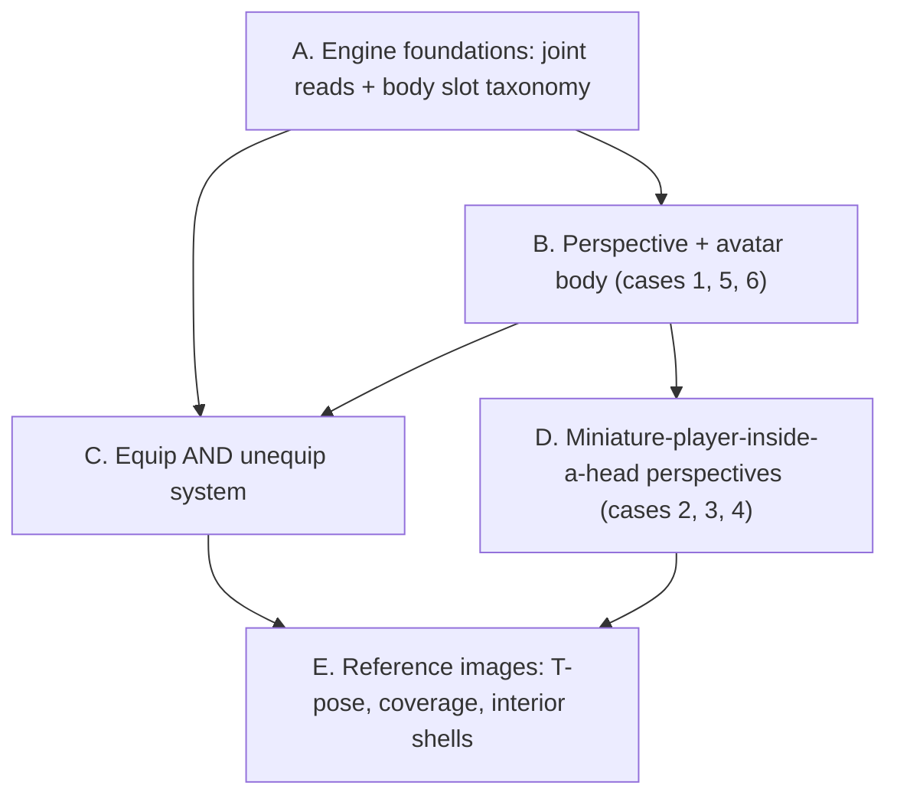

# Player perspective, avatar body, equip/unequip, and T-pose reference images

Five phases, executed strictly in order, each verified before the next starts. Later phases depend on earlier ones: the equip system needs the body-slot taxonomy and a real avatar to equip to, and the reference-image stage needs to know what kind of avatar the game asked for before it can write the right prompt.

## Why this is bigger than one mechanic

The Iron Man case in [Prebuilt Equip Mechanic Details.md](Helper_Folder/GLB_Edditing_Updates/NPC/Prebuilt%20Equip%20Mechanic%20Details.md) requires a gauntlet to sit from fingertips to elbow on the player's own arm. Today that is impossible, for three concrete reasons in the code:

- `IAttach::attach` in [engine/runtime/include/ptv/api/MechanicContext.h](engine/runtime/include/ptv/api/MechanicContext.h) resolves one anchor (socket, exact joint, or loose alias `hand_r`/`head`/`spine`) with a fixed local offset. There is no span, no fit, and no body-part vocabulary.
- `ISkeleton` exposes `joint_index`, `set_joint_rotation`, `play_clip` — but **no way to read a joint's world transform**, so a fingertip-to-elbow span cannot be measured.
- `Application::create_player_body()` creates `__player` as a **kinematic capsule with `CTag{"player"}`, no `CMesh`, no `CSkeleton`**. `create_hand_entities()` loads `hand_left.glb`/`hand_right.glb` (16 joints, `mixamorig:` prefix). There is no torso, no arms, and no elbow to equip anything to.

And the two review files remove two assumptions the previous plan had baked in: that a `hide_head` boolean is an acceptable model of VR perspective, and that equipping is a one-way operation.



---

# Phase A. Skeleton read API + canonical body-slot taxonomy

Extend `ISkeleton` in [engine/runtime/include/ptv/api/MechanicContext.h](engine/runtime/include/ptv/api/MechanicContext.h), implemented in the nested class in [engine/runtime/src/core/Application.cpp](engine/runtime/src/core/Application.cpp), which already owns the palette behind `ISockets::socket_world`:

```cpp
virtual Mat4 joint_world(std::uint32_t entity, int joint) const = 0;
virtual int  joint_parent(std::uint32_t entity, int joint) const = 0;
virtual int  joint_for_slot(std::uint32_t entity, const char* slot) const = 0;
virtual int  joint_subtree(std::uint32_t entity, int root,
                           int* out, int max_out) const = 0;
```

`joint_for_slot` is the single resolver the built-ins and generated code share, so slot names are never re-invented per game. `joint_subtree` exists because Phase B needs every joint under `head` (head, hair, jaw, eyes) in one call.

New `engine/runtime/include/ptv/api/BodySlots.h` + `engine/runtime/src/animation/BodySlots.cpp` holds one table mapping each canonical slot to ordered candidate joint names, matched case-insensitively with the `mixamorig:` prefix optional. Grounded on the Mixamo 65-bone standard (`Hips`, `Spine`, `Spine1`, `Spine2`, `Neck`, `Head`, `LeftShoulder`, `LeftArm`, `LeftForeArm`, `LeftHand`, `LeftHandIndex1..3`, `LeftUpLeg`, `LeftLeg`, `LeftFoot`, `LeftToeBase`) plus Tripo-spec and loose fallbacks, which matters now that the pipeline produces both Mixamo-spec and Tripo-spec rigs.

Slots: `head`, `face`, `eyes`, `nose`, `ears`, `neck`, `chest`, `spine`, `waist`, `back`, and sided `shoulder`, `upper_arm`, `elbow`, `forearm`, `wrist`, `hand`, `thumb|index|middle|ring|pinky` (+ `_tip`), `thigh`, `knee`, `shin`, `ankle`, `foot`, `toes` (`_l`/`_r`).

Reuse the table in [HandPoseMechanic.cpp](engine/runtime/src/mechanics/builtin/hand_pose/HandPoseMechanic.cpp), which hard-codes `kBonePrefix = "mixamorig:"`, so a Tripo-named avatar rig poses correctly too.

**Verify A:** new `smoke.cpp` cases for slot resolution across Mixamo and Tripo naming, `joint_subtree` returning the head chain on the hand fixture's rig, and `hand_pose` still passing its existing finger-curl case.

---

# Phase B. Perspective and avatar body — replacing `hide_head`

`hide_head` was wrong in two ways at once: it hid the head from *every* view (so a mirror would show a headless avatar), and it implied that `false` means "camera inside the skull", which conflates head *visibility* with camera *placement*. Those are independent, and [builtin.avatar_body.md](Helper_Folder/GLB_Edditing_Updates/NPC/Plan%20Redesign/builtin.avatar_body.md) requires six configurations, not two.

The boolean is deleted and replaced by three orthogonal concepts:

- **Where the camera sits** — at the avatar's eyes, or inside the head as a separate miniature player.
- **Whether the head renders in the player's own view** — independent of whether it renders in a mirror.
- **What the asset actually contains** — a full body with a head, or a neck-down suit.

## B1. Prompt-driven perspective in the schema

Add a `player_avatar` block plus `player_perspective` to [packages/schemas/ptv_schemas/build_spec.py](packages/schemas/ptv_schemas/build_spec.py), which is already where prompt interpretation lands (it holds `player_height_meters`, `locomotion`, `comfort`), and re-export `build_spec.schema.json`.

`PlayerPerspective`:
- `first_person_avatar` (default) — camera at the avatar's eyes. Cases 1, 5, 6.
- `inside_head_free_look` — miniature player inside their own avatar's head; physical head rotation looks around the skull and does NOT rotate the host; controllers drive the host. Case 2.
- `inside_head_npc_host` — miniature player inside an autonomous NPC's head; controllers drive the miniature player, not the NPC. Case 3.
- `inside_head_piloted` — miniature player inside their own larger avatar's head, but HMD rotation drives the host's head and the sticks drive the host's locomotion and turning. Case 4, the robot cockpit.

`PlayerAvatarSpec`:
- `coverage`: `full_body` (default) | `neck_down` | `hands_only`
- `head_visibility`: `hidden_in_self_view` (default) | `always_visible` | `toggleable`
- `leg_animation`: bool, default true
- `needs_mirror`: bool — set when the prompt asks for a mirror, customization, or reflection

**The default that answers the open question in the review file.** The user was unsure whether a neck-down prompt should generate a headless asset or a full character with the head hidden downstream. The answer this plan commits to: **always generate a full body with a head unless the prompt explicitly asks for a body-only avatar**, and treat head visibility as a runtime concern. Case 6 says the engine should "mostly all the time by default create the 3D Avatars with heads", and a head that exists can always be hidden, while a head that was never generated cannot be shown. `coverage: neck_down` is therefore reserved for prompts that explicitly say "feet to the neck", like the case 5 example.

Prompt inference rules go into `BUILD_SPEC_SYSTEM` in [prompts.py](apps/orchestrator/ptv_orchestrator/pipeline/prompts.py): a mirror, customization, or reflection request sets `needs_mirror` and `head_visibility: always_visible` (or `toggleable` when the prompt asks for a show/hide button, exactly the second Green Lantern example); "I don't want my avatar's legs to move" sets `leg_animation: false`; an explicit "inside the head" prompt selects the matching `inside_head_*` perspective.

## B2. Self-view head suppression, done per draw copy

The engine builds ONE `DrawItem` list per frame in `Renderer::build_items_from_world` and renders it to both eyes, with `push_joint_palette` accepting an arbitrary palette per item:

```46:64:engine/runtime/include/ptv/render/Renderer.h
    struct DrawItem {
        Mat4 model{1.0f};
        Vec4 color{0.8f, 0.8f, 0.82f, 1.0f};
        float material_id{0.0f};
        int mesh_slot{-1};
        int joint_base{-1};
        int joint_count{0};
    };
```

That makes the industry-standard approach a natural fit. VRM's `thirdPersonOnly` flag and VRChat's Head Chop both solve this by rendering the avatar differently per view rather than deleting the head globally — VRChat literally renders a mirror clone with the head at full scale alongside a local clone with head bones scaled down. Ready Player Me's Unity guidance is the same idea via per-camera layer culling.

So: add a `CSelfViewHide` component listing joint indices plus a scale factor. When the avatar is emitted for the **player's own view**, push a modified palette with those joints collapsed; the mirror pass in B3 pushes the **unmodified** palette. No layer system, no per-view masking machinery, no extra pass for the self view, and one extra palette copy per frame for one entity.

- The joint list comes from `joint_subtree(avatar, joint_for_slot(avatar, "head"))`, so hair and jaw go with the head instead of floating.
- `head_visibility: toggleable` is a runtime scale factor on the same component, which is how case 6's show/hide button works, and mirrors VRChat's global scale factor.
- Items **equipped to a head slot** (hat, helmet, mask) are suppressed in self view too, because VRM classifies them as view-blocking for the same reason. Phase C's equip service is what makes that list knowable.
- `coverage: neck_down` makes suppression a harmless no-op, so both asset shapes share one code path.

## B3. `builtin.mirror_surface` — a Quest-safe mirror

Cases 1 and 6 both hinge on seeing yourself, and equip Examples 1 and 16 need a full-body wardrobe mirror. The engine has no reflection support today: `Renderer` owns only swapchain framebuffers and a depth image, with no offscreen target.

**Decision: stencil-masked mirrored geometry, not render-to-texture.** On the tile-based GPU in a Quest, rendering into a texture forces a GMEM round-trip to system memory and back, and bandwidth is the bottleneck; drawing geometry twice directly into the output buffer is comparatively cheap. Meta's own mobile-VR guidance says the simplest mirror is a reflected copy of the geometry. Published Quest 3 measurements put a full-scene stereo mirror at roughly 2.5-3.5 ms of frame time, which is why the reflected set here is deliberately tiny.

New module `engine/runtime/src/mechanics/builtin/mirror_surface/`, bound to a mirror entity:

- Reflect a **restricted draw set** only: the player avatar, its equipped items, and entities tagged `mirror_visible`. Never the whole scene.
- Mirrored items are the same mesh and the same joint palette with `model` premultiplied by the plane-reflection matrix, so the reflection is animated and shows the head for free.
- Reflection flips triangle winding, so mirrored items need front-face culling instead of back-face. The renderer already builds a `VK_CULL_MODE_NONE` pipeline variant at [Renderer.cpp:821](engine/runtime/src/render/Renderer.cpp), so a cull-mode variant is precedented rather than novel.
- A stencil mask from the mirror quad keeps the reflection inside the mirror and out of the wall behind it.
- One active mirror at a time (nearest within `max_active_distance_m`), plus a draw-set cap, reported on the existing per-second `perf:` line so a mirror cannot silently eat the frame budget.
- Params: `plane_normal`, `size_m`, `max_active_distance_m`, `reflect_tags`.

## B4. `builtin.avatar_body` — rewritten

New module `engine/runtime/src/mechanics/builtin/avatar_body/`, `MechanicScope::Player`, `MechanicPhase::Simulate`, following the `BuiltinMechanicBase` + `configure(params)` pattern used by [ThrowMechanic.cpp](engine/runtime/src/mechanics/builtin/throw/ThrowMechanic.cpp).

- Root follows the `PlayerRig` (position + yaw, feet on floor), so the body travels with locomotion.
- Params mirror `PlayerAvatarSpec`: `coverage`, `head_visibility`, `leg_animation`, plus `eye_height_offset_m` for trimming where the camera sits relative to the rig's `head` joint. No `hide_head`.
- **Camera placement**: in `first_person_avatar` the camera stays at the XR rig's tracked head pose and the avatar's `head`/`neck` joints are driven to match, so the body agrees with where the player is actually looking. The camera is never parented inside the skull in this mode — that only happens in Phase D, and only when the prompt asks for it.
- **Arms**: two-bone analytic IK (law of cosines) per arm, `shoulder -> elbow -> wrist`, target = the controller grip pose from `InputSnapshot::HandState::hand_position/rotation`. Pole hint biased down-and-back, extension clamped near 170 degrees to avoid singularity flicker, and the wrist is **never** distance-clamped: at full reach the chain simply straightens. All three rules come from shipped VR avatar IK practice, and they are what keeps a forearm-mounted gauntlet visually attached. The solver lives in a pure-math header so it is unit-testable without the engine.
- **Legs**: `leg_animation` plays idle/walk/run from achieved rig speed, with clip playback scaled to distance covered. Extract the selection logic from [CharacterLocomotionMechanic.cpp](engine/runtime/src/mechanics/builtin/character_locomotion/CharacterLocomotionMechanic.cpp) into a shared `LocomotionClipSelector.h` so there is one implementation rather than two that drift. `leg_animation: false` is the "just slide" case.
- Fingers stay owned by `builtin.hand_pose` — no second writer.
- Auto-bind in `Application::ensure_player_locomotion_bindings()` when a `player_avatar`-tagged entity exists, exactly as `builtin.hand_pose` is bound today.

**Verify B:** `smoke.cpp` cases for the IK solver (reach, full extension, pole side, degenerate input), head-subtree suppression producing a collapsed palette while the unmodified palette is unchanged, mirror reflection matrix math, and the toggle changing only the self-view copy. Python tests for `PlayerAvatarSpec`/`PlayerPerspective` round-trip and for the BuildSpec prompt rules. Then `cmake --build`, `ctest`, and `pytest`.

---

# Phase C. Equip AND unequip

[builtin.equip.md](Helper_Folder/GLB_Edditing_Updates/NPC/Plan%20Redesign/builtin.equip.md) is explicit that the previous plan had a design hole, not a documentation gap: it had `equip_on` with no `unequip_on`, and a single `lock` parameter that conflated two different ideas. Its 18 examples also show that equip state has to be queryable and runtime-mutable, not just a tag.

## C1. The semantic split

`lock` is deleted and replaced by three independent flags:

- `passive_grab_protection` (default `true`) — brushing a hand past the gauntlet must not rip it off.
- `removable` (default `true`) — whether intentional removal is currently allowed. **Runtime-mutable**, because Examples 2, 4, 10 and 17 all change it mid-game (in flight, mid-experiment, outside the airlock, cursed until a quest completes) without destroying and recreating the item.
- `re_equippable` (default `true`) — whether this specific instance may be equipped again. **Runtime-mutable**, for the contaminated glove in Example 12 and the escape-room devices in Example 8.

## C2. `IEquip` — an engine-owned service, not just a mechanic

Examples 1, 3, 13, 15, 16 and 18 all drive equip from something other than a hand: a menu button, sitting in a seat, a pickup collision, a 30-second timer. Those cannot work if equip state lives in a tag and a `CAttachment`, so equip ships as a service on `MechanicContext` alongside `ISockets` and `ISkeleton`:

```cpp
class IEquip {
public:
    virtual bool equip(std::uint32_t item, std::uint32_t wearer,
                       const char* slot) = 0;
    virtual bool unequip(std::uint32_t item) = 0;
    virtual const char* slot_of(std::uint32_t item) const = 0;
    virtual std::uint32_t equipped_at(std::uint32_t wearer,
                                      const char* slot) const = 0;
    virtual int equipped_items(std::uint32_t wearer, std::uint32_t* out,
                              int max_out) const = 0;
    virtual bool slot_exists(std::uint32_t wearer, const char* slot) const = 0;
    virtual void set_removable(std::uint32_t item, bool removable) = 0;
    virtual void set_equippable(std::uint32_t item, bool equippable) = 0;
    virtual bool is_removable(std::uint32_t item) const = 0;
    virtual void set_offset(std::uint32_t item, const Vec3& position,
                            const Quat& rotation) = 0;
};
```

`set_offset` is what lets Example 15's night-vision goggles swing between raised and lowered without ever being unequipped, and it keeps generated code from writing `CTransform` on an attached item.

New components:

- `CEquipSlots` on a wearer: each slot is a name, an owner (a `BodySlots` anatomical slot on this entity, or a socket on another **equipped item**), a local offset, a snap radius, an `exclusive` flag, and a compatible-tag list.
- `CEquipped` on an item: wearer, slot, the three flags above, group id, and current offset.

Two consequences worth calling out. First, **custom named slots** come from scene params, because anatomy alone cannot express "sword sheath on the left hip", "hammer loop on the tool belt", or "back sling" (Examples 6, 11, 15). Second, **a slot can be owned by an equipped item**, which is how a breathing mask connects to a back-mounted oxygen tank and how goggles mount on a helmet (Examples 9, 15) — and because `CAttachment` already chains, the geometry follows for free.

The service works on any rigged entity, not just the player, so the goblin-with-a-rifle case in [docs/npc-and-ai.md](docs/npc-and-ai.md) becomes the same code path.

## C3. `builtin.equip` — parameters

New module `engine/runtime/src/mechanics/builtin/equip/`, registered with `PTV_REGISTER_MECHANIC("builtin.equip", ...)` plus a link anchor in [BuiltinMechanics.cpp](engine/runtime/src/mechanics/BuiltinMechanics.cpp). Empty params means "equippable anywhere on the body", per the freedom-first default in the original spec.

Placement:
- `slots`: allowed slot names, e.g. `["hand_l","hand_r"]` for gloves. Empty means any slot.
- `coverage_start` / `coverage_end`: slot names bounding a span, e.g. `index_tip_r` to `elbow_r` for the gauntlet.
- `fit_to_span` (default `true` when coverage is set): uniform scale so the object's long axis matches the measured span.
- `rest_slots`: extra contact points that refine orientation — how glasses sit on `nose` plus both `ears` while anchored at `face`.
- `rotation_offset_deg`, `position_offset_m`, `auto_side` (default `true`), `snap_radius_m`.

Triggers, deliberately independent so equip-only and unequip-only games are pure config:
- `equip_on`: `grab_release` (default) | `button` | `contact` | `api` | `scene_start` | `never`
- `unequip_on`: `grab_pull` (default) | `button` | `api` | `never`
- `unequip_requires_free_hand` (default `true`) and `unequip_with_other_hand_only` (default `true`) — the second is not a nicety: a glove equipped on `hand_r` cannot be grabbed by `hand_r`, and Example 12 makes that rule explicit for surgical gloves.

Occupancy:
- `exclusive` (default `true`): equipping into an occupied exclusive slot auto-unequips the incumbent rather than stacking two objects in one place.
- `on_replace`: `to_hand` (default) | `drop` | `despawn` | `inventory` — Examples 3, 14 and 16 each want a different disposition for the displaced item.
- `group`: outfit-set id, so one button equips or removes several coordinated pieces while leaving unrelated accessories alone (Example 16).
- `requires`: slots that must already be filled, which is what lets Examples 4, 9 and 10 gate an activity on the full safety set being worn.

The default gesture is grab-to-pull-off: reach to the equipped item with the other hand and squeeze grip, and it detaches directly into that hand. It is the natural inverse of `equip_on: grab_release`, spends no new button budget (grips are already grab/throw), reuses the proximity search in `find_grabbable`, and flows straight into `builtin.throw` because you end up holding the thing.

Attach math is unchanged from the previous plan: resolve the span-root joint (the parent-most of start/end via `joint_parent`), read both endpoints with `joint_world`, read the object's own axis from its derived `mount_base`/`mount_tip` sockets, then compute local offset, rotation and scale and call `ctx.attach->attach(...)`. Rigid single-parent attachment is deliberate — `tick_attachments` runs after the pose system, so the item swings with the animated arm for free.

Grab interoperability: `builtin.grab` skips items whose `passive_grab_protection` is set, except for a deliberate `grab_pull` on a `removable` item.

## C4. `builtin.ui_panel` — because four examples need a menu

Examples 1, 3, 15 and 16 all want a virtual panel that distinguishes a *selected* item from an *equipped* one and has Equip/Unequip buttons. Generated code currently has no way to build one: there is no UI system on `MechanicContext`, only debug draw and raycast.

The engine already proves the pattern, though. `Application.cpp` carries a working world-anchored locomotion menu — pages, per-hand `prev_trigger` edge detection, `confirm_cooldown_s`, and an anchor placed in front of the user at eye height following Meta's comfort guidance. That code is hard-coded in the application layer rather than reusable.

Generalize it into `builtin.ui_panel` plus a pointer: config-driven rows (label, optional thumbnail mesh, enabled/selected/marked state), a laser from a chosen hand, trigger to click, and a small event queue generated code polls. Paired with `IEquip`, a wardrobe menu, a loadout screen, or a dress-up panel becomes thin generated code over engine-owned truth instead of a from-scratch reimplementation. This pays off far beyond equip — inventories, settings, and dialogue choices all need it.

## C5. How the 18 examples map

Each example is config over C1-C4, not new engine code:
- Equip-only (7) is `unequip_on: never`; unequip-only (8) is `equip_on: never` plus `scene_start` pre-equipping and per-item `set_equippable(false)` after removal.
- State-gated removal (2, 4, 10, 17) is `set_removable` toggled by generated game logic.
- Replacement (3, 14, 16) is `exclusive` plus `on_replace`.
- Nested equipment (9, 15) is slots owned by equipped items.
- Non-hand triggers (13, 18) are `equip_on: api` / `unequip_on: button` driven by generated code and timers.
- Custom holsters and tool belts (6, 11) are scene-declared custom slots with `snap_radius_m`.

The plan explicitly does **not** claim every example is achievable with zero generated code. Per the review file, the goal is a solid base that a code-edit or a generated mechanic can build on, and `builtin+config_code_edit` remains available by adding equip to `_MODULE_FOR_ID` in [builtin_source.py](apps/orchestrator/ptv_orchestrator/pipeline/builtin_source.py).

**Verify C:** `smoke.cpp` cases for equip/unequip round trip, other-hand-only enforcement, `passive_grab_protection` versus a deliberate pull, `set_removable(false)` refusing removal then allowing it after re-enabling, exclusive-slot replacement with each `on_replace` disposition, a nested slot on an equipped item, and group equip/unequip. Python tests for equip params reaching `scene.json`. Then `cmake --build`, `ctest`, `pytest`.

---

# Phase D. Miniature player inside a head (cases 2, 3, 4)

**Decision: one world, nested geometry, scaled player — no portals and no render-to-texture.** The interior of the head is a real mesh attached to the host's `head` joint, and the eye openings are literal apertures in it. Looking through them shows the actual outside world with correct parallax for zero extra rendering cost, which is the only version of this that survives the Quest frame budget for the same GMEM reason that ruled out an RTT mirror in B3. The player is genuinely shrunk, which is also what the review file describes ("a tiny person trapped inside", seeing desks pass by).

## D1. Player reference frame and player scale

`PlayerRig` is world-space today:

```179:186:engine/runtime/include/ptv/core/Application.h
    struct PlayerRig {
        float pos_x{0.0f};
        float pos_y{0.0f};
        float pos_z{0.0f};
```

Add an optional parent (entity + anchor joint) and a scale, compose them in `rig_mat`, and expose `set_reference_frame(entity, anchor)`, `clear_reference_frame()` and `set_player_scale(float)` on `ILocomotion`. Near-plane and head/hand offsets scale with the player so a few-centimetre-tall player still renders correctly.

This is deliberately generic rather than head-specific: a rig parented to a moving anchor is also how vehicles, elevators, boats and moving platforms work, all of which "any type of VR game" will need. Case 3's requirement that the NPC carries the whole interior while the player's local position inside it stays put is exactly this feature.

## D2. `builtin.head_interior`

Bound to the host entity (the player's own avatar or an NPC), it attaches the interior shell to the host's `head` joint, sets the player's reference frame to that joint, and applies `interior_scale`. Two routing params cover the three cases:

- `head_tracking`: `decoupled` (cases 2 and 3 — physical head rotation looks around the skull and never rotates the host) or `drives_host_head` (case 4 — HMD rotation drives the host's neck/head joints).
- `control_routing`: `host_locomotion` (case 2 — sticks move and turn the host), `self_locomotion` (case 3 — sticks move the miniature player inside the head while the NPC lives its own life), or `host_piloted` (case 4 — sticks drive the host's locomotion and snap/smooth turning).

Case 3 needs nothing extra from the AI system: the host stays a normal NPC with `builtin.character_locomotion` and its own behaviours. Case 4's host head rotation writes through `ISkeleton::set_joint_rotation`, so it composes with the animation system instead of fighting it.

The miniature player can have its own body by binding a second, scaled `builtin.avatar_body` — the review file asks for the tiny player to have their own hands and possibly a small body, and Phase B already provides that.

## D3. The interior shell asset

A new `character_role: head_interior` asset: Gemini generates a hollow head or skull interior with a brain and two eye apertures (natural pose, not T-pose — it is scenery, not a character), Tripo makes the mesh, it stays unrigged, and it attaches to the host's `head` joint. For case 4 the same slot holds a mechanical cockpit interior instead. `SCENE_SPEC_SYSTEM` places it and binds `builtin.head_interior` on the host.

**Verify D:** `smoke.cpp` cases for reference-frame composition (host moves, player local position preserved), player scale affecting head/hand offsets, and each `control_routing` mode routing stick input to the right entity. Python tests for perspective inference and interior-asset emission.

---

# Phase E. Reference images: T-pose, coverage, and interior shells

`stage_reference_images` currently composes only `reference.prompt` + `style_notes` and never looks at `category`, `rigged`, or `npc_plan.json`:

```114:118:apps/orchestrator/ptv_orchestrator/pipeline/stage_reference_images.py
def _compose_prompt(item) -> str:
    base = item.reference.prompt.strip()
    if item.style_notes:
        return f"{base}\nStyle: {item.style_notes.strip()}"
    return base
```

## E1. A deterministic pose and coverage decision

Add to `ReferenceImageRequest`:
- `pose`: `natural` (default) | `t_pose` | `neutral_quadruped`
- `coverage`: `full_body` (default) | `neck_down`

The manifest agent proposes both; a deterministic reconciliation pass then decides, which is what makes this reliable rather than prompt-dependent. `npc_plan` is stage 3 and `reference_images` is stage 6 in [orchestrator.py](apps/orchestrator/ptv_orchestrator/pipeline/orchestrator.py), so the NPC decision is already on disk when images are generated.

Rules, in order:
- `character_role == player_avatar` -> character pose, and `coverage` copied from `PlayerAvatarSpec.coverage` decided in B1. This is the case `npc_plan` deliberately ignores, since it plans non-player characters only.
- asset appears in `npc_plan.npcs` -> character pose, **including** `movement_style: slide_no_animation`. The stated goal is reusing the GLB in other 3D software, which wants T-pose regardless of whether this game animates it.
- `character_role == head_interior` -> `natural`; it is an environment shell.
- everything else, including a `category: character` duck used as a grabbable prop -> `natural`. This is the prop-duck versus NPC-duck distinction in [NPC-Avatar Edits.md](Helper_Folder/GLB_Edditing_Updates/NPC/NPC-Avatar%20Edits.md).

Character pose resolves to `t_pose` for anything humanoid or bipedal (the cartoon duck with wings-as-arms included, as in the run already done), and `neutral_quadruped` for genuine four-legged, serpentine or aquatic creatures, where a T-pose is meaningless and a legs-separated neutral stance is the correct analogue. The manifest agent supplies the shape hint; `t_pose` is the default when it is silent.

Also add `AssetItem.character_role: none | npc | player_avatar | head_interior` and re-export `asset_manifest.schema.json`. [stage_scene_compile.py](apps/orchestrator/ptv_orchestrator/pipeline/stage_scene_compile.py) currently infers the player avatar from `style_notes` substrings in `_character_role()`; that becomes the fallback for old artifacts only.

## E2. Prompt composition

`_compose_prompt` gains a deterministic pose clause and a matching negative fold-in. Keep the wording close to what actually worked in the duck and Red Lantern run recorded in `3D object Test/_work/generate_assets.py`: arms straight out to the sides, legs straight and slightly apart, facing camera, orthographic front view, isolated on a neutral background, with `sitting, A-pose, crossed arms, action pose, side view` in the avoid list. Negatives are folded into the text by `_compose_gemini_prompt`, since Gemini image models have no `negative_prompt` field.

`coverage: neck_down` adds its own clause — outfit or suit from the feet up to the neck, clean flat neck opening, no head, no face, no neck stump detail — and pushes `head, face, helmet` into the avoid list. This is the case 5 requirement, and it is the only path that produces a headless asset; every other avatar keeps its head and hides it at runtime per B1.

Also update the reference-image rules in `ASSET_MANIFEST_SYSTEM` ([prompts.py](apps/orchestrator/ptv_orchestrator/pipeline/prompts.py) lines 115-131) so base prompts are written pose-aware and coverage-aware from the start, and the deterministic clause reinforces rather than contradicts them.

**Verify E:** new tests for `_compose_prompt` (the stage has zero coverage today): NPC gets the T-pose clause, prop duck does not, player avatar does, `neck_down` gets the coverage clause and the head negatives, quadruped gets the quadruped clause, interior shell stays natural, and negatives are appended once. A `_compose_gemini_prompt` test in [test_providers.py](packages/provider-clients/tests/test_providers.py), which has none. Full `pytest` and `ctest`. Then a live check: regenerate the duck as an NPC and as a prop from the same base description, confirm only the NPC comes back T-posed, and rig-check both.

---

# Cross-cutting pipeline, catalog and docs work

Done incrementally at the end of each phase, not saved up:

- **Catalog and planner.** Add `builtin.avatar_body`, `builtin.mirror_surface`, `builtin.equip`, `builtin.ui_panel` and `builtin.head_interior` to `_BUILTINS` in [engine_catalog.py](apps/orchestrator/ptv_orchestrator/engine_catalog.py) with full param docs; sync the stale `BUILTIN_MECHANIC_IDS` in [mechanic_plan.py](packages/schemas/ptv_schemas/mechanic_plan.py) (also missing `builtin.character_locomotion` today); add each to `_MODULE_FOR_ID` in [builtin_source.py](apps/orchestrator/ptv_orchestrator/pipeline/builtin_source.py).
- **Mount sockets.** Extend `ptv_glb_sockets` (already principal-axis PCA plus mass asymmetry) to derive `mount_base`/`mount_tip` in unit space so the span fit survives the LOD chain. Teach `ASSET_MANIFEST_SYSTEM` to add those `socket_hints` for wearables, and fail loudly at scene compile when an equip binding sets `coverage_*` but the asset has no mount sockets, reusing the `SocketContractError` pattern in `_check_required_sockets`.
- **Prompts.** `MECHANIC_PLAN_SYSTEM` gains equip guidance (glove = `slots`; gauntlet = `coverage_start`/`coverage_end`; equip-only and unequip-only games are `equip_on`/`unequip_on`, still `builtin+config`, not `generate`) and perspective guidance. `SCENE_SPEC_SYSTEM` wires equip onto wearables, `avatar_body` onto the `player_avatar` entity, `mirror_surface` onto mirrors, and `head_interior` onto the host.
- **Docs.** [docs/input-and-bindings.md](docs/input-and-bindings.md) gains equip/unequip (including the default gesture), avatar body, and ui_panel sections in the existing per-mechanic format. New `docs/player-avatar-and-perspective.md` covers the six cases, the self-view/mirror split, and the mirror budget. [docs/npc-and-ai.md](docs/npc-and-ai.md) reconciles its "Equipping: two shapes" section with `IEquip`. [docs/codegen-agents.md](docs/codegen-agents.md) loses its "Equip on body slots | Stub" row. [docs/rendering.md](docs/rendering.md) documents the mirror and self-view suppression cost. [docs/prompt-schema.md](docs/prompt-schema.md) gets the new schema fields and a corrected builtin id list.

---

## Constraints honored throughout

- No new top-level dependencies: IK, span fit, reflection matrices and slot resolution are plain `glm` plus std, so the Quest APK path is unaffected.
- Everything new is hand-authored engine code under `engine/runtime/src/mechanics/builtin/`, `engine/runtime/src/animation/`, and a contained set of renderer additions (one palette variant, one cull-mode variant, one stencil mask). Nothing lands in `engine/generated/`.
- No built-in is modified in place beyond the `LocomotionClipSelector` extraction, the `hand_pose` slot-table reuse, and the grab protection check.
- Quest budget is explicit rather than assumed: one extra skinned rig for the avatar, two analytic IK solves, one extra palette copy for self-view suppression, and one avatar-only mirror pass capped to a single active mirror and measured on the existing `perf:` telemetry line.
- No hard-coded perspective assumption anywhere: head existence, head visibility, camera placement, head tracking coupling, and control routing are five independent decisions driven by the prompt, which is the core requirement of [builtin.avatar_body.md](Helper_Folder/GLB_Edditing_Updates/NPC/Plan%20Redesign/builtin.avatar_body.md).
