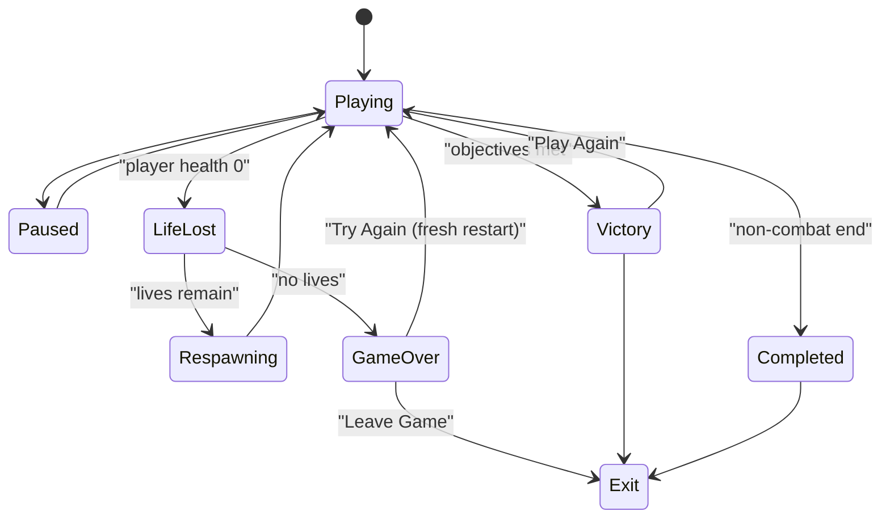

# Grounding, facing and complete game flow for every game

Builds on the finished NPC plan (`npc_spawn_and_behaviour_fix_a2a930ff`). It keeps that plan's constraints: `quest_runtime_verify` is Quest-only and report-only, games with no NPCs get base checks only, stationary NPCs get no-drift checks, and a run with no headset is skipped, not failed. The issues are handled in order. Issues 1 and 2 share one new contract.

## Root causes (measured, not guessed)

- **Floating:**
  - Tripo GLBs have the origin at the feet (bind y from 0 to h). Uthana GLBs are centred at the hips (y from -h/2 to +h/2).
  - [stage_scene_compile.py](apps/orchestrator/ptv_orchestrator/pipeline/stage_scene_compile.py) `_mesh_render_fields` emits `foot_offset_m` only when `bind_sole_y < 0`, so Tripo models never get one.
  - `CharacterLocomotionMechanic::foot_offset()` then falls back to `0.5 * height`, and so does `encounters.place_persistent_npcs`. Tripo NPCs float by half their height.
  - [GltfSkinnedLoad.cpp](engine/runtime/src/render/GltfSkinnedLoad.cpp) scales by the longest extent. The T-posed bruiser's arm span (2.44 m) wins over its height, so it renders 1.56 m tall instead of 1.9 m.
  - The telemetry value `feet_gap` uses the same fallback, so it cannot see any of this.
- **Facing:**
  - `turn_toward` uses `atan2(f.x, -f.z)`, a mirrored formula. The correct one is `atan2(-f.x, -f.z)`. The same bug was fixed once before in `Application.cpp` `yaw_for_facing`.
  - Uthana models face +Z and Tripo goblins face +X. Only `AvatarBody` measures model forward (its `facing_`); NPCs have no correction at all.
  - The smoke test only checks travel along -Z, so the error never showed up in tests.
- **Nothing at 0 health:**
  - The generated `survival_run_flow` paused the director, which is why the goblins stopped attacking.
  - The results panel's restart path (`submit_result_action`) was the dead contract flagged during codegen.
  - `UiRow` labels are never drawn, because the engine has no text rendering.
  - There is no engine API to revive the player, restart a scene fresh, or quit the app.

## Phase 1: model frame and grounding (Issue 1)

1. **Measure a model frame in `asset_contract`.** This reuses an existing deterministic stage; no new paid calls.
   - Add a measurement module, `pipeline/model_frame.py`, reusing the joint and GLB readers in [rig_edit.py](apps/orchestrator/ptv_orchestrator/pipeline/uthana/rig_edit.py).
   - For each skinned character, record the following in `asset_contract.json`, all in bind pose and unit space:
     - `sole_y`: the lowest foot or toe joint, cross-checked against the skin's minimum y.
     - `height`: the head top minus the sole.
     - `forward`: cross(up, shoulder line), confirmed by the toes-ahead-of-ankles direction.
     - `t_posed`.
   - Unrigged characters use `AssetItem.forward_hint`, or the provider default with a loud warning.
   - The stage fails loudly if a rigged character has no measurable feet.
2. **Scene contract.**
   - `scene_compile` always emits `foot_offset_m`, `model_yaw_offset_rad` and `scale_basis` (`height` for characters, `longest_axis` for props) from the frame, never from the sign of `bind_sole_y`.
   - `unit_scale` and sockets use the same basis.
   - A skinned character with no frame fails the stage.
   - Update the pydantic models, JSON schemas, and the [SceneLoader](engine/runtime/src/scene/) consumer together.
3. **Runtime.**
   - `GltfSkinnedLoad` applies one pivot, `T(sole) * R(yaw_offset) * S(height basis)`, so every character's feet sit at its declared foot offset and its face points down -Z, whatever the source.
   - Remove the `0.5 * height` fallback from `CharacterLocomotionMechanic.cpp` and `encounters.py`. When `scene.json` lacks a value, the runtime measures the sole from the loaded bind vertices and logs the gap.
   - `AvatarBody` reads the same frame and keeps its shoulder measurement only as a cross-check.
4. **NPC motor modes** in `CharacterLocomotionMechanic`. Keeps jumping, falling, flying and hovering working.
   - `grounded`: the current step-up cap of 0.35 m, plus a slope limit from the floor normal. Instead of teleporting down, the NPC falls with gravity when the floor drops away by more than the step-down distance, then lands. A new one-shot `CLocomotionIntent.jump_velocity` plays the `jump` clip when the model has one.
   - `flying`: no ground snap. The NPC moves in 3D, or holds `hover_height_m` above the floor.
   - The motor mode comes from `MovementStyle` (`flying` maps to the flying motor). Add an optional `hover_height_m` to the NpcPlan for prompts that ask for hovering. `scene_compile` passes both through as params.
5. **Visual and physics truth.**
   - Telemetry `feet_gap` becomes the animated lowest foot joint's world y minus the floor hit, not a derived offset.
   - The capsule stays centred on the entity origin, sized from `height`.
   - Verify check: grounded NPCs within 5 cm. Flying and hovering NPCs are checked against their hover height instead.

## Phase 2: facing (Issue 2)

1. **One public yaw helper.** Add `ptv::yaw_from_forward()` / `forward_from_yaw()` in `ptv/api` math and replace every `atan2` yaw in `CharacterLocomotionMechanic`, `Application.cpp`, the encounter director, `AvatarBody` and `NpcMeleeChase`. This fixes the mirrored `turn_toward`, and one definition cannot drift again.
2. **Facing coordination** in character_locomotion.
   - Turns are rate-limited.
   - When the yaw error is over about 60 degrees, travel speed scales down so the NPC turns in place instead of walking sideways.
   - `face_travel` / `face_target` stay as they are, so strafing and backing away still work.
   - `builtin.npc.melee_chase` sets `face_target` to its target during approach and attack, so attacks always face the victim.
   - Add an optional clamped head look-at (`look_target`, plus or minus 60 degrees of yaw on the head joint through `ISkeleton`) for NPC-specific facing.
3. **Tests and checks.**
   - Smoke tests travel along +X, -X, +Z, -Z and diagonals, using synthetic +X-facing and +Z-facing models.
   - Telemetry adds `facing_err_deg`, the angle between the body's forward and the travel direction or face target.
   - Verify check: the median error while chasing stays under 20 degrees.

## Phase 3: engine-owned game flow (Issue 3)

1. **The `GameDesign` schema** (`packages/schemas/ptv_schemas/game_design.py` plus JSON).
   - Every decision carries `source: explicit|inferred`, plus a `prompt_quote` when explicit.
   - Sections:
     - `player_vitality`: whether there is health, the maximum, and damage sources.
     - `lives`: a count or infinite.
     - `on_life_lost`: respawn point (spawn, checkpoint or last safe), delay, whether health is restored, whether the loadout is kept, invulnerability seconds, and the enemy policy (none, clear nearby, reset wave, or reset all).
     - `objectives`: kinds `survive_time`, `defeat_count`, `clear_waves`, `reach_location`, `collect`, `interact`, `custom`.
     - `victory` and `failure` conditions.
     - `end_screens`: buttons drawn from `try_again | play_again | continue | leave_game`.
     - `pause_menu`.
     - `reset_policy`: what a restart resets.
     - `hud`: which of health, lives, timer, score and objective are shown.
   - A book reader is valid with no vitality and no failure, ending in `Completed`, or `free_exploration` with only Leave Game.
2. **New `game_design` stage**, placed after `npc_plan` and before `mechanic_plan`.
   - It runs on the Agents SDK with `gpt-5.6-sol` at reasoning `high` and no tools, like `npc_plan`.
   - Inputs:
     - The original prompt, the source of explicit rules and the text every `prompt_quote` must match.
     - BuildSpec: `game_type`, `target_device`, `player_experience`, mechanics, `hud_summary`, `scenes`, `acceptance_tests`.
     - NpcPlan: hostility toward the player, damage, encounters.
     - AssetManifest, so `collect` and `interact` objectives name real items.
   - It has a deterministic validate-and-repair loop:
     - Every explicit quote must appear in the prompt, and explicit decisions win.
     - Enemies that can hurt the player require vitality, unless the prompt says the player is invulnerable.
     - Respawn requires at least one life.
     - Every terminal state must have an exit.
     - `survive_time` needs a duration.
     - `defeat_count` and `clear_waves` must reference real NpcPlan encounters.
     - `reach_location` adds a required `objective_marker` that the world builder must declare.
   - Its output feeds `mechanic_plan`, `scene_spec`, `world_generation` and codegen.
   - Add it to `ProjectState`, the orchestrator order, `stages.ts` (both device step lists) and the docs.
3. **New engine services** in [MechanicContext.h](engine/runtime/include/ptv/api/MechanicContext.h).
   - `ICombat::revive(entity, health)`.
   - `ISceneTransition::restart_current(fresh)`, which reloads at a frame boundary, skips the persistence overlay and resets encounters.
   - `IApp::request_exit()`. It calls `xrRequestExitSession`, then on `STOPPING` calls `xrEndSession` and ends the loop. On Android it also calls `ANativeActivity_finish` before `android_main` returns, per the Khronos spec and hello_xr issue 329. On desktop it closes the window.
   - `IGameFlow` (`ctx.game`): `state()`, `gameplay_active()`, `report_progress(objective, value)`, `complete(objective)`, `fail(reason)`, `time_remaining()`, `lives()`.
4. **`builtin.game_flow` (C++).**
   - It is data-driven from the GameDesign params and runs the state machine above.
   - Player death is detected through `ctx.combat`. Kills are counted from the damage feed. Waves come from `ctx.encounters`, and arrival from objective markers.
   - Respawn uses comfort fades, `teleport_to`, `revive` and invulnerability, keeping or restoring the loadout through `IEquip`.
   - On end screens it pauses encounters, disables locomotion and makes the player invulnerable.
   - Generated weapons and HUDs gate on `ctx.game->gameplay_active()`.
   - `builtin.game_hud` shows only what the design enables.
5. **In-world text.**
   - Add `stb` to [engine/vcpkg.json](engine/vcpkg.json). Both builds already use vcpkg.
   - Bundle one OFL font under `engine/runtime/assets/fonts/` and package it in the Quest APK.
   - Bake an SDF atlas at startup and add a world-space text pipeline to the Vulkan renderer.
   - `CUiPanel` titles and `UiRow` labels get drawn at last, and an `IText` service covers HUD numerals.
   - Panels keep the existing comfort anchoring and the laser-pointer clicks from `builtin.ui_panel`.
6. **Planning reconcile and codegen.**
   - The mechanic plan maps run flow, lives, respawn, results screens and health HUD items to `builtin.game_flow` / `builtin.game_hud`, using the same pattern as the NPC reconcile.
   - Only game-specific objectives stay `generate`, and they report through `ctx.game`.
   - Update the build_spec, mechanic, scene and codegen prompts in [prompts.py](apps/orchestrator/ptv_orchestrator/pipeline/prompts.py) and the codegen API docs.
   - A lint rule in `codegen_contracts.py` rejects private lives, respawn or restart logic, and bumps `API_CONTRACT_VERSION`.
7. **Flow validation.**
   - **Static, in `scene_compile`:** every state is reachable, every button maps to a real action, the panels exist, and objective markers exist in the world.
   - **On the headset, in `quest_runtime_verify`, still report-only:** a second launch runs with `debug.ptv.verify_flow` set.
     - The player is unprotected, flow timers run under a time scale, and the engine clicks end-screen buttons automatically.
     - New `flow:` telemetry lines are recorded.
   - The checks come from the GameDesign:
     - Health reaching 0 costs a life.
     - Respawn restores health, position and loadout.
     - Game Over follows the last life.
     - Try Again resets lives, timer, wave and NPC count.
     - Victory fires when the objective is met.
     - Play Again resets the game.
     - Leave Game ends the process cleanly, and the app relaunches afterwards.
   - A game with no death gets a "no death state reachable" check instead.

## Phase 4: rebuild and verify

- Resume humans-vs-aliens from `game_design`. Assets are not rebuilt, so there is no Tripo or Uthana spend; `asset_contract` re-runs deterministically.
- Run every verify check on the connected headset and fix failures until they pass, then hand off for a play test.
- Expected Goblin Shooter design:
  - 3 lives.
  - Respawn at spawn with the blaster.
  - A 3-minute survival win.
  - Game Over and You Win screens with Try Again, Play Again and Leave Game.
- Update the docs (`npc-and-ai.md`, `runtime-subsystems.md`, `quest-build.md`, `codegen-agents.md`, the overview and architecture docs, plus a new `game-flow.md`), along with [AGENTS.md](AGENTS.md) and `.cursor/rules/30-generated-code.mdc`.