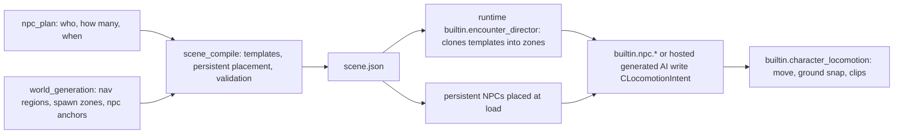

# Fix NPC spawning and behaviour across the VR engine

## What the investigation found

These were verified against both projects, the packaged APK, the engine source, and Jolt's documentation.

**Ruled out (the data is correct):**
- All 21 NPC GLBs are packaged inside the APK.
- Every NPC mechanic is compiled into `libptv_quest.so`.
- `scene.json` has the ally next to the player, three hidden enemy templates, and the encounter director.
- The player spawn, the ally, and all 4 enemy spawn zones lie inside the world's declared walkable areas.
- So the "NPCs placed outside the world" idea is not the cause.

**Root causes (all in shared engine code, so every project is affected):**

1. **NPCs shoot into the sky on their first frame.**
   - `builtin.character_locomotion` keeps each NPC on the floor by casting a ray downward from the top of the NPC's own collision capsule.
   - [`PhysicsWorld::raycast`](engine/runtime/src/physics/PhysicsWorld.cpp) calls Jolt's `CastRay` with no filter.
   - Jolt treats solid shapes as solid: a ray starting inside or on a shape hits it immediately, at distance 0.
   - So the ray hits the NPC's own capsule, and the NPC is lifted by its own height every frame (about 120 m/s at 72 fps).
   - Evidence: the goblin project's ally used the correct built-in follow and locomotion, and it still disappeared.
   - The smoke tests never caught this because they use fake physics whose raycast always reports the floor.

2. **Generated NPC AI never runs.**
   - `MechanicHost::attach_one` in [`MechanicRegistry.cpp`](engine/runtime/src/mechanics/MechanicRegistry.cpp) only calls `make_mechanic`; nothing ever calls `make_behaviour`.
   - The codegen prompt ([`prompts.py`](apps/orchestrator/ptv_orchestrator/pipeline/prompts.py) around line 1369) tells every AI task to use `IBehaviour` and `PTV_REGISTER_BEHAVIOUR`.
   - Result: those behaviours are dropped at load and those NPCs have no AI.
   - Affected here: `friendly_ally_follow` and `stalker_alien_behavior`. Affected in the goblin project: all 4 of its AI tasks.

3. **Two "player" entities.**
   - The engine creates `__player`, which moves with the headset.
   - The scene also has a static `player_rig` entity at (0, 1.7, 1.2), about 27 m from the real spawn, tagged `player` and `player_rig` and carrying its own health and faction.
   - The generated follow and stalker code look up `player_rig`, so they would head for the world origin instead of the real player.

4. **Hidden templates run their mechanics.**
   - Templates are already excluded from physics, but `attach_bindings` still ticks their bound mechanics.
   - So invisible copies at y = -50 run `melee_chase` underneath the player.

**Related gaps:**
- **Perception and navigation probes have the same self-hit problem.** Perception line-of-sight starts its ray 0.15 m out, still inside the NPC's own capsule (radius about 0.29 m), and counts that self-hit as a clear view. So walls are never tested.
- **Alien hits never reach the game.**
  - `player_health_and_damage` waits for hits in a private `MeleeHitInbox` that nothing writes to.
  - The built-in enemies damage the player through `ctx.combat`, which has no way for other code to observe damage events.
  - So the HUD's health never drops and the run never ends.
- **The planner over-generates.** It made a code edit of `builtin.npc.follow` just to set `catch_up=false`, which is already a parameter.
- **Nothing validates that a binding is actually instantiated.** Nothing checks that every scene binding resolves to something the engine hosts. There is also no runtime check on the device.

## Architecture decision: who places and spawns NPCs

World generation should not spawn NPCs, but it is the only stage that knows the level's layout. So responsibilities split like this:

- **World generation** declares space only: walkable areas, enemy spawn zones, and new optional NPC anchor points (for example "guard post" or "shop counter").
- **The NPC plan** decides who exists, how many, and when.
- **The scene compiler** builds the population and validates it against the world.
- **The runtime encounter director** does the spawning during play.

## Phase 0: Record a baseline on the headset

- Run the currently installed `com.prompttovr.p20261023_205949_humans_vs_aliens_survival` and capture `adb logcat -s ptv`. Use `prox_close` so it runs while nobody is wearing the headset.
- Expected confirmations:
  - "No mechanic registered for id: generated.friendly_ally_follow" for the dropped AI.
  - "encounter: wave 1/4 started" for the director.
- Keep the log for a before/after comparison.

## Phase 1: Engine runtime fixes

**Physics queries ignore the caller's own body.**
- Add an ignore-entity raycast to `PhysicsWorld`, using Jolt's `IgnoreSingleBodyFilter` plus an optional "static only" layer filter.
- Expose it as a new virtual on `IPhysicsAccess` with a default implementation.
- Use it in:
  - `CharacterLocomotionMechanic::snap_to_ground`: ignore self and other character capsules, and cap the step-up per frame as a safety guard.
  - `PerceptionService::unobstructed`.
  - `NavigationService::project_to_ground` and `line_of_sight`.

**Templates are inert.**
- `MechanicHost::attach_bindings` skips entities tagged `template`.
- Clones still attach their own mechanics through `attach_entity_runtime`.

**Generated AI is hosted.**
- Extend [`IBehaviour.h`](engine/runtime/include/ptv/api/IBehaviour.h) with context-taking `on_attach` and `on_tick` forms, which receive `MechanicContext` and `InputSnapshot`. Their defaults forward to the current forms, the same way `IMechanic` already handles old and new signatures.
- Add a behaviour adapter in `MechanicHost`: if `make_mechanic` finds nothing, try `make_behaviour` and wrap the result.
- Log a per-scene summary of any bindings that still don't resolve. `IDialogueHook` gets a warning only, since there is no dialogue system yet.

**One player entity.**
- `Application::create_player_body` adopts the scene's `player_rig` entity, keeping its id, tags, health, faction, and bindings.
- The engine then drives that entity's transform every frame, as it does `__player` today.
- If the scene has no `player_rig`, the engine falls back to `__player`.

**Damage events.**
- Add a damage feed to `ICombat`: a sequence number and recent events per entity (amount, attacker, source position, time).
- Default implementations keep existing test fakes compiling.

**NPC telemetry.**
- At load, log one manifest line per NPC: skeleton loaded, animation intents resolved to real clips, mechanics resolved.
- During play, log one status line per second per NPC (position, speed, current clip, intent, alive), capped in count.

**Verification mode.**
- Turned on by the system property `debug.ptv.verify` on Android, or an environment variable on desktop.
- Moves the player along a scripted loop and keeps them alive, while still recording damage events.

**Real-physics smoke tests** in [`smoke.cpp`](engine/runtime/tests/smoke.cpp):
- NPC stays on the floor for 300 frames.
- Templates do not tick.
- The behaviour adapter ticks generated AI.
- `player_rig` is adopted as the player.
- Damage events are recorded.

## Phase 2: Pipeline and validation

**Codegen contract** (`prompts.py`, `codegen_agent.py`):
- AI tasks use the context-taking `IBehaviour` form.
- The player is found through `ctx.hands->player_entity()`, never by looking up `player_rig` by name.
- Movement uses `ctx.nav`, `ctx.perception`, and `ctx.combat`.
- Health and HUD code reads the `ctx.combat` damage feed instead of private inboxes.

**Deterministic code lint** (new `codegen_contracts.py`, called alongside [`bounds.py`](apps/orchestrator/ptv_orchestrator/pipeline/bounds.py)):
- Reject AI that only implements the old context-free form.
- Flag `find("player_rig")` used for targeting.
- Detect "dead contracts": a public submit or inbox API that no other task and no built-in ever calls.
- Problems go back into the existing repair loop.

**Regenerate stale code.**
- [`codegen_board.py`](apps/orchestrator/ptv_orchestrator/pipeline/codegen_board.py) gets an API-version invalidation that scans the generated source for markers, modelled on the existing socket fingerprint.
- Only tasks written against the old contract are regenerated.

**Prefer built-ins for NPC behaviour** (`reconcile_npc_mechanics` in [`npc_population.py`](apps/orchestrator/ptv_orchestrator/pipeline/npc_population.py)):
- Define which behaviours each built-in covers:
  - `follow_leader` maps to `builtin.npc.follow`.
  - `chase`, `melee_attack`, and `react_to_damage` map to `builtin.npc.melee_chase`.
- A code-edited or generated AI item for an NPC whose behaviours are fully covered becomes plain `builtin+config`. Its config carries over; unknown keys are dropped with a note.
- Only uncovered behaviours (for example `reposition`, `ranged_attack`, `flee`, `patrol`, flying) justify generated code.
- Run this reconcile both after the mechanic-plan agent and at the start of code generation, so existing plans get upgraded too.

**Scene compile** ([`stage_scene_compile.py`](apps/orchestrator/ptv_orchestrator/pipeline/stage_scene_compile.py), [`encounters.py`](apps/orchestrator/ptv_orchestrator/pipeline/encounters.py)):
- **Binding resolution check:** every binding id must be either a built-in or a `PTV_REGISTER_*` found in this project's generated sources. Any unresolved id fails the stage.
- **Generated AI that won't be hosted:** the NPC falls back to the built-in behaviour, with a warning.
- **Required NPC with no scene entity:** build one from the asset manifest if its GLB exists; otherwise fail loudly with the full list.
- **Persistent NPC placement, after the world is merged:** the NPC must be:
  - inside a walkable area;
  - not overlapping static geometry;
  - at floor height plus its foot offset;
  - visible from the spawn, for companions;
  - placed at a world anchor when the world declared one.

**World anchors:**
- Add an optional `npc_anchor` declaration to [`IWorldBuilder.h`](engine/runtime/include/ptv/api/IWorldBuilder.h). It is a no-op by default, like `npc_spawn_zone`.
- The `ptv_worldgen` host emits it into `npc_anchors`.
- Validated in `stage_world_generation` (must be inside a walkable area).
- The architect's brief asks for anchors when the NPC plan has persistent NPCs that aren't companions.

**Quest build:**
- Assert that every GLB an NPC references (main mesh and LODs) is packaged in the APK, before running Gradle.

## Phase 3: On-device verification stage

New `quest_runtime_verify` stage after `quest_build`, implemented in `stage_quest_verify.py`. It is also available on demand through a route in [`routes.py`](apps/orchestrator/ptv_orchestrator/api/routes.py).

**Quest 3 projects only. Never part of PC VR.**
- The stage is added only to `_QUEST_TAIL` in [`orchestrator.py`](apps/orchestrator/ptv_orchestrator/pipeline/orchestrator.py), between `quest_build` and `engine_promotion`. `_PCVR_TAIL` and `_SHARED_STAGES` are not changed.
- That tail is picked by `_stages_for(target_device)`, from `ProjectState.target_device`: the Quest 3 / PC VR choice made in the New Project UI. A PC VR project never reaches this stage.
- The on-demand verify route checks `target_device` the same way the existing `/launch` route does, and returns HTTP 400 for a `pcvr` project.
- As a safety net, the stage itself skips with a message if it ever runs on a project whose `target_device` is not `quest`.
- The engine fixes in Phases 1 and 2 are shared and also improve PC VR builds. Only this on-headset check is Quest-specific.

**Report only.** The stage diagnoses and reports. It never repairs anything or reruns earlier stages. Fixing what it finds is a separate, manual step, like Phase 4.

**No headset connected: skip, never fail.**
- Before doing anything, the stage checks `adb devices`. It skips when:
  - adb is not installed or can't be found;
  - no device is listed;
  - the device shows `unauthorized` or `offline`;
  - more than one device is listed and `Settings` doesn't name which one to use.
- A skip:
  - is recorded as a successful stage with a "skipped" event and a clear reason, for example "no Quest headset connected; runtime verification skipped";
  - writes `runtime_verification.json` with `status: "skipped"` and that reason;
  - lets the pipeline continue to `engine_promotion`.
- You can run the check later, once the headset is plugged in, through the on-demand verify route.
- A headset that disconnects partway through is also treated as a skip, not a failure, and the reason says so.

**Steps** (only when a headset is available):
1. `prox_close` (keeps the session running unworn).
2. `setprop debug.ptv.verify 1`, `install -r`, `logcat -c`, `am start -S`.
3. Capture the log for the start delay plus about 40 s. In a game with no NPCs and no encounters, about 20 s is enough.
4. Force-stop the app, then `automation_disable` to restore the proximity sensor. This also runs if an earlier step failed.

**What it checks.** Every check comes from what this game's `npc_plan.json` and `scene.json` ask for. A check only runs when the game calls for it, so the stage always knows what it is looking for:

- **Every Quest game, with or without NPCs (base checks):**
  - the app launches and stays running;
  - the scene loads;
  - there is no crash or native fault;
  - every scene binding resolves to a hosted mechanic;
  - no GLB fails to load.
- **Persistent NPCs** (`persistent_count > 0`): each one is present with its skeleton and clips loaded, stands within 0.3 m of the floor, and stays inside the walkable area.
- **Stationary NPCs** (`movement_style: stationary`, as the prompt asked, such as a turret, shopkeeper or guard):
  - **Checked:** each one is present and visible; it is on the floor at its compiled position (scene compile places it at floor plus foot offset, since no locomotion snaps it); its horizontal position drifts less than 0.25 m over the whole capture; it plays `idle` if it has that clip.
  - **If it has combat behaviours** (for example `ranged_attack` or `melee_attack`): it may turn to face the player and must play its attack and land damage events, but it must still not move from its spot.
  - **Not applied:** the follow or chase movement checks. A stationary NPC that walks fails the check, because the prompt asked for it to stay put.
- **Moving NPCs with `follow_leader`:** the follower stays within its trailing band (plus some slack) while the scripted player moves, and switches between walk and idle appropriately.
- **Moving NPCs with `slide_no_animation`:** they move as their behaviours require, with no clip checks.
- **Games with an `encounters` plan:** waves start, and enough enemies spawn within the start delay plus 15 s, including stationary ones spawned by waves.
- **Enemies hostile to the player, with `chase` or `melee_attack`:** they close the distance to the player, play run and attack clips, and land damage events on the player.

**Games with no NPCs.**
- An empty `npc_plan.npcs` is a valid, complete answer in the schema, so the stage never fails just because a game has no NPCs.
- Only the base checks run.
- `runtime_verification.json` marks the NPC section "not applicable: this game has no NPCs".
- The stage passes as long as the game launches and runs cleanly.

**Output:** writes `runtime_verification.json` and a log.
- Overall `status` is `passed`, `failed` or `skipped`.
- Each check lists its name, pass, fail or not applicable, and the evidence (log lines and measured values).
- A failed check fails the stage, with an exact list of what didn't pass. Nothing is repaired automatically.

Schema changes:
- `ProjectStage.quest_runtime_verify`.
- A `RuntimeVerification` model in `packages/schemas`, with its exported JSON schema.

## Phase 4: Rebuild and verify humans-vs-aliens-survival only

- Resume from `code_generation` with no re-planning.
  - The reconcile turns the ally into `builtin.npc.follow` and deletes the generated follow files.
  - The board regenerates only `stalker_alien_behavior`, `player_health_and_damage`, and any dependents whose definitions changed.
- Then run `scene_compile`, `quest_build`, and `quest_runtime_verify`.
- Investigate and fix whatever fails, repeating until verification passes.
- Then hand it to you for a real play test: the ally follows you; aliens spawn, chase you, and attack; and the HUD and defeat flow react.

## Phase 5: Docs and rules

Update these in the same change:
- [`docs/npc-and-ai.md`](docs/npc-and-ai.md)
- [`docs/runtime-subsystems.md`](docs/runtime-subsystems.md)
- [`docs/world-generation.md`](docs/world-generation.md) (the placement decision and anchors)
- [`docs/navigation.md`](docs/navigation.md)
- [`docs/quest-build.md`](docs/quest-build.md) (the verify stage)
- [`docs/codegen-agents.md`](docs/codegen-agents.md)
- [`docs/troubleshooting.md`](docs/troubleshooting.md)
- `AGENTS.md` (the new stage, the context-taking `IBehaviour`, the single player entity)
- [`.cursor/rules/30-generated-code.mdc`](.cursor/rules/30-generated-code.mdc) (`IBehaviour` is now hosted and receives `MechanicContext`)
