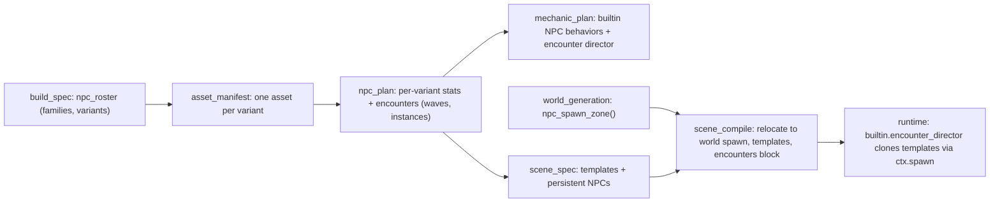

# NPC spawning, variety and behavior

## Why nothing appeared in the goblin APK (verified in the project files)

1. **The goblins could never spawn.**
   - `generated.goblin_wave_flow` builds its pool from scene entities tagged `goblin` AND `pooled` ([goblin_wave_flow_pool.cpp](engine/generated/mechanics/20261019-202355-fun-goblin-shooter-game/goblin_wave_flow_pool.cpp) `discover_scene`).
   - The scene has exactly one goblin, tagged `template` and not `pooled`, so `pool_count_ == 0` and `spawn_one` always returns false.
   - The LLM-written spawner and the LLM-composed scene disagreed, and nothing in the engine reconciles the two. The engine's own `ctx.spawn->instance` was never used.
2. **The whole gameplay layer was stranded about 30 m from the player.**
   - The SceneSpec authored the layout around a spawn at the origin; world generation moved the spawn to (2.2, 0, -30).
   - `scene_compile` copies the world spawn ([stage_scene_compile.py](apps/orchestrator/ptv_orchestrator/pipeline/stage_scene_compile.py) around line 1422) but never moves the gameplay layer with it.
   - Distances from the real spawn: the ally 27.8 m, the blaster 30.7 m, the mission panel 31.5 m.
3. **Tripo clips were mis-mapped.**
   - `_pair_intents_to_clips` ([stage_asset_animation.py](apps/orchestrator/ptv_orchestrator/pipeline/stage_asset_animation.py) line 408) assumes clips come back in request order, but the GLB lists them alphabetically.
   - The goblin got `run -> "fall"`, `attack -> "hurt"`, `die -> "slash"`, `hurt -> "run"`.
4. **Clones were incomplete.**
   - `Application::clone_entity` copies the mesh, physics, bindings, tags and skeleton, but not `CHealth` or `CFaction`, so a spawned enemy can't be damaged and isn't hostile.
   - It also doesn't clone attached gear: the goblin's club template is never cloned onto the instance.
5. **No variety was planned.** The BuildSpec has only prose (`npc_summary`) for NPCs, so "goblin enemy NPCs" became one asset.

## Target architecture: who owns what

- **Unique assets** are decided ONCE, in the BuildSpec (`npc_roster`), because assets are created from it.
- **Instances, waves and stats** live in the NPC plan (`npc_plan.json`).
- **Placement:** the scene compiler places persistent NPCs and emits one hidden template per spawned type.
- **Spawning:** at runtime, the engine's new `builtin.encounter_director` does all of it; generated code never spawns NPCs again.
- **Behavior:** new data-driven built-ins handle the common cases (follow, chase-and-melee). Generated C++ only adds what is unique to a game.

## Part 1: root-cause fixes (engine-wide)

1. **Tripo clip pairing by name** ([stage_asset_animation.py](apps/orchestrator/ptv_orchestrator/pipeline/stage_asset_animation.py)).
   - Match each preset (`preset:biped:slash`) to the clip whose normalized name equals its tail (`slash`). This also tolerates `Armature|preset_slash`-style names. Fall back to order only for clips no name accounts for.
   - In the reuse path, re-derive `animations` from the GLB's clip names, so re-running `asset_animation` repairs existing projects with zero Tripo calls.
   - Add a test using this project's exact clip list.
2. **Gameplay layer follows the world spawn** (`scene_compile`).
   - When the world's spawn differs from the SceneSpec spawn, rigidly transform every gameplay entity by the yaw and translation between the two spawns.
   - Excluded: templates, the `player_avatar` entity (`builtin.avatar_body` places it), the `player_rig` and attached children.
   - Then nudge any entity whose footprint lands inside a world static collider to the nearest free point on a declared nav region (ring search, deterministic), and log each move.
3. **Complete clones** ([Application.cpp](engine/runtime/src/core/Application.cpp) `clone_entity`).
   - Copy `CHealth` (reset to max), `CFaction`, `CEquipSlots`, `CMovable` and `CInteractive` state.
   - Clone attached children: template entities whose `CAttachment.parent` is the source get cloned and re-attached to the new instance.
   - `despawn` and death cleanup remove those children too.
4. **Persistent NPCs never get lost.** The follow built-in (Part 3) catches up when more than `catchup_distance_m` away or unreachable for 3 s: it re-places the NPC on the nav floor behind the player, out of view.

## Part 2: deciding NPC variety and counts from the prompt

1. **BuildSpec `npc_roster`** (new schema in [build_spec.py](packages/schemas/ptv_schemas/build_spec.py)).
   - Each `NpcFamily` has: `family_id`, `role`, `count_reading` (`singular` / `explicit_number` / `plural_unspecified` / `single_type_requested`), `explicit_count`, and `variants[]`.
   - Each `NpcVariant` has: `asset_id`, `name`, `physique` (standard / tall_lean / big_bulky / small_fast / elite / custom), `visual_notes`, and stat multipliers (speed, damage, health, scale).
   - Build-spec prompt rules:
     - a singular character gets 1 variant;
     - an explicit "one type" gets 1 variant reused for every instance;
     - an unspecified plural gets **exactly 3** distinct variants that fit the fiction (standard, tall/lean/fast, big/bulky/strong by default);
     - an explicit number of types gets that number.
   - Every variant must have an `AssetEntry`.
   - A deterministic validator in `stage_build_spec` rejects a plan that breaks these rules or leaves a variant without an asset, and retries the agent with the reason.
2. **Asset manifest:** one `character` item per variant, with variant-specific style notes and size. The validator checks coverage, and `npc_summary` stays as prose.
3. **NpcPlan additions** ([npc_plan.py](packages/schemas/ptv_schemas/npc_plan.py)), backwards compatible:
   - `NpcSpec.family`, `NpcSpec.variant`, and `NpcSpec.persistent_count` (placed at load, for example 1 ally).
   - `NpcPlan.encounters`: `mode` (`waves` / `continuous` / `fixed`), a `start` trigger (`on_load`, `delay_s`, `player_grabs_tag`, `signal`), `max_concurrent`, `inter_wave_delay_s`, `spawn_interval_s`, and `waves[]` of `{groups: [{asset_id, count}], clear_to_advance}`.
   - Prompt guidance: derive per-variant stats from the physique multipliers. Give waves a logical progression, for example early waves standard-only, then mixed, then tall-only, then a big-bulky finale. That shape is an example in the prompt, never hard-coded.
   - Validators: waves reference only planned enemy variants, a singular ally has `persistent_count` 1 and no waves, and the total concurrent animated agents fit `max_animated_agents`.

## Part 3: runtime systems (C++, data-driven, any NPC type)

1. `**builtin.encounter_director**`, a new mechanic plus a new `IEncounters` service in [MechanicContext.h](engine/runtime/include/ptv/api/MechanicContext.h).
   - It reads the scene's `encounters` block and clones templates with `ctx.spawn->instance`.
   - It respects `max_concurrent`, the animated-agent budget minus persistent NPCs, the spawn interval and the start trigger.
   - It places spawns in declared zones that are at least `min_player_distance_m` away and preferably out of the player's line of sight, projected to the ground.
   - It counts defeats through combat deaths and advances waves.
   - The service is read and control only: `phase()`, `wave_index()`, `wave_count()`, `alive()`, `remaining()`, `defeated()`, `start()`, `pause()`, `reset()`, plus event sequence numbers for wave_started, wave_cleared and victory. Generated HUD and mission code reads it.
2. `**builtin.npc.follow**` (follow_leader).
   - The leader is the player or a tag. It keeps a trailing-distance band, routes with `ctx.nav->next_waypoint`, and walks or runs by gap.
   - It catches up when lost, can be soft-collision and invulnerable, and never fights.
3. `**builtin.npc.melee_chase**` (chase + melee_attack + react_to_damage).
   - It targets the nearest hostile or a `target_tag` through `ctx.perception`, chases via nav, and keeps separation between siblings.
   - In range, it does a telegraphed attack (configurable windup, active window, cooldown and damage) with `play_clip("attack")` and its fallback.
   - It does a hurt flinch and stagger on damage; death is left to the engine.
   - All numbers come from params, so every variant gets its own stats.
4. `**WorldContext::npc_spawn_zone(NpcSpawnZoneDesc{id, position, radius, tags})**` in [IWorldBuilder.h](engine/runtime/include/ptv/api/IWorldBuilder.h), serialized by WorldGen into `npc_spawn_zones` and read by `SceneLoader`.
   - The world-builder prompt requires zones whenever the NPC plan has encounters.
   - When none are declared, `scene_compile` derives zones from nav regions 12 m or more from the spawn.
5. **Catalog entries** for the three built-ins in [engine_catalog.py](apps/orchestrator/ptv_orchestrator/engine_catalog.py), with full param docs.
6. **Smoke tests:** a director with fake spawn and combat (waves, cap, trigger, defeat counting); clone completeness with an attached child; follow catch-up; the melee attack cycle.

## Part 4: pipeline wiring so every future game uses it

- `**mechanic_plan`:**
  - A deterministic reconcile adds `builtin.encounter_director` when `npc_plan.encounters` exists, and maps the follow_leader and chase+melee behaviors to the built-ins (`builtin+config` with per-variant params).
  - Prompt: generate code only for behaviors the built-ins can't express; never plan a wave spawner or pool.
- `**scene_spec`:** the prompt says to author ONE hidden template per spawned variant (tag `template`, parked off-map, with health, faction and per-variant bindings) and place persistent NPCs near the spawn.
- `**scene_compile`:**
  - creates any missing templates from the NPC plan;
  - compiles `encounters` and `npc_spawn_zones` into `scene.json`;
  - binds the director on a `game_director` entity;
  - fills per-variant params from the NPC plan;
  - strips stale `pooled` assumptions.
- **CODE_TASK prompt:** document `ctx.encounters`. Never spawn or pool NPCs, never reimplement follow or chase-melee when a built-in is bound, and read the director for wave HUDs.
- **Docs:** [docs/npc-and-ai.md](docs/npc-and-ai.md) (ownership table, encounters, variants), the world-builder doc, and [AGENTS.md](AGENTS.md).

## Part 5: rebuilding the goblin game

Recommended: a **full rerun from `build_spec`**, which you anticipated. The asset set changes (three goblin variants), so the manifest, NPC plan, mechanic plan, SceneSpec, models, rigs, animations, world (it must declare spawn zones) and code (the old generated wave flow and AI must be replaced by the built-ins) all have to be redone.

**After implementing, I will:**

1. Let you know that you will need to fully rerun the pipeline and leave that for you to do.

- Existing working systems: avatar body, locomotion, sprint, weapons, and the Uthana and Tripo pipelines apart from the clip-pairing fix.
- Old generated mechanics remain valid. Games that still bind them keep working; only new plans prefer the built-ins.