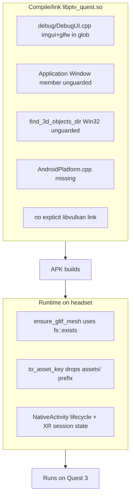

# Fix all remaining Quest 3 APK blockers

Scope: get `20260727-130000-iron-man-training-arcade` (generated mechanics + generated world + 13 Tripo GLBs) to build a `libptv_quest.so`, package an APK, install, and run on the Quest 3. All fixes are in the engine/template so every future Quest project benefits. The Gradle-wrapper blocker is already fixed.

NOTE on quality vs blockers: the renderer's lack of GLB textures/skinning is a POLISH item (separate Quest 3 Starter Room plan, Phase 2), NOT a blocker. With the fixes below, GLBs render with their baked vertex/base colors, which is enough to test on-device.

## Blocker map



## A. NDK compile/link fixes

- Exclude the desktop debug UI from the Android glob. In [engine/android/app/src/main/cpp/CMakeLists.txt](engine/android/app/src/main/cpp/CMakeLists.txt) the glob (lines 74-76) only excludes `/src/platform/desktop/`; add an exclude for `/src/debug/` so [engine/runtime/src/debug/DebugUI.cpp](engine/runtime/src/debug/DebugUI.cpp) (includes `<imgui.h>`, `<imgui_impl_glfw.h>`) is not compiled on Android.
- Guard the GLFW `Window` member so the excluded `Window::~Window()` is not odr-used at link. In [engine/runtime/include/ptv/core/Application.h](engine/runtime/include/ptv/core/Application.h) wrap `#include "ptv/platform/Window.h"` (line 13) and `std::unique_ptr<Window> window_;` (line 138) in `#if !defined(__ANDROID__)`; guard the remaining `window_` usages in [engine/runtime/src/core/Application.cpp](engine/runtime/src/core/Application.cpp) (e.g. `window_.reset()` around line 1741). Most GLFW/DebugUI paths are already guarded.
- Guard the Win32-only path lookup. In [engine/runtime/src/core/Application.cpp](engine/runtime/src/core/Application.cpp) `find_3d_objects_dir()` (lines 194-210) uses `GetModuleFileNameW`/`MAX_PATH`/`DWORD` with no guard; make the Android build return `{}` (procedural locomotion-menu icons already fall back, lines 1624-1628).
- Add the missing platform glue implementation. [engine/runtime/src/platform/android/AndroidPlatform.h](engine/runtime/src/platform/android/AndroidPlatform.h) declares `set_android_app()` / `current_android_app()` but no `.cpp` defines them (referenced by `AndroidMain.cpp`, `Application.cpp`, `XrSession.cpp`). Add `engine/runtime/src/platform/android/AndroidPlatform.cpp` with a static `android_app*` store (picked up automatically by the `src/platform/android` glob).
- Link Vulkan explicitly. In [engine/android/app/src/main/cpp/CMakeLists.txt](engine/android/app/src/main/cpp/CMakeLists.txt) add `find_library(VULKAN_LIB vulkan)` and link `${VULKAN_LIB}` (volk dlopens at runtime, but the NDK `libvulkan.so` should be linked). Also switch `Jolt` to `Jolt::Jolt` for consistency (both are valid).
- Fix the no-op whole-archive so self-registering generated mechanics are never stripped. Lines 126-129 emit empty `-Wl,--whole-archive`/`-Wl,--no-whole-archive`. Compile `PTV_GENERATED_SOURCES` into a `STATIC` lib (e.g. `ptv_generated`) and link it wrapped in the whole-archive flags (parity with the desktop `/WHOLEARCHIVE` in [samples/starter-room/CMakeLists.txt](samples/starter-room/CMakeLists.txt)).

## B. Runtime GLB asset-loading fixes (the game's props/hands/targets)

The compiled scene stores `mesh.glb_path` like `projects/<id>/assets/<asset>/<uuid>_pbr.glb`; `stage_quest_build` packages GLBs into the APK at `assets/<asset>/<uuid>_pbr.glb`. Two bugs make all 13 GLBs invisible:

- Filesystem gate. In [engine/runtime/src/render/Renderer.cpp](engine/runtime/src/render/Renderer.cpp) `ensure_gltf_mesh()` (lines 1089-1096) rejects paths with `std::filesystem::exists()`, which is always false inside an APK. Replace with `asset_source().exists(resolved_path)` (the `IAssetSource` interface already has `exists()`, and `AndroidAssetSource` implements it via `AAssetManager`).
- Asset-key mapping. In [engine/runtime/src/platform/android/AndroidAssetSource.cpp](engine/runtime/src/platform/android/AndroidAssetSource.cpp) `to_asset_key()` (lines 11-25) strips everything up to the LAST `assets/`, turning `projects/<id>/assets/<asset>/<uuid>.glb` into `<asset>/<uuid>.glb` (missing the `assets/` dir that exists in the APK). Change it to strip a leading `projects/<id>/` prefix instead, yielding `assets/<asset>/<uuid>.glb`, which matches the packaged layout. Verify `scene.json` -> `scene.json` and `shaders/x.spv` -> `shaders/x.spv` still map correctly (they have no `projects/` prefix). This keeps `stage_quest_build._package_assets()` unchanged.
- No change needed to `resolve_project_mesh_paths()` (it is a filesystem no-op on Android; the raw `projects/<id>/...` path now maps correctly via `to_asset_key`).

## C. NativeActivity lifecycle + XR bring-up (highest on-device risk)

- In [engine/runtime/src/platform/android/AndroidMain.cpp](engine/runtime/src/platform/android/AndroidMain.cpp) `handle_app_cmd` (lines 31-39) only handles `APP_CMD_DESTROY`. Handle `APP_CMD_INIT_WINDOW`, `APP_CMD_TERM_WINDOW`, `APP_CMD_GAINED_FOCUS`, `APP_CMD_LOST_FOCUS`, and resume/pause, and expose focus/running state to the loop.
- In [engine/runtime/src/core/Application.cpp](engine/runtime/src/core/Application.cpp) `run()` creates OpenXR + Vulkan immediately (init at lines ~1498-1525) before the Android event pump. Confirm the OpenXR session state machine (`xrPollEvent` -> `SESSION_STATE_READY` -> `xrBeginSession`, and `STOPPING`/`IDLE` handling) drives frame submission, and gate the render loop on session-running/focus so the headset is not blank. This is the documented "native XR bring-up" area and may need a few on-device iterations.

## D. Build configuration / prerequisites

- Pin the NDK. In [engine/android/app/build.gradle](engine/android/app/build.gradle) add `ndkVersion "30.0.15729638"` (the installed NDK at `ANDROID_NDK_HOME`) for deterministic externalNativeBuild.
- Ensure `glslc` is available during `quest_build` (on PATH or via `VULKAN_SDK`) so [apps/orchestrator/ptv_orchestrator/pipeline/stage_quest_build.py](apps/orchestrator/ptv_orchestrator/pipeline/stage_quest_build.py) `_compile_shaders()` packages `.spv` (already present for this project).
- Expect first-build FetchContent iteration for arm64-android (Jolt/spdlog most likely to need a version pin) per [engine/android/README.md](engine/android/README.md).

## E. Rebuild, install, validate on Quest 3

Re-run just the Quest build stage for the project (all upstream artifacts already exist), then install/launch:

```
# 1. Build the APK (from the orchestrator UI/pipeline re-run quest_build), or manually:
cd projects/20260727-130000-iron-man-training-arcade/builds/quest
./gradlew.bat assembleDebug --console=plain --stacktrace

# 2. Verify device, install, launch
adb devices
adb install -r "app/build/outputs/apk/debug/app-debug.apk"
adb shell am start -n com.prompttovr.p20260727_130000_iron_man_training_arcade/android.app.NativeActivity
adb logcat -s ptv:V *:F   # watch native logs
```

Expected APK: `projects/20260727-130000-iron-man-training-arcade/builds/quest/app/build/outputs/apk/debug/app-debug.apk`.

Validate on-device: app boots into VR, controllers tracked, teleport + smooth locomotion + snap turn, grab/throw, and the 13 GLB props/targets/gauntlet render (with baked colors). Iterate on section C if the headset is blank or input is missing.

## Troubleshooting checklist
- Build fails at NDK config: NDK version mismatch (pin `ndkVersion`), `ANDROID_HOME`/`ANDROID_NDK_HOME` unset, or FetchContent Jolt/spdlog compile error (pin versions).
- Link errors: undefined `set_android_app`/`current_android_app` (AndroidPlatform.cpp missing), undefined GLFW/imgui/`Window::~Window` (guards/glob excludes), or missing Vulkan symbols (add libvulkan link).
- Boots but blank headset: XR session never reaches READY / loop not gated on focus (section C); shaders missing (`glslc`/`.spv` not packaged).
- Props invisible: GLB path mapping (section B) - confirm `to_asset_key` yields `assets/...` and `ensure_gltf_mesh` uses the asset source.
- Mechanics not firing: whole-archive not applied to generated static lib (section A).
- Install/launch: `adb devices` shows `unauthorized` (accept headset prompt) / Developer Mode off; `INSTALL_FAILED` -> uninstall old package first.