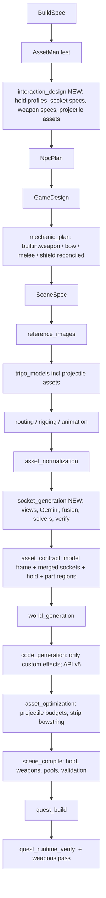
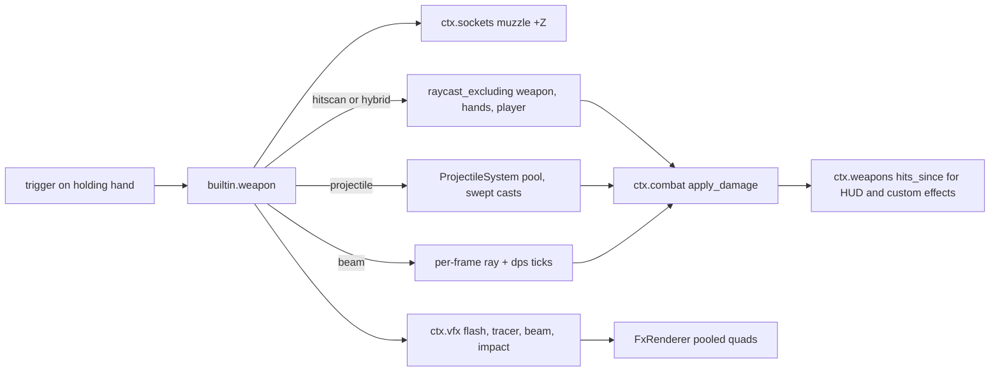

# Context-aware sockets, then shooting, for any weapon on Quest 3

## 0. What the research found

These findings drive every design decision below.

### Sockets today

The `asset_contract` stage runs `ptv_glb_sockets` ([engine/tools/glb_sockets.cpp](engine/tools/glb_sockets.cpp)), which does PCA plus a mass-asymmetry test. It can only produce `muzzle` and `grip`.

Measured on real project assets (`asset_contract.json`):

- **`survival_pistol` (humans-vs-aliens):** `grip` is the centroid of the rear half of all vertices. It sits about 5 cm above the handle, inside the frame, not where a palm goes. `grip` and `muzzle` also share one rotation, the barrel frame.
- **`range_rifle`:** `grip` lands in the stock or receiver region, not on the pistol grip. A support-hand socket cannot be expressed at all.
- **Non-weapons:** `bullseye_target`, `weapon_rack`, `target_carriage` and `hip_holster` all received made-up `muzzle` and `grip` sockets from the implicit fallback for props.
- **Geometry ceiling:** geometry alone cannot tell a sword's hilt from its blade on a near-symmetric mesh, the front of a shield from the back, or where straps are, and Tripo may not model straps at all.

### Grab today

`builtin.grab` with [GripHold.h](engine/runtime/src/mechanics/builtin/grab/GripHold.h) aims the barrel along the controller's aim ray and puts the wrong `grip` point at the grip pose. A second hand steals the object; there is no two-handed hold. `bind_sockets_to_joints` in [Application.cpp](engine/runtime/src/core/Application.cpp) is defined but never called.

### Shooting today

There is no engine fire system; `builtin.recoil` only kicks the transform. Every game generates its own `shooting_hub` and weapon profile.

- **Humans-vs-aliens:** `pistol_fire_simulation.cpp` calls `ctx.physics->raycast(origin, ...)` from the muzzle socket. The ray is not set to exclude anything, and the muzzle sits on or inside the pistol's own collider, so the first hit is almost certainly the pistol itself and the shot returns before reaching an alien. It also damages a private `EnemyHealthState` instead of `ctx.combat`. That explains "can't kill the aliens".
- **Goblin shooter:** this was never a real projectile. It is an instant raycast, a one-frame debug-draw line, and an impact mesh spawned through `ctx.spawn`.

### Renderer and physics today

- **Renderer:** lit GLBs, unlit debug cubes (material 3), and SDF text. There are no particles, beams, billboards, decals or instancing.
- **Physics:** `raycast` and `raycast_excluding` only. There is no shape cast and no CCD.

### Providers today

- **Gemini:** the current docs list `gemini-3.8-flash` (stable) on the Interactions API (`client.interactions.create`). Detection returns `box_2d` as [ymin, xmin, ymax, xmax] normalized to 0-1000. Segmentation returns a polygon `mask` as [x, y] in 0-1000, and the docs recommend `thinking_level: "minimal"` for it. The venv has `google-genai` 2.18.1, which has `client.interactions`.
- **numpy:** not installed.
- **OpenXR grip pose:** +X is the palm normal (into the palm for the right hand, away from it for the left). -Z runs through the finger tube from little finger to thumb. +Y follows from the right-hand rule. For either hand holding the same handle, +X points to the object's right, so one socket works for both hands.

## 1. Decision on the three socket options

**Option 1 (keep and expand the geometry approach): rejected.** It is measurably wrong on the pistol and the rifle, and it cannot express straps, support grips or blade edges.

**Option 2 (much better geometry only): rejected as the primary method.** Geometry is excellent at measuring but cannot reliably tell what a part is (strap versus rim, hilt versus blade, front versus back). It is kept as the precision layer and as a labelled low-confidence fallback.

**Option 3 (AI vision plus Python geometry): chosen, with four upgrades over the version in Sockets.md.**

1. **Exact mapping instead of raycasting.** The offline renderer writes a triangle-ID buffer and a depth buffer for every view, so every mask pixel and every keypoint maps to an exact triangle and surface point. Interior points such as the palm centre inside a handle use the entry and exit midpoint along the pixel ray.
2. **Multi-view voting.** A triangle belongs to a part only if the masks agree across views it is visible in. Keypoints are triangulated across views with outlier rejection, so one bad Gemini answer cannot move a socket.
3. **Deterministic per-kind solvers.** Gemini says what and where; Python computes exact frames (handle axis, palm centre, bore centre and diameter, strap line, blade segment).
4. **Render-and-verify loop.** A proxy hand, a muzzle arrow and strap markers are drawn onto the mesh and Gemini is asked whether the result is correct. If not, the stage retries once with the critique, then falls back loudly.

Alternatives considered and rejected:

- **3D part-segmentation research models (SAMPart3D, PartField):** heavy CUDA stacks and no semantic labels.
- **Tripo mesh segmentation:** splits the mesh but gives no semantics.
- **OpenAI vision:** no mask or point output contract. It stays only as a possible verifier.

## 2. Pipeline after this update

Projectile assets are decided in `interaction_design`. It runs right after `asset_manifest` and appends to the manifest before any image or Tripo money is spent, which satisfies "decide at or before asset_manifest". Reference images and Tripo already skip assets that are on disk, so resuming an old project only pays for the new projectile assets.

---

# PHASE S: SOCKETS (built and verified first)

## S1. New `interaction_design` stage (context: how each item is used)

New schema [packages/schemas/ptv_schemas/interaction_design.py](packages/schemas/ptv_schemas/interaction_design.py), plus `json/interaction_design.schema.json` and an export entry.

- **`InteractionDesign`** contains `items: list[ItemInteraction]`, `projectiles: list[ProjectileSpec]` and `notes`. Every decision carries provenance, reusing the GameDesign `explicit` / `inferred` pattern: an explicit decision quotes the prompt verbatim and the quote is checked; an inferred one carries a rationale and optional research sources.
- **`ItemInteraction`** has:
  - `asset_id`
  - `usage`: `held_weapon | held_tool | held_shield | thrown | worn | ammo | projectile | static_prop | not_interactive`
  - `wielders` (player, npc ids)
  - `hold: HoldProfile`
  - `sockets: list[SocketSpec]`
  - `weapon: WeaponSpec | None`
  - `melee: MeleeSpec | None`
  - `shield: ShieldSpec | None`
  - `bow: BowSpec | None`
  - `real_world_reference` (for example "Glock 17") and `real_world_dimensions_m` (for scale correction)
- **`HoldProfile`** has:
  - `kind`: `one_hand | two_hand_line | two_hand_wrap | forearm_strap | none`
  - `aim_aligned: bool` (true for guns, launchers and wands; false for swords, tools and shields)
  - `two_hand: none | optional | required`
  - `primary_socket`, `support_socket`, `forearm_socket`
  - `finger_pose`: `wrap | trigger | strap | pinch | open_support`
- **`SocketSpec`** has `name`, `kind`, `part_description` (the words Gemini segments with, for example "the pistol's handle below the slide, where the palm wraps") and `required`. Kinds:
  - Hands: `hand_grip`, `support_grip`, `support_wrap`, `hand_strap`, `forearm_strap`
  - Ranged: `muzzle`, `projectile_nose`, `projectile_tail`, `arrow_nock`, `arrow_rest`, `string_rest`, `limb_tip_top`, `limb_tip_bottom`, `magwell`
  - Melee: `strike_base`, `strike_tip`, `strike_face`
  - Other: `attach_point`
- **`WeaponSpec` and `ProjectileSpec`** are filled in during Phase W (their schema lands now so one stage owns all item decisions).

New files:

- [apps/orchestrator/ptv_orchestrator/pipeline/stage_interaction_design.py](apps/orchestrator/ptv_orchestrator/pipeline/stage_interaction_design.py)
- `interaction_design_agent.py`
- `interaction_rules.py`

Agent setup: OpenAI Agents SDK, `gpt-5.6-sol` with explicit `reasoning.effort="high"`, and `WebSearchTool` for real-world dimensions and calibres. Inputs are the verbatim prompt, BuildSpec, AssetManifest and target device. The `INTERACTION_DESIGN_SYSTEM` prompt in `prompts.py` teaches the hold kinds with worked examples: pistol (one hand plus optional wrap), rifle (line), two-handed sword (line on hilt), Captain America shield (hand strap far, forearm strap near), bow, hammer, book (no sockets).

The deterministic validate-and-repair loop (`interaction_rules.py`, max 2 agent rounds, then repair) enforces:

- Every held item has a hold profile, and every socket the profile names is declared.
- Aim-aligned items declare a `muzzle` or another forward reference.
- `forearm_strap` requires both strap sockets.
- Characters are skipped (they attach by rig joints).
- A book reader or boxing game gets zero weapons and no invented sockets.
- Explicit quotes are present in the prompt.

Manifest reconcile, the same pattern as npc_plan:

- Set `socket_hints` from the design for back-compatibility.
- Correct an item's `target_scale_meters` from `real_world_dimensions_m` unless the prompt overrides it (for example "giant hammer").
- Append projectile and arrow assets (Phase W fills these in).

Wiring:

- `ProjectStage.interaction_design` and the `orchestrator.py` `_SHARED_STAGES` entry between `asset_manifest` and `npc_plan`.
- [apps/web/src/lib/stages.ts](apps/web/src/lib/stages.ts) entry (cost: agent).
- Settings: `interaction_design_model`, `interaction_design_reasoning_effort`, `interaction_design_max_repair_rounds`.
- `test_ui_stage_parity.py` passes.
- npc_plan, game_design, mechanic_plan, scene_spec and the codegen messages receive an excerpt of the design.

## S2. Hand-socket frame convention (one contract for every hold)

Hand sockets (`hand_grip`, `support_grip`, `support_wrap`, `hand_strap`) are stored in the OpenXR grip frame. A socket means "where the OpenXR grip pose sits, relative to the object":

- **Origin:** a point on the gripped part's axis at palm height.
- **-Z:** along the gripped part, little finger to thumb (pistol: from the bottom of the handle toward the slide; sword: from the pommel toward the guard).
- **+X:** the object's right.
- **+Y:** completes the right-handed frame (the back of the handle).

Because +X is the same for both hands, one socket serves either hand, and the hold for a non-aiming item is simply `object_world = grip_world * inverse(socket_local)`.

All other socket kinds keep the existing convention, which generated code depends on: +Z is the facing direction (muzzle, strike tip, projectile nose) and +Y is up. This is documented in a new `docs/sockets.md`.

## S3. Offline view renderer `ptv_glb_views` (C++, engine/tools)

New [engine/tools/glb_views.cpp](engine/tools/glb_views.cpp), with a CMake target beside `ptv_glb_sockets`.

**Geometry loading:** add `load_glb_merged_textured` to [GltfMeshLoad.h](engine/runtime/include/ptv/render/GltfMeshLoad.h), sharing the same node traversal as `load_glb_merged` so positions are bit-identical to the runtime and to socket space. It adds `TEXCOORD_0`, a material index and the base-colour texture through tinygltf and stb_image (both already in vcpkg).

**Rendering:** a small CPU rasteriser (z-buffer, textured Lambert shading plus ambient, neutral grey background, no GPU, deterministic).

**Views:** 10 views in the PCA-aligned render frame: 6 orthographic axis views plus 4 three-quarter perspective views, 768x768 each.

**Outputs per view:**

- `view_k.png`
- `view_k.ids` (uint32 triangle ID + 1, 0 for background)
- `view_k.depth` (float32)

**Outputs per asset:**

- `cameras.json` (view and projection matrices, size, render-frame-to-mesh transform)
- `mesh.bin` (positions and indices in mesh space)

Overlay mode: `--overlay sockets.json` re-renders with a proxy fist (a capsule plus a palm arrow), muzzle arrows, strap bars and strike segments, used for verification and for human review.

## S4. Gemini vision client

New [packages/provider-clients/ptv_providers/gemini_vision_client.py](packages/provider-clients/ptv_providers/gemini_vision_client.py).

- Uses `client.interactions.create(model=..., input=[text, image], response_format={"type": "text", "mime_type": "application/json", "schema": ...}, generation_config={"thinking_level": "minimal"})`.
- Before writing the client, verify the exact signature against the installed `google-genai` 2.18.1 and the live docs (AGENTS rule 9). Fall back to `models.generate_content` with `response_schema` if needed.
- Retries with backoff. Images go inline (PNG, 768 px; each request stays under the 20 MB inline limit).
- Settings: `socket_vision_model="gemini-3.8-flash"`, `socket_vision_max_parallel=6`, `socket_view_size=768`, `socket_verify_rounds=1`.

## S5. New `socket_generation` stage (vision understands, geometry measures)

New [apps/orchestrator/ptv_orchestrator/pipeline/stage_socket_generation.py](apps/orchestrator/ptv_orchestrator/pipeline/stage_socket_generation.py) and a package `pipeline/sockets/` containing `views.py`, `vision.py`, `fusion.py`, `solvers.py`, `verify.py` and `fallback.py`. It runs after `asset_normalization` and before `asset_contract`. Add numpy to the orchestrator `pyproject.toml` and document it.

For each item whose design declares sockets:

1. **Render** with `ptv_glb_views` into `assets/<id>/sockets/`.
2. **Segment and point, per view, in parallel.** The prompt lists the asset name and summary plus each socket's `part_description`. The response schema is `{parts: [{part_id, visible, box_2d, mask, keypoints: [{name, point_yx}]}]}`. Keypoints by kind:
   - `hand_grip`: `palm_center`, `grip_top`, `grip_bottom`
   - `muzzle`: `bore_center`
   - Shield: `hand_strap_center`, `forearm_strap_center`, `rim_top`, `front_emblem_center`
   - Melee: `blade_base`, `blade_tip`
   - Bow: limb tips, string centre, arrow rest
   - Arrow: `nock`, `tip`
3. **Fuse.** Each polygon is rasterised to pixels, looked up in the ID buffer, and the triangle gets a weighted vote. A triangle's score is its votes divided by the views it is visible in. The part region is triangles with score at least 0.5, seen in at least 2 views, keeping the largest connected component. Keypoints come from ID-buffer surface hits, or from the entry/exit midpoint for interior kinds, triangulated across views with RANSAC.
4. **Solve per kind** (`solvers.py`, numpy):
   - `hand_grip`: region PCA gives the handle axis, oriented bottom to top using the keypoints or the item's functional end. The palm-height cross-section slab gives the centre via an ellipse fit and the handle thickness. The OpenXR frame of S2 follows, with +X perpendicular to the axis and the item's forward/up plane.
   - `muzzle`: rim vertices of the bore region near the extreme along the barrel give the circle-fit centre, `bore_diameter`, and +Z along the barrel-region axis.
   - `support_grip` (rifle): a foregrip region uses the `hand_grip` solver. A horizontal handguard puts the palm below its axis, with -Z along the barrel.
   - `support_wrap` (pistol): derived from the primary socket by mirroring the palm across the handle's mid-plane, offset forward and down by palm thickness, with the fingers over the primary hand.
   - `hand_strap` / `forearm_strap`: from the strap regions. If Tripo modelled no straps, they are synthesised on the back face: the hand strap at 0.35 r toward the rim and the forearm strap at 0.25 r past centre, along the shield's up axis. Confidence is `synthesized`.
   - `strike_*`: the blade segment from `blade_base` to `blade_tip`, or the hammer's face centre and normal.
   - Bow and arrow points: from keypoints. The bowstring region is recorded in `part_regions` for removal.
5. **Deterministic validation:**
   - The palm point is inside the mesh (ray parity) and within 1.5 cm of the region axis at authored scale.
   - Handle thickness is 2-6 cm at `target_scale_meters`.
   - The muzzle is at the 95th percentile or more along forward.
   - The angle between an aim-aligned forward and the grip axis is 60-130 degrees.
   - Two-hand support distance is plausible (rifle 0.25-0.7 m).
   - Frames are orthonormal.
6. **Render-and-verify:** overlay renders go to Gemini with per-socket questions ("Is the fist wrapped around the pistol's handle like a real grip? Is the arrow leaving the barrel opening?"). On failure, retry segmentation once with the critique. If it still fails, fall back to the improved geometry heuristic (`fallback.py`, the old PCA logic with the new frame), mark confidence `low`, and record a warning. A `required` socket that cannot be produced at all fails the stage loudly with every violation listed.
7. **Cache:** the key is sha256 of the GLB plus the spec plus the tool version, so a resume never re-bills and never moves a socket.
8. **Outputs:** positions in unit space (survive LOD), rotations, kind, confidence (`vision_verified | vision | synthesized | heuristic`), `bore_diameter_unit`, `handle_thickness_unit`, `part_regions` and `overlay_paths`.

Without a Gemini key, the stage runs the geometry fallback for weapon-like items, warns, and continues.

## S6. `asset_contract` and schema changes

- **`asset_contract.py`:** stop running the implicit muzzle/grip fallback for props. Merge the `socket_generation` results and add `hold` and `part_regions` per asset. Keep the model-frame work unchanged.
- **New pydantic model:** `AssetContract` in [packages/schemas/ptv_schemas/asset_contract.py](packages/schemas/ptv_schemas/asset_contract.py). `asset_contract.json` currently has no model.
- **`scene_spec.py`:** `SocketRef` gains optional `kind`, `bore_diameter_m` and `confidence`; `MeshRef` gains `hold: HoldRef`. Update the JSON schema and [SceneLoader.cpp](engine/runtime/src/scene/SceneLoader.cpp), and add a `CHoldProfile` component in `World.h`.
- **`stage_scene_compile.py`:**
  - Scale the new metric fields.
  - Emit `mesh.hold`.
  - Validate that every hold-profile socket exists and that two-hand sockets are within plausible distances.
  - `required_sockets` validation is unchanged.
  - Keep `hold_rotation_offset_deg` as a manual override.

## S7. Runtime hold solver and two-handed grab

- **`HoldSolver.h`** in `builtin/grab/` (pure maths, replacing GripHold.h):
  - Hand frame: `object = grip * inverse(socket)`.
  - Aim-aligned: rotate about the palm point so the item's forward and up match the aim pose.
  - Line: forward is primary palm to support palm, with roll from the primary hand's up; smoothed.
  - Forearm: the hand strap sits at the palm and the forearm strap lies on the palm-to-elbow line. The forearm direction comes from HandRig's measured wrist offset (Hands Only) or from the avatar's `forearm_*` BodySlot (Full Avatar), never hardcoded.
- **`GrabMechanic.cpp`:**
  - When hand B squeezes within 0.12 m of the `support_*` socket of an item hand A holds, B becomes the support hand instead of stealing the item.
  - B releases on letting go, or when the hands separate beyond 1.5x the socket distance plus 0.15 m.
  - Haptic pulse on support attach.
  - `two_hand: required` is exposed so weapons can gate fire.
- **New `IHands::set_hand_anchor(hand, pose, weight)`** and `clear_hand_anchor`. These are consumed by `place_hand_entity` and by the `wrist_target` in `AvatarBodyMechanic`, so the support hand visually snaps to the support socket (pistol wrap, rifle handguard) and the primary hand sits on the grip.
- **`builtin.hand_pose`** reads the held item's `CHoldProfile.finger_pose`. With `trigger`, the index finger follows the trigger value; `wrap` and `strap` give a full curl. Generated code still never poses fingers.
- **NPC-held items:** `IAttach` gains `attach_by_socket(child, child_socket, parent, anchor)`, which aligns the item's hand socket to an NPC's `hand_r` joint in the same frame. Wire the unused `bind_sockets_to_joints` for rigged assets.

## S8. Socket benchmark and verification gate (must pass before Phase W)

- **Benchmark project** `projects/socket-benchmark/`: a handcrafted `asset_manifest.json` with Glock-style pistol, assault rifle, laser blaster, one-handed sword, two-handed sword, round two-strap shield, bow, arrow, war hammer, RPG launcher and 9 mm bullet. Run it through `reference_images` and `tripo_models` (the approved ~10-asset spend), then `asset_normalization` and `socket_generation`. Also run the existing `survival_pistol`, `range_pistol`, `range_rifle` and `laser_blaster`.
- **Ground truth:** hand-labelled from the renders in `bench/ground_truth.json`.
- **Script:** `apps/orchestrator/scripts/socket_benchmark.py` writes a contact sheet and metrics.
- **Acceptance:**
  - Palm centre within 1.5 cm.
  - Muzzle within 1 cm.
  - Axes within 8 degrees.
  - Correct strap and support placement on every benchmark item.
  - No sockets on non-interactive props.
- **Python tests:** synthetic box-built pistol, sword and shield meshes with Gemini responses faked from known geometry, so solvers are tested exactly. Also interaction rules, reconcile, scene_compile hold validation, and stage parity.
- **C++ smoke tests:** `HoldSolver` (hand frame, aim-aligned, line, forearm), two-hand handoff, `set_hand_anchor`.
- **Headset:**
  - Resume humans-vs-aliens from `interaction_design`, through `quest_build` and verify. Add `hold` telemetry: palm socket world versus grip pose, and barrel versus aim angle.
  - Resume the shooting-range project to test the rifle two-handed.
  - The user confirms in the headset that the pistol sits in the palm, the support hand wraps, and the rifle's support hand sits under the handguard.

---

# PHASE W: SHOOTING AND WEAPONS (builds on Phase S sockets)

## W1. Weapon decisions in `interaction_design`

**`WeaponSpec`** fields:

- `fire_system`: `hitscan | projectile | hybrid | beam | drawn_launcher | thrown | none`
- `fire_mode`: `semi | burst | auto | charge | hold_beam`
- `rpm`, `burst_count`, `pellets`, `spread_deg`, `range_m`
- `damage` (falloff), `headshot_mult`
- `ammo`: `magazine`, `reserve`, `reload` (`button | auto | magazine_insert | overheat | none`), `infinite`
- `projectile_id`
- `visual`: `tracer | energy_bolt | mesh | none`, with `tracer_every_n`
- `beam` (dps, width, colour, max length, heat per second)
- `muzzle_flash` preset, `impact` preset (`sparks | blood | energy | dust`)
- `recoil` (kick back/up, recover)
- `haptics`
- `two_hand_required`

**`ProjectileSpec`** fields:

- `kind`: `bullet | rocket | arrow | energy_bolt | grenade`
- `calibre` (for example "9x19mm Parabellum", from the prompt or web research)
- `diameter_m`, `length_m`
- `speed_mps`, `gravity_scale`, `drag`, `lifetime_s`
- `on_hit`: `despawn | stick | bounce | explode`, with `splash_radius_m` and falloff
- `needs_mesh`, `asset_id`

**Inference rules** for the prompt, enforced by `interaction_rules.py`:

- The prompt's explicit choices always win: "7.62 mm in a Glock", "use hitscan", or "laser beam" means `beam`, not a projectile.
- A real bullet faster than about 150 m/s defaults to `hybrid` (instant ray hit plus a visible tracer). At 72 Hz a 9 mm round moves about 5 m per frame, so a bullet mesh would be invisible.
- Rockets, arrows, grenades and slow energy bolts use `projectile` with a mesh.
- A continuous laser is a `beam`, drawn and ray-tested every frame in C++, not a chain of meshes.
- A game with no shooting gets no `WeaponSpec`.
- A projectile asset is appended to the manifest only when `needs_mesh`. Its `target_scale_meters` is `length_m`, with low importance and a small triangle budget.

## W2. Engine services (public API, clamped like the others)

- **[ptv/api/Effects.h](engine/runtime/include/ptv/api/Effects.h) `ctx.vfx`:**
  - `muzzle_flash(Mat4 socket, preset)`, `impact(point, normal, preset)`, `tracer(from, to, speed, colour, width)`, `beam(from, to, width, colour)` (per frame), `decal(point, normal, size)`, `light_flash(pos, colour, intensity, duration)`
  - Backed by a new **`FxRenderer`** (`src/render/FxRenderer.cpp`, shaders `fx.vert`/`fx.frag`) built like `TextRenderer`: pooled quads (camera-facing, stretched for tracers and beams, oriented for decals), with shader-generated soft-glow and spark shapes so no texture assets are needed.
  - Additive and alpha pipelines, drawn after opaque geometry with depth test on and depth write off.
  - Transient point lights are fed into the existing point-light UBO.
  - Hard caps come from the performance block.
- **[ptv/api/Projectiles.h](engine/runtime/include/ptv/api/Projectiles.h) `ctx.projectiles`:** an engine `ProjectileSystem` (`src/gameplay/ProjectileSystem.cpp`).
  - A fixed pool, with no ECS entity and no physics body per projectile.
  - Semi-implicit integration with gravity and drag, and substeps for fast shots.
  - Each step is a swept test from the previous to the next position, using `raycast_excluding(owner, holder, friendlies)`. This is continuous collision by construction.
  - Radius greater than 0 uses a new `IPhysicsAccess::sphere_cast` (Jolt `CastShape`).
  - On hit: damage via `ctx.combat` (instigator = shooter), splash with a line-of-sight check, an impulse to dynamic bodies, impact FX, then the on-hit behaviour. `stick` attaches via `IAttach`.
  - Visuals are render-only draw items from the projectile's LOD mesh, oriented by its `projectile_nose` socket, or a tracer or bolt drawn by `FxRenderer`.
  - Interface: `launch(ProjectileDesc)`, `live_count()`, `hits_since(seq, out, max)`.
- **[ptv/api/Weapons.h](engine/runtime/include/ptv/api/Weapons.h) `ctx.weapons`:** ammo, magazine and reloading state, heat, `fire_seq`, `hits_since(seq, HitEvent*, max)` (weapon, shooter, target, point, normal, damage, killed, delivery), `trigger(weapon, pressed)` and `fire_once(weapon)`. NPC AI shoots with the same weapon.

## W3. New built-in mechanics (engine-owned, data-driven)

Each built-in gets an `engine_catalog.py` entry, a `BUILTIN_MECHANIC_IDS` entry, and docs.

- **`builtin.weapon`** (entity scope, Simulate phase), bound to each firing item:
  - Fires when held by the player (`input.hands[h].held_entity == self`) and that hand's trigger is pressed, or when `trigger()` is called for an NPC wielder.
  - Gated on `ctx.game->gameplay_active()` and, if required, two hands.
  - Fire modes and RPM, spread and pellets, ammo and reload modes, and overheat.
  - The ray starts at the `muzzle` socket with +Z forward and excludes the weapon, the holding hands and the player. This fixes the humans-vs-aliens bug class.
  - Delivery:
    - **hitscan:** ray hit and damage.
    - **hybrid:** ray hit and damage at fire time, plus a tracer travelling muzzle-to-hit at visual speed on every Nth round.
    - **projectile:** `ctx.projectiles->launch`.
    - **beam:** per-frame ray, damage-per-second accumulated in 0.1 s ticks, `ctx.vfx->beam`, heat drain.
  - Recoil is folded in, reusing the RecoilMechanic code, so a separate `builtin.recoil` binding is no longer needed.
  - Haptics, muzzle flash and light, impact FX, and hit events.
- **`builtin.bow`:**
  - Uses the bow's `hand_grip`, `arrow_rest`, `string_rest` and limb-tip sockets, and the arrow's `arrow_nock` and `projectile_nose`.
  - Nocks when the arrow's nock comes within 6 cm of the string; drawing pulls along the bow's back axis to the maximum draw; launch speed is a function of draw distance.
  - The string is drawn procedurally (FX beam segments). The modelled bowstring triangles are stripped by `asset_optimization` using `part_regions`, so there are not two strings.
  - Draw haptics ramp up; the arrow launches through `ctx.projectiles` with `on_hit: stick`.
- **`builtin.item_source`:** reach to a body slot (back or shoulder for a quiver, hip for magazines) or a world spot and squeeze, and a copy is spawned into the hand. Uses a new grab request `IHands::request_hold(hand, entity)`, consumed by `builtin.grab`. This covers arrows, magazines and grenades.
- **`builtin.melee_weapon`:** a swept segment between the `strike_base` and `strike_tip` sockets (or a strike-face sphere), with 3-5 rays between frames and a speed threshold. Damage scales with speed, with a per-target cooldown, haptics and impact FX. Used for swords, hammers, axes and bats.
- **`builtin.shield`:** the held shield's kinematic body already stops projectiles. It also registers as a blocker with `CombatService`, so NPC melee damage is blocked when the shield intersects the attacker-to-torso segment. Block haptics and FX.
- **`builtin.npc.ranged_attack`:** executes the existing `ranged_attack` NPC behaviour. It keeps distance, faces through `CLocomotionIntent`, checks line of sight, and fires its `attach_by_socket` weapon via `ctx.weapons->trigger` with accuracy spread and burst cadence. This makes the Navy SEAL teammates example possible.

## W4. Planner, reconcile and codegen changes

- **New `weapon_plan.py`:** `reconcile_weapon_items(mech_plan, design)`, following the `game_flow_plan.py` pattern. It adds `builtin+config` items (`builtin.weapon`, `bow`, `melee_weapon`, `shield`, `item_source`) with config from the specs, binds them to the item's asset, and removes generated `shooting_hub`, `*_fire`, ammo-reload and recoil duplicates. It keeps a `generate` item only for custom on-hit effects (freeze ray, portal gun) or truly novel weapons, which consume `ctx.weapons->hits_since` / `ctx.projectiles` / `ctx.vfx`.
- **Prompts (`prompts.py`):**
  - BUILD_SPEC: drop the shooting-hub instruction; weapons are items whose firing interaction_design decides.
  - MECHANIC_PLAN: weapons map to built-ins.
  - ASSET_MANIFEST: socket hints are now owned by interaction_design, and projectile meshes are added there.
  - NPC_PLAN: ranged attackers name a weapon asset.
  - CODEGEN: add the `ctx.weapons`, `ctx.projectiles`, `ctx.vfx` and `sphere_cast` APIs; remove the contradictory `muzzle_offset` "held weapons" block; keep "never hard-code a muzzle".
- **`codegen_contracts.py`, API v5:** fail generated code that implements fire, ammo or projectile pooling for an item bound to `builtin.weapon`, that raycasts from a muzzle without exclusion, that keeps private enemy health instead of `ctx.combat`, or that poses hands or holds. Also update [.cursor/rules/30-generated-code.mdc](.cursor/rules/30-generated-code.mdc) and AGENTS.md.
- **`builtin.game_hud`:** shows the held weapon's ammo and heat from `ctx.weapons` when the game design's HUD asks for it.

## W5. Projectile scale and Quest 3 performance

- **Scale:** `socket_generation` measures the projectile mesh's cross-section diameter and nose/tail, and `bore_diameter_m` on the weapon. `scene_compile` checks that projectile diameter is 0.6-1.3x the bore for realistic weapons, or 1-3x for energy bolts, and corrects the projectile's `target_scale_meters` deterministically unless the prompt explicitly asks otherwise. Arrow length must fit the bow's draw. Every check is reported.
- **PerformanceProfile** (`stage_asset_optimize.py`, scene `performance` block) gains:
  - `max_live_projectiles` (Quest 64, PC VR 256)
  - `max_fx_quads` (Quest 1024)
  - `max_beams` (Quest 4)
  - `max_decals` (Quest 48)
  - `max_flash_lights` (2)
  - `projectile_max_triangles` (Quest 300, and the projectile LOD is chosen per distance)
- **Runtime rules:** no per-shot allocation, ring buffers only, at most 2 ray or sphere casts per projectile per frame, tracers only every Nth round for automatic weapons, and the oldest-first recycling when a pool is full.
- **Telemetry:** projectile count, FX quads, casts per frame and frame milliseconds are added to the existing 1 Hz telemetry line.

## W6. Scene compile and headset verification

- **`scene_compile`:**
  - Emits weapon params on bindings.
  - Emits a projectile template per `ProjectileSpec` (mesh, LOD, nose socket) into a scene-level `projectiles` table parsed by `SceneLoader`.
  - Validates that every weapon has a `muzzle` (beam and hitscan included), that bows have their full socket set, and that projectile assets exist when `needs_mesh`.
  - Checks the performance block caps.
- **`stage_quest_verify.py`:** a third launch, `debug.ptv.verify_weapons`. The engine force-holds each weapon in the right hand, logs hold accuracy, aims at a test dummy or enemy clone 8 m ahead, and fires: semi x5, auto for 3 s, beam for 2 s, and a scripted bow draw and release. It logs `shot` (origin error from the muzzle socket), `projectile`, `hit` and `damage` events, kills, and p95 frame time during sustained fire. `evaluate_weapons` checks:
  - Origin within 2 cm of the muzzle.
  - Hits register and damage lands through `ctx.combat`.
  - Beams damage continuously.
  - Projectiles respect the pool caps.
  - p95 frame time is under 13.9 ms at 72 Hz.

  It is report-only and is skipped when no headset is connected, like the existing passes.

## W7. Integration runs on the headset

- **Rebuild existing projects** with Resume from `interaction_design`: humans-vs-aliens (pistol, expected `hybrid`; aliens must die), shooting range (pistol and rifle), and goblin shooter (laser blaster).
- **Run new prompts end to end:**
  - Glock with 9 mm
  - Glock that shoots a laser beam (expected `beam`)
  - Navy SEAL M16 and SCAR with teammates (`hybrid` plus `npc.ranged_attack`)
  - Bow and arrow with an over-the-shoulder quiver
  - Captain America sword and shield
  - RPG range (`projectile` with explode)
  - Book reader (no weapons, no sockets)
- **Review:** verify reports plus the user's play test.

## W8. Docs (same change)

- New `docs/sockets.md` and `docs/weapons.md`.
- Update `docs/architecture.md` (socket contract and grab maths), `rendering.md` (FxRenderer), `input-and-bindings.md` (new ctx services), `npc-and-ai.md` (ranged attacks), `codegen-agents.md` (no shooting hub, API v5), `quest-build.md` (weapons pass), `prompt-schema.md`, the stage READMEs under `docs/All_Stages_Docs/` for `interaction_design` and `socket_generation`, AGENTS.md (pipeline steps 2a and 7a, the built-ins list, Gemini vision model) and `.cursor/rules/30-generated-code.mdc`.

## Runtime shot flow

