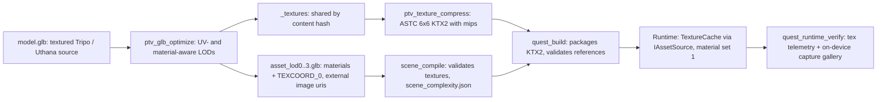

# Textured assets + Quest rendering performance

## Decisions (from your answers)
- **Materials:** base color only for every game (base-color texture x `baseColorFactor` x `COLOR_0`), on the existing lighting.
  - No normal-map or metal/roughness shading and no mandatory Standard/High selector. Those maps stay untouched in each source `model.glb` for a later update.
- **Renderer depth:** full. Multiview, Fixed Foveated Rendering that actually works, two frames in flight, static batching, instancing and a GPU timer.
  - Each one is measured on the headset and has an internal toggle in the performance profile, so a regression can be switched off without rebuilding the engine.
  - These internal toggles are engineering switches, not user settings (see "What users can override").
- **Optimization is automatic by default** for every generated game, chosen per game from complexity analysis and refined at runtime from measured CPU and GPU time.
  - A new optional "Custom Quest Optimizations" box, and the same wording in the main prompt, overrides only the settings it names. The box wins on a conflict.
  - A warning is shown, and nothing is blocked.
- **Test games:**
  - **Glock Laser Deck:** one APK, automatic settings.
  - **Fun Goblin Shooter** (`20261019-202355-fun-goblin-shooter-game`): animated full-body player avatar and goblin NPCs.
  - **Navy SEAL Raid** (`20261030-165847-navy-seal-raid`): the large-environment test, run once on automatic settings and once with the max-quality overrides from your example.

## Root cause (established)
Every Glock Laser Deck source `model.glb` has 1 material, 3 images, `TEXCOORD_0` and a base-color texture. Each `_lod0.glb` has `imgs 0`, only `POSITION`/`NORMAL`/`COLOR_0`, and a white factor.
- [`engine/tools/glb_optimize.cpp`](engine/tools/glb_optimize.cpp) drops UVs, images and materials on both the static and the rigged path, and writes white `COLOR_0`. Its header says so deliberately.
- [`GltfMeshLoad.h`](engine/runtime/include/ptv/render/GltfMeshLoad.h) `LitVertex` and [`GltfSkinnedLoad.h`](engine/runtime/include/ptv/render/GltfSkinnedLoad.h) `SkinnedVertex` (48 bytes) have no UV.
- The runtime is built with `TINYGLTF_NO_STB_IMAGE` and decodes no images.
- `Renderer` has no material descriptor set and no sampler. The `scene*` shaders use only the vertex color times `pc.color`.
- [`stage_quest_build.py`](apps/orchestrator/ptv_orchestrator/pipeline/stage_quest_build.py) packages the texture-less LOD GLBs.
- The default hands GLB also has a texture (plus `TANGENT` and `TEXCOORD_1`), which the skinned loader ignores.
- Procedural world primitives (`CPrimitive.color`) already show colour and are kept as they are.

## Baselines (headset)
- **Glock Laser Deck:** 72 fps, with "work" at 10.1 ms of the 13.9 ms budget. That number is CPU and GPU added together, because `draw_frame` waits on its fence every frame. 180 draws per eye, recorded twice (once per eye), of which 174 are single world primitives. Only about 37k triangles.
- **Navy SEAL Raid:** about 104 x 107 m with 19 nav regions, 232 entities (193 primitives, 24 GLB meshes) and 12 rigs.
  - Measured 8.2 ms of work, 211 draws, 46k visible triangles, 352k resident, untextured.
  - It is classified `compact` because the tier counts assets, not visible cost. This is why Phase 6 estimates visibility instead.
- **Foveation:** requested on the swapchain without the fragment-density-map flag or attachment, so it most likely has no effect on the image today.
- **Governor** ([`QualityGovernor.cpp`](engine/runtime/src/core/QualityGovernor.cpp)) has one fixed ladder (LOD bias, then cull distance, then foveation). It is driven by combined CPU+GPU time and has no concept of a user-locked setting.

## Phase 0: Measure before changing anything
- **GPU timer:** `vkCmdWriteTimestamp` at the start and end of the frame, read back two frames later and scaled by `timestampPeriod`.
- **CPU time:** recorded separately, excluding the fence wait.
- **Telemetry:** extend the `perf:` line in [`Application.cpp`](engine/runtime/src/core/Application.cpp) to `cpu X ms | gpu Y ms`, plus draws per eye, pipeline binds and descriptor binds.
- Record the Glock Laser Deck and Navy SEAL Raid baselines on the headset.
  - This includes their peak and steady PSS (`dumpsys meminfo`, `gpumeminfo`) and an empty-scene engine baseline PSS, which seeds the Phase 13 memory model.

## Phase 1: Build time — keep texture data through decimation
- **Inputs to `ptv_glb_optimize`.** Read per primitive:
  - `TEXCOORD_n`, where n is the base-color texture's `texCoord`;
  - the material, `baseColorFactor` and `KHR_texture_transform`;
  - `alphaMode`/`alphaCutoff` and `doubleSided`;
  - the sampler wrap and filter modes;
  - `COLOR_0`, but only if the source has it.
- **Material ranges.** Group triangles into per-material index ranges (submeshes). Each vertex belongs to one primitive, so collapses never cross materials. After simplifying, assert that all three corners of every triangle share a material, and fail loudly otherwise.
- **UV-aware decimation.** Static and rigged both use `meshopt_simplifyWithAttributes`:
  - UV weight = 1/sqrt(average UV area), as the meshoptimizer docs recommend;
  - normal weight 0.5;
  - UV-seam vertices protected with `meshopt_generatePositionRemap` + `meshopt_SimplifyVertex_Protect`.
  - The rigged path keeps its current regularize rules and still refuses sloppy simplification.
  - Record each LOD's simplification `error` in the report for Phase 8.
- **Images.**
  - `--list-images` prints each source image's hash, size and mime type.
  - Images are written once to `projects/<id>/assets/_textures/<hash>.<ext>` (deduped across assets and LODs).
  - `--textures map.json` makes every LOD reference them by relative `uri`.
  - Each texture also gets `extensions.PTV_texture_astc` pointing at the KTX2 file. This goes in `extensionsUsed` only, so standard viewers still show the PNG/JPEG.
  - The GLB stays valid glTF.
- **New `ptv_texture_compress`** (engine/tools, offline only). It uses the vcpkg `ktx` port (libktx, with ARM astcenc bundled), added to [`engine/vcpkg.json`](engine/vcpkg.json) and documented.
  - Resize with `stb_image_resize2`.
  - Build the mip chain in linear space for sRGB images.
  - Compress with `ktxTexture2_CompressAstcEx`: 6x6 sRGB for base color, 4x4 for UI-category assets. The texture-quality override "high" also uses 4x4.
  - Write uncompressed (no supercompression) KTX2, plus a resized JPEG/PNG fallback for PC VR, since desktop GPUs lack ASTC.
- **[`stage_asset_optimize.py`](apps/orchestrator/ptv_orchestrator/pipeline/stage_asset_optimize.py): quality-first texture sizing.**
  - Size each texture from the texel density it needs: the asset's closest possible view distance, taken from its placement relative to walkable `nav_region`s (held and worn items count as 0.4 m), and its size in metres.
  - Cap by importance: held or hero up to 2048, standard 1024, background 512, projectiles 256. Never above the source size.
  - A skyline building nobody can approach gets 512; the crate beside the spawn keeps 1024. Large games do not shrink everything.
  - While the total is over `texture_memory_budget_mb`, shrink the farthest and least important textures first, never to solid colour, and report every reduction.
  - Write a `textures` section into `asset_optimization.json` covering, per asset: materials, UV presence, closest view distance, source and output size, format, bytes and hash.
  - Extend the LOD stamp fingerprint to include the texture parameters.
- **Same closest-view-distance rule for LOD0 triangle budgets:** detail goes where the player can get close (an extension of the existing importance weighting in [`performance.py`](packages/schemas/ptv_schemas/performance.py)).

## Phase 2: Runtime — load and keep textures
- **Vertex formats (with UV, compressed as Meta recommends; see Phase 13).**
  - Static vertices go from 48 to 24 bytes: position f32x3, normal 10:10:10:2 snorm, UV unorm16x2 (float16 when UVs leave 0–1), colour unorm8x4.
  - Skinned vertices take 32 bytes: the same plus joints u8x4 and weights unorm8x4.
  - The `static_assert`s are updated. A smoke test checks UV error is under a quarter texel at 2048.
  - Both loaders read `TEXCOORD_n` and the material ranges. Fold `KHR_texture_transform` into a per-material UV transform.
- **`TextureCache`** (new, `engine/runtime/src/render/`):
  - Load the KTX2 through a small built-in parser (no runtime dependency) when `textureCompressionASTC_LDR` is available; enable that feature in [`VulkanContext.cpp`](engine/runtime/src/render/VulkanContext.cpp).
  - Otherwise decode the PNG/JPEG with stb and generate mips with `vkCmdBlitImage`.
  - Upload through the fixed staging ring (Phase 13), mip by mip for large textures, so no upload ever spikes memory. No CPU copy is kept.
  - Key the cache by resolved path, with a refcount tied to mesh residency, so repeated instances share one upload and eviction releases memory.
  - Levels can be uploaded tail-first (Phase 10).
- **Paths:** tinygltf gets a no-op image loader that records the `uri`. Bytes are read through `ptv::IAssetSource` (APK or filesystem), with `..` normalised relative to the GLB.
- **Default hands and avatars:** the skinned loader picks up their base-color textures automatically, with no project edits.
- **Diagnostics instead of silent white:**
  - **Load log line**, per mesh: `GLB loaded: ... materials 1 [bc 1024x1024 ASTC6x6 sRGB hash ab12]`.
  - **Missing texture:** a texture referenced but unloadable logs an ERROR naming the asset, material, uri, stage and cause. It is drawn with the material's factor, as magenta in verify and debug builds, and counted.
  - **Untextured source:** a material with no texture in its source is reported as intentional ("source untextured"), not as an error.
  - **New 1 Hz `tex:` telemetry line:** textures resident, MB, missing count, fallback-decode count.

## Phase 3: Shaders and binding
- **Material set:** new descriptor set 1 with one combined image sampler, and one set per texture.
  - Samplers are cached per wrap/filter mode: trilinear, anisotropy 4 when supported.
  - A 1x1 white texture is bound for untextured materials, so primitives and untextured GLBs keep today's look exactly.
- **Shading:** [`scene.frag`](engine/runtime/shaders/scene.frag) (static and skinned): `albedo = texture(baseColor, uv)` (the sRGB format decodes in hardware) x factor x vertex colour x tint.
  - Then today's half-Lambert, ambient, fog and ACES unchanged.
  - `MASK` uses alpha test. `BLEND` is drawn as `MASK` 0.5 with a warning (a reported limitation).
- **Tint rule:** GLB meshes default to a white tint instead of the `DrawItem` 0.8 grey, so textures are not darkened. Highlight and damage tints still multiply.

## Phase 4: Validation at every stage
- **`asset_optimization`:** fail when the source has a base-color texture and UVs but the LOD has none, or when a referenced file is missing. Report untextured sources plainly.
- **`scene_compile`:** every mesh entry's LOD GLB texture uris must resolve, and the KTX2 must exist for Quest. Record texture bytes in the performance block.
- **`quest_build`:**
  - Package the referenced `_textures/*.ktx2` and skip the PNG/JPEG fallbacks to keep the APK small.
  - Keep the fallbacks for PC VR.
  - Validate before Gradle that every referenced texture is in the APK and that there are no basename collisions (paths are hash-named).
- **`world_generation`:** the validator warns when primitives use the default colour. The world prompt asks for an explicit colour on every primitive.
- **`quest_runtime_verify`:** a base check that `tex: missing=0` and every expected texture loaded.

## Phase 5: Comparing the original with the rendered result
- **Offline:** [`ptv_glb_views`](engine/tools) gains `--compare src.glb lod.glb`, rendering both textured from the same 10 views. Per view it reports mean colour difference (CIELAB ΔE), a colour histogram distance and white-pixel fraction. Thresholds fail the stage, and I also inspect the PNGs visually.
- **On device:** a new `debug.ptv.verify_textures` launch (the same pattern as `verify_weapons`).
  - The engine renders each textured asset into an offscreen target with the real Quest pipeline and ASTC textures.
  - It reads both multiview layers back to PNG under the app's files directory, pulled with adb.
  - The verifier compares them with the offline reference and checks that the two eyes differ and are non-empty.
- Results are written to `runtime_verification.json`.

## Optimization policy: automatic by default, user overrides on top

### Two kinds of optimization
- **Build time** (decided once per game, baked into the APK):
  - decimation and the LOD chain, with LOD0 budgets from closest view distance;
  - texture size, ASTC block and mips;
  - deduplication;
  - static-batch eligibility and cell size;
  - room/portal data;
  - MSAA sample count;
  - initial FFR level, render scale and refresh rate;
  - memory budgets;
  - the locks from user overrides.
- **Runtime** (the generated APK adapts while it runs on the Quest 3):
  - frustum, room and small-object culling;
  - projected-size LOD selection with `lod_bias`;
  - the FFR level (dynamic);
  - render resolution (dynamic);
  - draw distance;
  - animation and AI tick bands;
  - mesh, texture and chunk residency.

### Applied automatically to every game, with no user action
- **Never reduce quality:** multiview, instancing, static batching, texture dedupe, ASTC with mips, two frames in flight, exact two-eye frustum culling, room/portal culling where the world has rooms, and residency streaming.
- **Trade quality only when measurements require it,** via the governor: FFR level, render resolution, LOD bias and draw distance, tried in perceptual order.
- **Per-game starting values** come from `scene_complexity` (Phase 6), not from game size alone. A large world whose estimated visible cost is low starts with FFR off and full resolution, exactly like a small game.

### What users can override (decided after reviewing every technique)
- **Fixed Foveated Rendering:** `auto` (default), `off`, `fixed:low|medium|high` (pinned), or `max:low|medium|high` (dynamic, but never above that level).
- **Dynamic render resolution:** `auto` (default; may drop to a 0.85 floor), `off` (always native 1680x1760 per eye), or `high`.
  - `high` renders at up to 1.25x, close to the Quest 3's physical panel resolution, clamped to the runtime's `maxImageRect`.
  - `high` locks out reductions.
- **Model detail (LOD):** `auto`, `detail`, or `performance`.
  - `detail`: a lower screen-error threshold, the governor's `lod_bias` capped at 0, and higher LOD0 ceilings within the memory budget.
  - `performance`: the opposite.
- **Texture quality:** `auto`, `high`, or `memory_saver`.
  - `high`: one size step up per importance class, ASTC 4x4, and a budget raised up to the safety ceiling.
  - `memory_saver`: one step down.
- **Draw distance:** `auto`, `far`, or `performance`.
  - `far`: the governor may not shrink the cull distance, and the small-object threshold drops to 0.5 px.
  - `performance`: an earlier distance cut is allowed.
  - Small-object culling is folded in here rather than exposed separately, because at 1.5 px it is invisible.
- **Room/portal culling:** `auto` or `off`. Turning it "on" in an outdoor world is reported as not applicable.
- **Anti-aliasing (MSAA):** `auto` or `high` (always 4x). Changing it requires a rebuild; it is not a runtime knob.
- **Frame rate:** `auto` (72 Hz) or `90`/`120` through `XR_FB_display_refresh_rate`. The frame budget changes to 11.1 ms or 8.3 ms, and the warning says so.

### Not user-controllable, and why
- **Multiview, instancing, batching, dedupe, frames in flight, ASTC itself, mips, frustum culling and residency:** they save work without intentionally lowering visible quality.
- A request to "disable texture compression" is answered as unsupported: memory safety requires compression. The closest supported option, texture quality `high` (ASTC 4x4), is applied and reported.
- **Eye-tracked foveation** is unsupported: the Quest 3 has no eye tracking. FFR is offered instead.

### Hard safety limits (never overridable; requests beyond them are clamped and reported)
- Memory safety (Phase 13):
  - the 4.5 GiB steady-state target and the 5.0 GiB peak ceiling, both under Meta's 5.75 GiB limit;
  - `MemoryGuard` is always on, and no user wording can disable it;
  - when a request cannot fit, the exact compromises are listed rather than the request being silently ignored;
- max texture size 2048;
- render scale at most 1.25 and at most `maxImageRect`;
- MSAA at most 4x;
- refresh rate limited to what the runtime reports.

### Interaction with `PerformanceProfile` and the governor
- Every overridden setting becomes a lock in `performance.locks`, with the user's value, a source tag (`custom_box` or `main_prompt`) and the verbatim quote.
- `derive_profile` applies tier defaults, then complexity-driven starting values, then locks, in that order.
- `QualityGovernor` builds its ladders only from unlocked ranges. A locked knob is never changed, even under sustained bad frames.
  - If every remaining knob is exhausted or locked, it logs `governor: over budget, blocked by user settings` and keeps running.
  - The verify report records this as a warning ("frame rate below target because of user-chosen settings"), not a failure.
- Settings the user did not mention stay fully automatic. "FFR off" leaves instancing, compression, culling and resolution untouched.

## Phase 6: Central performance config + scene complexity
- **Extend `PerformanceProfile`** ([`performance.py`](packages/schemas/ptv_schemas/performance.py) -> JSON schema -> `ScenePerformance` in [`Scene.h`](engine/runtime/include/ptv/scene/Scene.h) / [`SceneLoader.cpp`](engine/runtime/src/scene/SceneLoader.cpp)) with:
  - texture fields: memory budget, max size per importance, ASTC block;
  - LOD fields: screen-error threshold in pixels, hysteresis;
  - a small-object cull threshold in pixels;
  - `render_scale` with its floor and ceiling, and `refresh_hz`;
  - FFR: initial level and max level;
  - resident memory budgets;
  - internal toggles: `multiview`, `ffr_fdm`, `frames_in_flight`, `static_batching`, `instancing`, `room_culling`;
  - `locks` (the user overrides above).
- **New `scene_complexity.py`**, run in `scene_compile`, writes `scene_complexity.json`, with each figure labelled as an estimate or measured:
  - assets, unique meshes, materials, textures and texture MB;
  - triangles per LOD, draw calls before and after batching and instancing;
  - peak animated NPCs from encounter caps;
  - world bounds and density, indoor or outdoor, repetition, alpha-tested share.
  - **Visibility sampling:** sample viewpoints across walkable `nav_region`s, at eye height and in 8 directions. Count what the frustum, distance and room tests would draw, giving p50/p95 visible triangles, draws and texture MB.
    - A large world is judged by what is visible from where the player can stand, not by its total size.
  - Verify runs fill in the measured values (cpu, gpu, draws, tris, memory).
- **Per-game starting settings from the estimates:**
  - initial FFR level (0 unless the p95 GPU estimate is high);
  - MSAA (4x unless the fill estimate is heavy);
  - texture budget, batching cell size, room culling on or off, cull distance, LOD thresholds;
  - the tier, which it may raise but never lower.
  - When a measured `runtime_verification.json` exists from an earlier run, the next `scene_compile` prefers the measured numbers over the estimates.
- It never removes content. An over-budget estimate becomes a named warning.

## Phase 7: Draw calls
- **Per-frame instance buffer:** model, tint, material parameters and joint base, indexed by `gl_InstanceIndex`. Push constants shrink to well under the guaranteed 128 bytes (today they are 160).
- **Sorted draw list:** by pipeline, then material, then mesh. Identical mesh and material draws become one instanced draw, including skinned NPC clones that share a mesh, each with its own palette.
- **Static batching:**
  - `scene_compile` marks `static_batch` only for world geometry that nothing can move: no bindings, not named in generated code or encounters, not an objective, not hidden or attached.
  - The runtime merges those per spatial cell and colour/material into a few meshes.
  - Colliders stay per entity, so physics, AI and navigation are unchanged.
  - Verify runs check every second that batched transforms never changed.

## Phase 8: Culling and LOD
- **Frustum culling:** a bounding sphere is tested against both eye frustums (12 planes, OR'd). This replaces the widened-FOV approximation (`kCullFovRadians`) and is correct for each eye.
- **Moving objects:** bounds use the current transform. Skinned meshes use the animated bounds the offline tool computes by sampling clips.
- **Projected-size LOD:** switch to LOD n when its recorded simplification error, projected to the screen, is under the threshold in pixels, with hysteresis.
  - The governor's `lod_bias` scales the threshold, which keeps popping under a pixel.
  - Hands, held weapons, worn items and the player avatar always use LOD0.
- **Small-object culling:** objects under about 1.5 projected pixels are culled from rendering only.
- **Gameplay-relevant exemptions:** distance and small-object culling never hide:
  - a living hostile NPC within its weapon's engagement range;
  - an active objective;
  - anything held or worn.
  - So a sniper is never invisible while it can shoot the player.
- **Occlusion:** use the world's declared `nav_region`/`nav_link` as rooms and doorways. A neighbouring room draws only if its link crossing is in either frustum.
  - Enabled when the complexity analysis finds indoor, multi-room scenes (Navy SEAL Raid has 19 regions), unless the user turned it off.
  - Kept only if measured GPU/CPU time improves; otherwise documented as not beneficial.
  - Glock Laser Deck is one room, so it stays off there.

## Phase 9: Quest XR rendering
- **Multiview:** one swapchain with `arraySize` 2, 2-layer depth and MSAA, viewMask 0b11. Every pipeline (scene, skinned, mirror, sky, fx, text, vignette) indexes a 2-matrix UBO with `gl_ViewIndex`. Recording happens once per frame.
- **Fixed Foveated Rendering (FFR):** not eye-tracked, because the Quest 3 has no eye tracking and `XR_META_foveation_eye_tracked` is not used.
  - The full-detail region stays fixed at the centre of each eye's display (`verticalOffset` 0). Only its strength changes at runtime.
  - **Native setup:**
    - enable `XR_FB_foveation`, `XR_FB_foveation_configuration`, `XR_FB_foveation_vulkan` and `XR_FB_swapchain_update_state`;
    - enable `VK_EXT_fragment_density_map` (+`_map2`);
    - create the multiview swapchain with `XR_SWAPCHAIN_CREATE_FOVEATION_FRAGMENT_DENSITY_MAP_BIT_FB`;
    - fetch each image's density map with `XrSwapchainImageFoveationVulkanFB` and attach it to the render pass through `VkRenderPassFragmentDensityMapCreateInfoEXT`.
    - This is engine code inside every APK, not a compile-time effect.
  - **Dynamic level:** our governor is the only controller and sets the level (none/low/medium/high) with `xrUpdateSwapchainFB` during gameplay, raising it when the GPU is the bottleneck and lowering it when there is headroom.
    - The runtime's own dynamic flag is switched off (today `set_foveation_level` enables it), so two controllers never fight and every change can be measured.
  - **Measured, not assumed:** each raise is followed by a GPU-time comparison over the next 90 frames. If GPU time did not fall by at least 3%, typically because the scene is CPU- or vertex-bound, the level is reverted and FFR is skipped for a cooldown.
  - Verified on the headset by GPU time at levels 0 and 3, plus the `ffr` value in telemetry following load.
  - User locks: `off` means level 0 permanently; `fixed` pins a level; `max` caps the ladder.
- **Two frames in flight:** per-frame command buffers, fences, UBOs, palette, instance, FX and text buffers. CPU work for frame N+1 overlaps GPU work for frame N. `frames_in_flight: 1` remains as a fallback.
- **Dynamic render resolution:**
  - The swapchain is allocated at the ceiling: 1.0x by default, up to 1.25x with the `high` override.
  - The submitted `imageRect` shrinks toward the floor (0.85 by default) as a GPU-bound step, and grows back with headroom.
  - It has the same effectiveness probe as FFR.
- **Refresh rate:** add `XR_FB_display_refresh_rate`; request `refresh_hz` (72 by default) and adopt its frame budget.
- **Governor** ([`QualityGovernor.cpp`](engine/runtime/src/core/QualityGovernor.cpp)) is reworked from one fixed ladder into bottleneck-aware ladders in perceptual order:
  - Classification: GPU-bound when GPU ms is above 90% of the budget; CPU-bound when CPU ms is; both can apply at once.
  - **GPU ladder:** FFR low -> render scale 0.95 -> FFR medium -> LOD bias +0.5 -> render scale 0.90 -> FFR high -> LOD bias +1.0 -> render scale floor.
  - **CPU ladder:** animation/AI bands tighter -> draw distance shrink (respecting the exemptions above) -> LOD bias.
  - Rules:
    - relaxing walks back in reverse;
    - existing hysteresis stays, plus per-knob cooldowns;
    - every step is logged with its measured effect and reported;
    - locked knobs are skipped;
    - the governor never removes content.

## Phase 10: Streaming and residency for large worlds
- **Evaluation:** today `request_stream`/`evict_to_budget` streams meshes by distance and evicts by LRU. Textures have no residency at all. There are no world chunks, and eviction is off below the `massive` tier.
  - That is not enough for a large city or base with hundreds of textured props, so the following is added.
- **Device memory budget:** resident mesh plus texture MB comes from the Phase 13 memory model: the 4.5 GiB steady-state target minus the always-resident set and planned transients. This replaces triangle counts alone.
  - Eviction is on for every tier. It activates only when the budget would be exceeded, or when `MemoryGuard` raises its level.
  - Loads reserve their bytes before they start (Phase 13), so streaming never overshoots.
- **No pop-to-nothing:**
  - Every asset's lowest LOD stays resident, along with each texture's mip tail (128 px and below), which costs a few MB in total.
  - Higher LODs and full mips stream in by priority, so a late load shows a lower-detail version, never an invisible object or a white surface.
- **Priority:** projected size, then gameplay importance (held, hostile in range, objective), then distance.
- **Speed-aware prefetch:** look ahead along the player's velocity, using the measured sprint speed from the locomotion built-ins, so higher LODs arrive before they are needed.
- **World chunks:** static-batch cells (Phase 7) are the chunk unit. A far cell's merged geometry is evictable and streams back by the same priority rule.
- **Never breaks gameplay:** rendering, residency, existence and simulation stay separate.
  - Colliders, nav data, entities, AI, encounters, `ctx.game` state and the world's persistent state are never unloaded.
  - Only GPU buffers and images are.
  - An evicted NPC keeps thinking, moving and attacking; only its higher-detail mesh is gone.
- **Verified:** a streaming soak in verify mode (a scripted walk across Navy SEAL Raid) checks:
  - resident MB stays under budget;
  - nothing visible lacks a resident LOD;
  - hitches stay under the frame budget;
  - gameplay checks still pass.

## Phase 12: Custom Quest Optimizations (UI + pipeline)
- **Schema** (`packages/schemas/ptv_schemas/optimization_preferences.py`, JSON export):
  - `OptimizationPreferences` holds one optional field per user-controllable setting above.
  - Each field carries its value, `source`, `quote` and `differs_from_auto`.
  - Plus `unsupported[]` (the request, the reason and the closest supported setting) and `clamped[]`.
- **`ProjectState.custom_quest_optimizations: str = ""`** and `CreateProjectRequest` in [`routes.py`](apps/orchestrator/ptv_orchestrator/api/routes.py), stored with the project and left empty by default.
- **New stage `optimization_preferences`** (right after `build_spec`):
  - A deterministic keyword gate looks for foveation/FFR, resolution, LOD/detail, texture, draw/render distance, culling, fps/Hz, anti-aliasing, graphics or visual quality, and performance, in both the main prompt and the box.
    - If neither matches, it writes empty preferences with no model call.
  - Otherwise one light-tier `LlmClient` structured-output call maps the wording onto the schema.
  - A deterministic validator then:
    - requires each quote to appear verbatim in its source text;
    - applies "the custom box wins" on conflicts;
    - records unsupported requests and clamps.
  - The BuildSpec prompt is told to ignore optimization wording, so it never shapes gameplay.
  - The result is written to `optimization_preferences.json`.
- **Carried to the APK:** `derive_profile` turns preferences into locks, `scene_compile` writes `performance.locks` into `scene.json`, `SceneLoader` reads them, and the governor and renderer honour them.
  - `quest_runtime_verify` checks that the locks held on the device. For example, "FFR off" means `ffr 0` in every `perf:` line and no foveation call; resolution "off" means render scale 1.0 throughout.
- **UI** ([`NewProjectPage.tsx`](apps/web/src/pages/NewProjectPage.tsx), [`client.ts`](apps/web/src/api/client.ts)):
  - **Input:** a collapsed "Custom Quest Optimizations" section with an empty textarea, shown when Quest is the target.
  - **Preview:** a new `POST /api/optimization-preferences/preview` runs the same function and cache on blur of either field.
  - **Warning (inline, non-blocking):** when any setting differs from automatic, from either input, an inline warning lists the parsed overrides, unsupported requests and clamps, then shows: "Warning: Your custom Quest optimization settings differ from the VR engine's recommended settings. Disabling or modifying certain optimizations may reduce performance, cause unstable frame rates, or prevent your game from running smoothly on the Quest 3."
    - Create is never disabled.
  - **Project page banner:**
    - shows the authoritative `optimization_preferences.json`;
    - adds a scene-specific risk line after `scene_compile` (for example: "FFR off; estimated p95 GPU 12.8 ms of the 13.9 ms budget");
    - adds the measured result after verify.

## Phase 13: Memory safety — use the Quest 3 fully, never run out

### Meta's limit versus the engine's own targets
- **Meta's limit** ("Memory / RAM", native and essentials pages): an immersive app on Quest 3 / 3S may use 5.75 GiB, measured as PSS.
  - PSS is the app's share of RAM. The headset has 8 GB physically; the rest is reserved for tracking, the OS and background services.
  - CPU and GPU share that RAM, so every texture, buffer and render target counts.
  - An app over the limit can survive a quiet session and still get a "Low Memory Kill" (`lowmemorykiller`) when the headset is under pressure. Meta advises targeting well below the limit.
- **Engine targets.** These are engineering choices for this engine, not Meta numbers:
  - **Steady-state target: 4.5 GiB PSS (about 78% of the limit).** Residency budgets are sized so normal play sits at or below this.
  - **Peak ceiling: 5.0 GiB (about 87%).** Nothing the engine plans may cross it, including loads, scene reloads and streaming bursts. That leaves 0.75 GiB for OS activity, driver alignment and estimate error.
  - Why not lower (say 3.5 GiB): it would throw away about 1 GiB a large game can use for texture and model detail. Why not higher: the estimate error and pressure spikes Meta warns about.
- **Calibrated from the headset:**
  - Phase 0 measures the engine's empty-scene baseline PSS.
  - Every verified run records measured versus estimated memory per category in `memory_calibration.json` (orchestrator).
  - The estimator multiplies by the worst observed ratio, so if estimates prove optimistic the effective margin widens automatically.
  - The targets themselves change only in the profile, with the docs.
- PC VR is unaffected; desktop GPUs have their own memory.

### What is counted (memory model in `scene_complexity.py`)
Each category is labelled exact or estimated, and the result is written to `memory_estimate` in `scene_complexity.json`.
- **Engine baseline (measured):** code, Vulkan driver, OpenXR runtime share, Jolt and EnTT startup.
- **Textures:** ASTC bytes per mip, rounded up to the GPU's allocation granularity.
  - Meta notes that textures round up at certain sizes. The real table comes from `vkGetImageMemoryRequirements` on the device during the texture verify pass.
  - Texture sizing then prefers sizes without wasted space.
- **Meshes:** vertex and index bytes for each resident LOD (compressed vertices), plus static-batch cells.
- **Characters:**
  - joint palettes for every animated agent at the encounter cap;
  - skeleton and clip data once per unique rig, shared by every clone.
- **Render targets:**
  - swapchain images (count x 2 layers x render-scale ceiling) and foveation maps;
  - MSAA colour and depth, which are zero when lazily allocated and the full size otherwise.
- **Per-frame buffers** x frames in flight: environment UBO, instances, palettes, FX, text.
- **Fixed pools:** projectiles, FX quads, decals, the text atlas.
- **Simulation:** Jolt bodies, shapes and temp allocator; navigation data; entities and components; game flow and encounter state.
  - Audio is a reserved category; there is no audio system today.
- **Load transients:** the largest GLB, mapped plus the tinygltf copy, plus the staging ring.
- **Native-heap fragmentation allowance:** measured on the device.
- **Outputs:**
  - the always-resident set (lowest LODs, mip tails, colliders, all entity and game state, render targets, pools);
  - the streamable set;
  - the steady-state estimate at the chosen residency budget;
  - the peak estimate (steady state plus the largest transient).

### Build time: fit decision and automatic corrections (`asset_optimization` + `scene_compile`)
- **If everything fits under the target while resident:** nothing streams.
- **If it doesn't, but the always-resident set fits:** Phase 10 residency is on, with budget = target minus always-resident minus transients. This is the normal outcome for large worlds, not a warning.
- **If the always-resident set plus transients exceed the target:** automatic corrections run in order of least visible impact. Each step is re-estimated, and the loop stops as soon as the game fits.
  1. Quality-neutral savings: dedupe, compressed vertices, packaging, lazy attachments. These are always on.
  2. Textures the player cannot get close to, by the closest-view-distance rule: one size step down. ASTC 8x8 for assets seen only in the background.
  3. A smaller resident mip tail (128 to 64 px) for background assets.
  4. Lower LOD0 budgets, for background assets only.
  5. If the user asked for render scale `high`, the swapchain ceiling drops from 1.25x to 1.0x. This is reported as a compromise.
  6. Only then do hero, near and held assets go one step down.
  - Never: removing entities, NPCs, encounters or weapons; replacing a texture with a solid colour; or changing gameplay.
- **If it still doesn't fit:** the APK is still built and downloadable. It gets `memory_status: at_risk` with the contributors, the corrections tried and the remaining gap. The runtime guard still protects it.
- **With user overrides:**
  - The request is satisfied in priority order, held and near assets first, with far assets lowered first.
  - The exact compromise is reported, for example: "texture quality high kept on 41 near textures; 63 skyline textures one step lower to fit 4.5 GiB."
  - The engine never silently ignores the preference and never ships a build it knows exceeds the ceiling without flagging it.

### Load path: less memory and bounded spikes (some earlier decisions change)
- **Vertex compression** (Meta tip, replaces Phase 2's float layouts): static 48 to 24 bytes, skinned 32 bytes. This halves mesh memory and vertex bandwidth.
- **APK assets:** `noCompress` for `glb`, `ktx2` and `spv` in the Gradle template ([`engine/android`](engine/android)), read with `AAsset_getBuffer`. That memory-maps clean, reclaimable pages instead of inflating a heap copy.
- **Fixed 32 MB staging ring**, reused for every upload, with large textures sent mip by mip. Upload spikes are bounded whatever the texture size. This replaces per-upload staging buffers.
- **One asset at a time:** the tinygltf model and decoded arrays are freed right after upload. Only skeletons, clips and collider shapes stay on the CPU (Meta tip: textures and meshes live only in GPU memory).
- **Shared character data:** skeleton and clip data are shared across clones of the same NPC type. The current code is checked; anything copied per clone becomes shared.
- **Lazily allocated MSAA colour and depth:** `VK_IMAGE_USAGE_TRANSIENT_ATTACHMENT_BIT` + `VK_MEMORY_PROPERTY_LAZILY_ALLOCATED_BIT`, which Meta recommends for native Vulkan. These live only in tile memory.
- **Return freed native memory:** `mallopt(M_PURGE_ALL, 0)` after a scene load, after a scene reload and after a large eviction burst.
  - Android's allocator otherwise keeps freed pages; one published case dropped from 4.0 to 1.7 GiB PSS with this call alone.
  - The engine never calls it today.
- **GPU fragmentation:**
  - images of 4 MB or more get dedicated VMA allocations, freed whole on eviction;
  - small resources share pooled blocks;
  - empty blocks are released;
  - VMA's unused bytes are reported, and above 10% waste an incremental `vmaBeginDefragmentation` runs during light frames.
- **Scene reload** (Try Again / Play Again) frees every GPU and CPU resource of the old scene, then purges, before loading the new one.
- **Predictive reservations:** the residency manager reserves a load's bytes before issuing it. If the reservation would cross the target, the lowest-priority invisible data is evicted first, so memory is made available before the spike rather than after.

### Runtime: `MemoryGuard` (new, `engine/runtime/src/core/MemoryGuard.cpp`), in every APK, always on
- **Inputs:**
  - the engine's own accounting (VMA statistics, caches and pools; exact, every frame);
  - PSS from `/proc/self/smaps_rollup` every second on a background thread (the Quest 3 offers no `VK_EXT_memory_budget`);
  - the system's `MemAvailable` from `/proc/meminfo`;
  - `APP_CMD_LOW_MEMORY` from the native glue in [`AndroidMain.cpp`](engine/runtime/src/platform/android/AndroidMain.cpp), as a late extra signal only.
- **Projection:** it adds the bytes of queued prefetches and reservations for the next few seconds and acts on projected PSS. It does not wait for Android's warning or for current usage to climb.
  - Example: walking from a small courtyard into a dense block shows up as reservations before the spike, so lower-priority data is released first.
- **Levels** (with hysteresis on the way back down):
  - **green, below 4.25 GiB:** normal.
  - **yellow, 4.25–4.5 GiB:** stop speculative prefetch, and evict invisible streamable data down to 4.0 GiB.
  - **red, 4.5–4.8 GiB, or `MemAvailable` under 512 MB, or `APP_CMD_LOW_MEMORY`:**
    - evict everything invisible above the always-resident floor;
    - defer new high-detail loads;
    - purge the allocator;
    - log an ERROR naming the top consumers.
  - **critical, 4.8 GiB and above:** also step visible objects down to their resident lower LODs and mips. This is a visible quality drop, never a crash.
- **Gameplay is never touched:** entities, colliders, navigation, AI, encounters, game state and world persistence are never freed. An NPC whose mesh was evicted keeps acting.
- **Recoverable allocation failures:** every `vmaCreate*`, `vkAllocateMemory` and large heap allocation site is audited.
  - Out-of-memory triggers red-level eviction, a purge and one retry.
  - If that fails too, the lower LOD is kept and the failure is logged. The engine never aborts.
- **Kept separate from frame rate:** `QualityGovernor` reacts only to frame time (FFR, resolution, LOD bias, draw distance, AI bands). `MemoryGuard` reacts only to memory.
  - FFR and dynamic resolution save no memory, because the swapchain is allocated at its ceiling, so the guard never uses them.
  - A slow frame never triggers eviction.
  - Telemetry and verify reports classify every problem as frame-time (GPU-bound or CPU-bound) or memory.
- **Telemetry:** a 1 Hz line: `mem: pss 3120 MB (target 4608, ceiling 5120, limit 5888) | projected 3300 | tex 610 | mesh 240 | targets 160 | heap 410 | vma_waste 3% | sys_avail 2100 | level green | evict 0`.
- Quest system warnings and messages are never suppressed or hidden; the engine prevents the conditions that cause them.

### Verification on the headset (`quest_runtime_verify`)
- **Measurements, sampled at 2 Hz** through launch, load, steady play and the streaming soak:
  - `adb shell dumpsys meminfo <package>`: total PSS, Native Heap, Graphics, GL mtrack;
  - `adb shell gpumeminfo -p <pid> -m -o` (Meta's tool, Vulkan device memory);
  - the engine's `mem:` line;
  - the PSS line Quest logs to logcat every second.
- **Checks:**
  - peak PSS at or under the 5.0 GiB ceiling, and steady state at or under 4.5 GiB;
  - estimated versus measured memory per category, written to the report and fed into calibration;
  - **leaks:** 3 Try Again / Play Again cycles with PSS growth of no more than 50 MB per cycle, plus a 10-minute soak (scripted walk across areas) whose PSS rises by no more than 5 MB per minute after warm-up;
  - **pressure** (`debug.ptv.simulate_memory_pressure`): the guard's targets are lowered mid-game. It must reach red, evict, stay alive, keep the gameplay checks green and recover.
  - **kills:** `logcat` is scanned for `lowmemorykiller` / `lmkd` / "Low Memory Kill" naming the package across every verify launch. Any hit fails the run, with the last `mem:` line attached.
- **Automatic correction loop:**
  - On a memory failure, verify writes `memory_feedback.json` (measured versus estimated per category).
  - The pipeline then re-runs `asset_optimization` -> `scene_compile` -> `quest_build` -> `quest_runtime_verify` with budgets scaled by the measured ratio, up to `quest_memory_max_correction_rounds` (default 2).
  - Only non-gameplay stages re-run. User locks are respected except where memory safety clamps them, which is reported.

### Status and the APK download: never blocked, never over-claimed
- **`memory_status`**, written to `runtime_verification.json` (in a new `memory` section) and to the project:
  - **`verified_safe`:** measured on a connected Quest 3, all memory checks passed.
  - **`estimated_safe_not_device_tested`:** the estimate fits, but no headset was connected. Never shown as verified.
  - **`at_risk`:** the estimate is still over target after corrections, and there was no headset.
  - **`failed_on_device`:** a measured failure (ceiling, leak or kill) remains after the correction rounds.
- **Overall verification is `passed` only when memory is `verified_safe` and every other check passes.** A memory failure makes it `failed`, with the memory reason first.
- **The APK is always downloadable:** a new `GET /projects/{id}/apk` endpoint and a "Download APK" button on [`ProjectDetailPage.tsx`](apps/web/src/pages/ProjectDetailPage.tsx), next to the existing "Run on headset".
  - Both work whatever the status.
  - The badge beside them shows the status, the reasons and any compromises, for example "Memory: not tested on a Quest 3 (estimate 3.9 of 4.5 GiB)".

## Phase 11: Tests, devices, docs
- **Smoke tests** ([`smoke.cpp`](engine/runtime/tests/smoke.cpp)):
  - `textured_glb` on real Tripo LODs: materials resolved, UVs finite and in range;
  - KTX2 parse and size math;
  - `TextureCache` dedupe;
  - two-eye frustum edges;
  - projected-LOD hysteresis;
  - static batch eligibility;
  - multiview matrix selection.
  - **Governor ladders:** GPU- versus CPU-bound order, an ineffective-step revert, cooldowns, and "a locked knob never moves" under 10,000 simulated bad frames.
  - **Residency:** the lowest LOD and the mip tail are never evicted.
  - **Lock parsing in `SceneLoader`.**
  - **Memory:**
    - `MemoryGuard` levels, hysteresis and projection (acting on reservations before usage rises);
    - an injected out-of-memory allocation recovering without an abort;
    - the staging ring bounding peak upload memory;
    - vertex-compression precision;
    - clones sharing clip data;
    - scene reload returning every cache total to zero.
  - All 62 existing smoke tests must stay green.
- **Orchestrator:**
  - texture validation (lost versus intentional), packaging validation, `scene_complexity` with visibility sampling, profile fields and the verify texture checks;
  - **`optimization_preferences`:** your two example prompts, both inputs present with the box winning, an unsupported request ("eye-tracked foveation", "no compression"), a clamp, the empty-input no-call path, and locks reaching `scene.json`;
  - **verify:** lock checks, and user-caused frame misses reported as warnings.
  - **Memory:**
    - byte math per category and the calibration multiplier;
    - the three fit outcomes;
    - correction order (background first, never removing entities, held and near assets last);
    - overrides satisfied near-first with exact compromise text;
    - the `at_risk` path still producing an APK;
    - status semantics with and without a headset, never `verified_safe` without device data;
    - parsing `dumpsys meminfo`, `gpumeminfo` and `lowmemorykiller` lines;
    - correction-loop rounds.
  - All 560 existing tests must stay green.
- **Web:**
  - the section is collapsed and empty by default, and the warning appears for overrides from either input while Create stays enabled;
  - Download APK is visible after any successful build whatever the memory status, and the badge says "not tested on a Quest 3" when no headset ran it.
- **Textures_Update.md tests:**
  - A–C: Glock Laser Deck assets (each drone, the pistol, the HUD) with offline comparisons and the on-device gallery, plus a cross-assignment check by hash.
  - D: Fun Goblin Shooter goblins and avatar while animated.
  - E: procedural world colours and imported props.
  - F: full Glock Laser Deck APK on Quest 3, with the base, flow and weapons verify passes and the new texture pass.
  - G: existing functionality (hands check, gameplay, physics).
  - H: Fun Goblin Shooter end to end.
- **Performance tests:**
  - small scene (Glock Laser Deck);
  - large scene (Navy SEAL Raid on automatic settings, plus a stress sample);
  - rapid scripted turning with no culling pops;
  - the Navy SEAL Raid streaming soak;
  - gameplay flows;
  - an FFR level 0 versus 3 GPU comparison;
  - frame times against 13.9 ms on device.
- **Max-quality test:** Navy SEAL Raid re-run from `optimization_preferences` with your example override text ("no FFR, no resolution reduction, high textures, detailed models far away").
  - It must build, honour every lock on the device and report its measured frame rate honestly next to the automatic build.
  - Because no gameplay stage re-runs, the game itself is identical.
- **Memory tests on the headset:** every test APK runs the Phase 13 memory pass (peak, steady state, leak cycles, 10-minute soak, pressure, kill scan).
  - Both Navy SEAL Raid builds must reach `verified_safe`. The max-quality build lists any memory compromise it needed.
  - Estimated and measured peaks are compared to calibrate the model.
- **Projects:** re-run `asset_optimization` -> `scene_compile` -> `quest_build` -> `quest_runtime_verify` for the three test games only (plus `optimization_preferences` for the max-quality Navy SEAL Raid). No gameplay files change, and every touched file is named in the final report.
- **Headset:** set `debug.oculus.guardian_pause` back to 0 first.
- **Docs, updated in the same change:**
  - [`docs/rendering.md`](docs/rendering.md): textures, multiview, FFR, culling, LOD, batching, instancing, governor;
  - new `docs/quest-optimization.md`: automatic policy, build-time versus runtime, user-controllable settings, locks, safety limits, warnings;
    - plus a memory section: Meta's limit versus the engine targets, the memory model and calibration, the correction order, `MemoryGuard` levels, the verify checks, `memory_status` and the always-available download;
  - [`docs/quest-build.md`](docs/quest-build.md): packaging (including `noCompress`), the texture verify pass and the memory pass;
  - [`docs/architecture.md`](docs/architecture.md);
  - [`AGENTS.md`](AGENTS.md): the new `optimization_preferences` stage and steps 8c, 9, 10 and 10b;
  - the dependency note for `ktx`.
- **Final report:**
  - points 1–10 of Textures_Update.md;
  - the optimization deliverables (what is automatic, what users can override, measured before and after for all three games, both Navy SEAL Raid builds);
  - memory: estimated versus measured peak and steady PSS for every test APK against 4.5 / 5.0 / 5.75 GiB, the leak, soak and pressure results, and which earlier decisions changed for memory;
  - the decisions not to implement where something did not help.

## Honest limits
- No configuration can guarantee 72 Hz for every prompt. The engine measures, adapts and reports bottlenecks instead.
- Horizon OS decides memory kills, so no app can rule out every memory warning or kill. The engine minimises them by budgeting below Meta's limit, acting before spikes and testing on the device. It reports `verified_safe` only from real headset measurements.
- Breachers, Tactical Assault VR and Ghosts of Tabor also rely on baked lighting and normal and metal/roughness materials. This update builds the performance and memory foundation that lets large worlds run smoothly; matching their look still needs the shading features deferred below.

## Explicitly not in this update
Normal-map and metal/roughness shading, a mandatory Standard/High selector, IBL, shadows, bloom, baked lighting, emissive textures (reported as a limitation), `BLEND` sorting, and eye-tracked foveation (no hardware on Quest 3).
