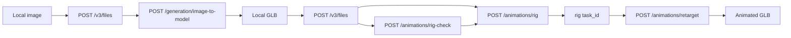

# Standalone Tripo Sequential Run Scripts

Create [`Sequential_Runs/Image_To_3D_TriD_Tripo`](Sequential_Runs/Image_To_3D_Tripo) (folder does not exist yet) with four run-from-top scripts plus one small shared helper. These scripts will **not** import `ptv_providers.TripoClient` or touch the VR engine/pipeline.

Verified against current Tripo V3 docs ([image-to-model](https://developers.tripo3d.ai/en/docs/generation-image-to-model/standard), [files](https://developers.tripo3d.ai/en/docs/files), [rig-check](https://developers.tripo3d.ai/en/docs/animations-rig-check), [auto-rig](https://developers.tripo3d.ai/en/docs/animations-rig), [retarget](https://developers.tripo3d.ai/en/docs/animations-retarget), [quick start](https://developers.tripo3d.ai/en/docs/quick-start)) and the existing client in [`packages/provider-clients/ptv_providers/tripo_client.py`](packages/provider-clients/ptv_providers/tripo_client.py).



## Shared helper: `tripo_common.py`

Keep it tiny and obvious. Each script still has its own USER CONFIGURATION block.

- Load `TRIPO_API_KEY` from the environment. If missing, try repo-root [`.env`](.env) via `python-dotenv` (same key already used by the orchestrator). Fail with a clear message if still unset. Never put the key in a script.
- Optional `TRIPO_BASE_URL` (default `https://openapi.tripo3d.ai/v3`).
- `Authorization: Bearer {key}` on every call.
- `POST /files` multipart (`file=@...`) → `data.file_token`.
- `POST {endpoint}` JSON → `data.task_id`; unwrap `code == 0`.
- `GET /tasks/{task_id}` every **2s** (docs: poll every 2s, stay under 1 req/s). Print `status` + `progress`. Terminal: `success` / `failed` / `cancelled`.
- Retry HTTP 429 / 5xx and Tripo codes `1007` (create quota) / `2000` (concurrency).
- Download `output.model_url` immediately (signed URLs expire quickly). Also accept `output.model_urls` if a multi-animation retarget returns a list.
- Validate local files exist; `mkdir` output dirs.

## 1. `3d_object_creation.py`

Config at top:

- `INPUT_IMAGE_PATH`, `OUTPUT_DIRECTORY`
- Sent: `model = "v3.1-20260211"` (required), `texture=True`, `pbr=True`, `texture_quality="standard"`, `geometry_quality="standard"` (omit if you switch to P1 / v2.5)
- Optional but exposed: `enable_image_autofix=False` (docs default), `orientation="align_image"`, `texture_alignment="original_image"`, `auto_size=False`
- **Omit unless you uncomment them:** `face_limit`, `quad`, `smart_low_poly`, `generate_parts`, `compress`, **`export_orientation`** (docs: do not set this if the model will later go through rig / retarget)

Flow: validate image (PNG/JPEG/WebP, ≤20 MB) → upload → `POST /generation/image-to-model` with `{ "input": file_token, ... }` → poll → download `model_url` as `{stem}.glb` → print path **and generation `task_id`** (useful as later `input`).

## 2. `rig_check.py`

Config: `INPUT_GLB_PATH` only.

Flow: validate GLB (≤150 MB) → upload → `POST /animations/rig-check` `{ "input": file_token }` → poll → print `output.riggable` and `output.rig_type` (`biped` / `quadruped` / `hexapod` / `octopod` / `avian` / `serpentine` / `aquatic`). No download (no `model_url`). Exit non-zero on failed/cancelled tasks.

## 3. `auto_rig.py`

Config:

- `INPUT_GLB_PATH`, `OUTPUT_DIRECTORY`
- `RUN_RIG_CHECK_FIRST = True` (docs: always check first)
- `RIG_TYPE = "biped"` (overridden by check result when `USE_RECOMMENDED_RIG_TYPE = True`)
- `RIG_MODEL` auto-mapped: biped → `v1.0-20240301`, otherwise `v2.5-20260210`
- `SPEC = "tripo"` — **not Mixamo**. Mixamo rigs 400 on `/animations/retarget` (error 1004). Exposed with a comment if you still want Unity-style names and will not retarget here.
- `OUT_FORMAT = "glb"`

Flow: upload GLB → optional rig-check (abort if `riggable=False`) → `POST /animations/rig` `{ input, model, rig_type, spec, out_format }` → poll → download `{stem}_rigged.glb` → **print the rig `task_id` in large type** (required by the next script).

## 4. `animation_retarget.py`

Designed around the real API: `input` **must** be a successful **rig** `task_id` (`task_...`). No local-GLB upload path (that fails).

Config:

```python
RIGGED_MODEL_TASK_ID = "task_xxxxxxxxx"
ANIMATION = "preset:idle"          # used if ANIMATIONS is empty
ANIMATIONS: list[str] = []         # if non-empty, send this and ignore ANIMATION
OUTPUT_FORMAT = "glb"
BAKE_ANIMATION = True
EXPORT_WITH_GEOMETRY = True
ANIMATE_IN_PLACE = False           # Tripo default; True = no baked root motion
OUTPUT_DIRECTORY = Path(r"...")
```

Send **exactly one** of `animation` or `animations`. Validate that, then `POST /animations/retarget` → poll → download `model_url` and/or `model_urls` into the output dir → print paths + retarget `task_id`.

Comment in the config block listing v2.5 biped presets (`preset:idle`, `preset:walk`, …) vs v1.0 biped (`preset:biped:idle`, …) vs creature singles.

## Style / constraints

- PEP 8, `pathlib.Path`, type hints, `if __name__ == "__main__"`.
- Console output matching the requested Uploading / Task ID / Processing: N% / Saved to flow.
- `httpx` only (already in `vrvenv`). No CLI, no class hierarchy.
- Do not edit engine, orchestrator, or `tripo_client.py`.
