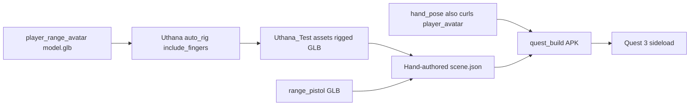

# Uthana Avatar Rig Quest Test

## Goal

Under [`Uthana_Test/`](Uthana_Test/), auto-rig [`player_range_avatar/model.glb`](projects/20260907-144543-shooting-range-game/assets/player_range_avatar/model.glb) via Uthana (with fingers), then package a Quest APK where that body is the first-person avatar with head/arm tracking, head-relative slide, grab/throw of [`range_pistol`](projects/20260907-144543-shooting-range-game/assets/range_pistol/model.glb), and controller-driven finger curls.

## Engine gap (required, minimal)

**Finding:** [`builtin.avatar_body`](engine/runtime/src/mechanics/builtin/avatar_body/AvatarBodyMechanic.cpp) already plants the body, tracks the head, and IK-solves arms. When the avatar has finger slots it **hides** the engine hand fixtures and expects [`builtin.hand_pose`](engine/runtime/src/mechanics/builtin/hand_pose/HandPoseMechanic.cpp) to curl the avatar — but `hand_pose` only targets `ctx.hands->hand_entity(h)` (the fixture GLBs). Result: Uthana fingers stay frozen.

**Default decision for this plan:** apply a **small, reversible** fix in `HandPoseMechanic.cpp` only:

- Keep curling fixtures as today.
- Additionally, if a `player_avatar` entity resolves finger slots (`index_1_l` / `index_1_r`), call the same curl `apply()` on that avatar entity.
- Do **not** change grab, locomotion, renderer, XR, or schemas.

Without this, the test cannot validate Uthana finger bones (only fixture hands).

**Thumb note:** the engine exposes `thumbrest_touched` / face-button touch, not a separate thumbstick-touch bit. Thumb curl will use the existing capsense path (thumbrest / A-B / X-Y). Matching literal “thumbstick touched” would need another OpenXR input change — out of scope for this test.

## Layout (all new work under `Uthana_Test/`)

```
Uthana_Test/
  README.md                 # how to rig, build APK, install
  requirements.txt          # uthana
  scripts/
    rig_avatar.py           # Uthana upload + download
    build_quest_apk.py      # hand-seed project + quest_build
    inspect_rig.py          # list joint names vs BodySlots
  projects/
    uthana-avatar-rig-test/ # ProjectStore root for this test only
      project_state.json    # target_device: quest
      scene.json            # hand-authored playable scene
      assets/
        player_range_avatar/model.glb          # Uthana output
        player_range_avatar/uthana_rig.json    # id + confidence
        range_pistol/model.glb                 # copy from shooting-range
```

Do **not** change global `PROJECTS_DIR` / `.env`. `build_quest_apk.py` constructs `ProjectStore(Uthana_Test/projects)` and calls [`stage_quest_build`](apps/orchestrator/ptv_orchestrator/pipeline/stage_quest_build.py) directly so the main `projects/` tree is untouched.

No files under `engine/generated/` (no worldgen C++, no generated mechanics) — builtins only.

## Phase 1 — Uthana auto-rig script

1. `pip install uthana` into the existing project venv.
2. Load `UTHANA_API_KEY` from repo `.env` (same pattern as other provider keys).
3. [`rig_avatar.py`](Uthana_Test/scripts/rig_avatar.py):
   - Input: shooting-range `player_range_avatar/model.glb`
   - Call `client.characters.create_from_file(...)` with:
     - `auto_rig=True`
     - `front_facing=True` (Python name for `auto_rig_front_facing`)
     - `include_fingers=True`
     - `auto_rig_strip_namespace=True` — docs default is **false**; we force **true** so joints lack `mixamorig:` prefixes (BodySlots already strips that prefix, but bare names are safer for inspection). If the published client lacks this kwarg, fall back to the GraphQL multipart mutation from [auto-rig docs](https://uthana.com/docs/api/capabilities/auto-rig-and-add-character) with `$auto_rig_strip_namespace`.
   - Download via `client.characters.download(id, output_format="glb")` per [download docs](https://uthana.com/docs/api/capabilities/downloading-character).
   - Write GLB + `uthana_rig.json` (character_id, confidence, joint dump).
4. `inspect_rig.py` prints which BodySlots resolve (shoulders, hands, `index_1_*`, etc.) so we know before Quest whether naming matches.

Auth pattern from [API key docs](https://uthana.com/docs/api/api-key#use-your-api-key):

```python
from uthana import Uthana
client = Uthana(os.environ["UTHANA_API_KEY"])
```

## Phase 2 — Hand-authored Quest scene (no LLM stages)

Author a final [`scene.json`](samples/starter-room/scene.json)-style file (bypass BuildSpec / NPC / Mechanic / SceneSpec / world_generation agents):

| Requirement | How |
|-------------|-----|
| First-person Uthana body | Entity tagged `player_avatar`, skinned mesh → Uthana GLB, **no** physics, **no** `attached_to`, binding `builtin.avatar_body` with `coverage: full_body`, `head_visibility: hidden_in_self_view`, `leg_animation: false` |
| Head-relative slide | `player.locomotion: "smooth"`, `default_locomotion_mode: "slide_head_relative"`, `locomotion_menu: false` — engine auto-binds slide builtins |
| Grab / collide / throw | Simple room: static floor + a few dynamic boxes + **range_pistol** entity with `dynamic` physics + `builtin.grab` + `builtin.throw` |
| Finger curls | Engine auto-binds `builtin.hand_pose`; after the Phase-0 wiring fix, curls hit the avatar skeleton |

Environment: small enclosed room (procedural AABB floor/walls/table like starter-room) — no `IWorldBuilder` C++, no Tripo environment.

Optional: if `quest_build` expects LODs, point `mesh.glb_path` at the single GLB (or copy as `*_lod0.glb`); keep meshes small for Quest.

## Phase 3 — Package + install

[`build_quest_apk.py`](Uthana_Test/scripts/build_quest_apk.py):

1. Ensure project tree + copied assets exist.
2. Write/refresh `project_state.json` (`target_device: "quest"`).
3. Invoke `run_quest_build` with a `StageContext` whose `store` is `ProjectStore(<repo>/Uthana_Test/projects)`.
4. Print APK path under `Uthana_Test/projects/uthana-avatar-rig-test/builds/quest/...` and the `adb install -r` / `am start` commands.

**Not run:** build_spec, asset_manifest, npc_plan, mechanic_plan, scene_spec, asset pipeline LLM/Tripo stages, world_generation, codegen.

## Data flow



## What stays untouched

- No changes to renderer, OpenXR session, physics core, ECS, schemas, or generated-code bounds.
- No edits to existing `projects/20260907-...` except **reading** the two source GLBs.
- Main orchestrator `PROJECTS_DIR` unchanged.

## Success criteria

1. Uthana returns a GLB whose joints include finger bones; `inspect_rig.py` resolves arm + finger BodySlots.
2. Quest APK installs and boots.
3. Looking down shows the avatar body (head hidden in self-view); arms follow controllers; slide moves the rig.
4. Trigger / grip / thumbrest curl the **avatar** fingers; grip release drops non-equipped props; pistol can be grabbed and thrown.
