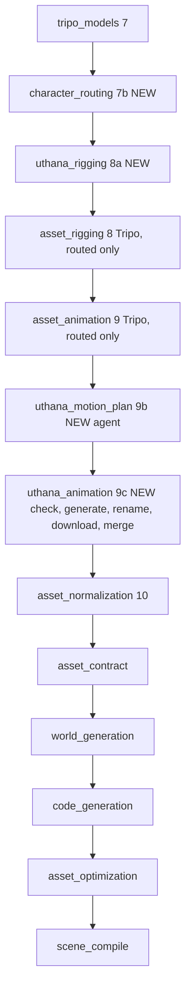
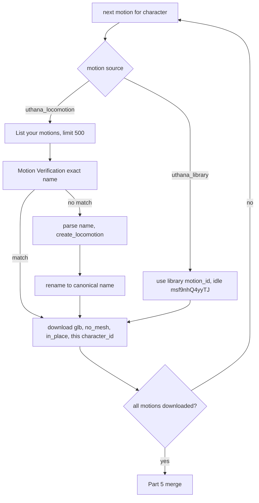

# Uthana Rigging and Animation for Characters (Parts 0-5)

## What the research found (these drive the design)

- **Engine bug, blocks animation:** [GltfSkinnedLoad.cpp](engine/runtime/src/render/GltfSkinnedLoad.cpp) (lines 161-172) folds non-joint ancestors into the root joint's bind pose, but [`parse_animations`](engine/runtime/src/render/GltfSkinnedLoad.cpp) (lines 235-296) copies keyframes verbatim. Real Uthana GLBs (`Sequential_Runs/Uthana_R_A/*.glb`) have a non-joint `Armature` node (rotation 90 deg about X, scale 0.01) above `Hips`. Animated `Hips` keys are in centimetres, in Armature-local axes, so every Uthana clip would render about 100x too big and rotated.
  - `ptv_glb_optimize` reuses the same loader ([glb_optimize.cpp](engine/tools/glb_optimize.cpp) lines 496-600), so every LOD inherits the bug.
  - It never surfaced because the Uthana test avatar used `leg_animation: false`.
- **Why Uthana characters float:** the bind pose has `Hips` at the origin. The in-place clip's `Hips` translation keys put the hips about 0.93 m up along Armature-local -Z (world +Y). So clips use a feet-at-origin convention, while the engine snaps the NPC origin to half its height above the ground ([CharacterLocomotionMechanic.cpp](engine/runtime/src/mechanics/builtin/character_locomotion/CharacterLocomotionMechanic.cpp) line 162). The correction must be expressed in the Hips parent's local axes, not as a raw "Y" subtraction.
- **Uthana dedupe:** "uploading the same file twice returns the first character_id", so the rig flags of the first upload win. The rigged GLB on disk was requested with `feet_on_floor=True` yet has its hips at the origin. The pipeline therefore measures and normalises the origin itself and never assumes either convention.
- **No idle in Uthana locomotion.** `LocomotionClipSelector` calls `play_clip("idle")` every frame. When that clip is missing, the call fails and the walk clip keeps cycling in place ([LocomotionClipSelector.h](engine/runtime/src/mechanics/builtin/LocomotionClipSelector.h) lines 139-163).
  - **Fix:** every Uthana-animated character (NPC or player avatar) gets the **same existing idle motion in your Uthana organisation, `motion_id = msf9nhQ4yyTJ`**. Part 4 downloads it with that character's own `character_id`, so Uthana retargets it on download.
  - Nothing is generated for idle, and no new motion API is used.
  - The engine also gains a "no idle clip -> fade to rest" safety net for any character whose idle download fails.
- **One-shot actions get overwritten:** the selector calls `play_clip(gait)` every frame, so a generated `play_clip(self, "attack", false)` is replaced on the next frame. This is fixed together with "punch while running" (gait variants).
- **Stride scales with the engine's resize.** The engine rescales the whole skeleton by `target_scale_meters / raw_longest_axis` ([GltfSkinnedLoad.cpp](engine/runtime/src/render/GltfSkinnedLoad.cpp) lines 511-515), and stride scales with it. Uthana's `move_speed` must therefore be `0.78 x` (walk) or `2.2 x` (run) of the **measured GLB height that Uthana animates** (Part 3A). The in-engine apparent speed is then `move_speed x scale`, and scene_compile writes that, not `0.78 x target`.
  - The engine scales by the LONGEST axis, which for some T-poses is the arm span. Part 3A reports this explicitly.
- **Billing:** Uthana is pay-as-you-go, billed per generated second, and downloads are unlimited. Your name-based reuse avoids re-paying for a motion, and download/retarget costs nothing, so the shared idle costs nothing per character.
- **Clip shape:** Uthana locomotion clips are 30 fps and loop with roughly a one-frame seam (at most 6.5 deg). Downloaded animations are unnamed, so the merge must write the motion name in.
- **Codegen blind spot:** the codegen agent never sees which clips an asset really has ([stage_code_generation.py](apps/orchestrator/ptv_orchestrator/pipeline/stage_code_generation.py) only receives `npc_plan_json`).

## New stage order

- [project_state.py](packages/schemas/ptv_schemas/project_state.py): add `character_routing`, `uthana_rigging`, `uthana_motion_plan`, `uthana_animation` to `ProjectStage`.
- [orchestrator.py](apps/orchestrator/ptv_orchestrator/pipeline/orchestrator.py): insert them into `_SHARED_STAGES` in the order above.
  - `uthana_rigging` runs BEFORE Tripo `asset_rigging`, so an avatar or NPC fallback to Tripo is picked up in the same run.
  - Existing projects resume at `character_routing` automatically, and the Tripo stages reuse their ledgers.
- Artifacts:
  - `character_routing.json` and `tripo_rig_check.json`
  - `uthana_rig.json`
  - `uthana_motion_plan.json`
  - `uthana_animation.json` (motion ledger)
  - `asset_animation.json`, shared with Tripo; Uthana entries add `provider: "uthana"`

## Shared foundations (built first, used by every Part)

- **Uthana provider client** `packages/provider-clients/ptv_providers/uthana_client.py`:
  - **Key loading:** `from dotenv import load_dotenv` on the repo `.env`, then `os.getenv("UTHANA_API_KEY")`. `Settings.uthana_api_key` is also accepted.
  - **Methods** (sync wrappers over the async `uthana>=0.5.1` SDK):
    - `create_character(path, name, flags)`: GraphQL multipart with all five auto-rig flags, the same mutation as [u_auto_rig.py](Sequential_Runs/Uthana_R_A/u_auto_rig.py).
    - `download_character`
    - `list_locomotion_styles`
    - `list_motions`
    - `get_motion`
    - `create_locomotion`
    - `rename_motion`
    - `download_motion` (`output_format="glb", no_mesh=True, in_place=True, fps=30`)
    - `is_download_allowed`
  - **Errors:** wraps `UthanaError` with the actionable messages from the docs: 30 MB limit, "Maximum number of characters reached", essential joints missing, auto-rig timeout.
  - Add `uthana>=0.5.1` to [provider-clients pyproject](packages/provider-clients/pyproject.toml). `python-dotenv` is already an orchestrator dependency; add it to provider-clients as well.
- **Animation catalog** `ptv_providers/animation_catalog.py`:
  - `TRIPO_BIPED_V1_PRESETS`: all 101 ids from [tripo_ani_list.md](Helper_Folder/Move_To_Uthana/tripo_ani_list.md).
  - `UTHANA_STYLES_FALLBACK`: from [uthana_ani_list.md](Helper_Folder/Move_To_Uthana/uthana_ani_list.md), used only if the live query fails.
  - `WALK_SPEED_PER_M = 0.78`, `RUN_SPEED_PER_M = 2.2`. A parity test parses [LocomotionClipSelector.h](engine/runtime/src/mechanics/builtin/LocomotionClipSelector.h) and [stage_scene_compile.py](apps/orchestrator/ptv_orchestrator/pipeline/stage_scene_compile.py) `_SPEED_PER_METER_OF_HEIGHT` to keep all three in sync.
- **Pure-stdlib glTF toolkit** `apps/orchestrator/ptv_orchestrator/pipeline/uthana/gltf_io.py`:
  - GLB read/write (JSON and BIN chunks, 4-byte alignment).
  - Accessor decode, including normalized ints, byteStride and sparse.
  - Node world matrices (TRS or `matrix`).
  - Skinning (`JOINTS_0`/`WEIGHTS_0`, inverse bind matrices; a skinned mesh's own node transform is ignored per spec).
  - Keyframe sampling (STEP, LINEAR with slerp, CUBICSPLINE) and FK at time t.
  - No numpy needed.
- **Settings** in [settings.py](apps/orchestrator/ptv_orchestrator/settings.py):
  - `uthana_api_key`, `uthana_enabled=True`
  - `uthana_avatar_min_confidence=0.20` (fall back when at or below this), `uthana_npc_min_confidence=0.20`
  - `uthana_locomotion_strides=5`, `uthana_motion_list_limit=500`
  - `uthana_idle_motion_id="msf9nhQ4yyTJ"` (the shared library idle; overridable from `.env` as `UTHANA_IDLE_MOTION_ID`)
  - `uthana_max_generated_seconds_per_run` (cost guard; counts generated locomotion only, since library downloads are free)
  - `character_routing_model/effort="gpt-5.6-sol"/"high"` (judgement plus cost)
  - `uthana_motion_plan_model/effort="gpt-5.6-sol"/"medium"` (output is constrained and validated deterministically)
  - `/health` gains `has_uthana_key`.
- **Schemas** (exported to `packages/schemas/json`):
  - `ptv_schemas/character_routing.py`:
    - `BodyPlan` enum: biped_humanoid, biped_non_humanoid, quadruped, hexapod, octopod, avian, serpentine, aquatic, non_creature.
    - `RigProvider` enum: uthana, tripo, none.
    - `MotionSource` enum: uthana_locomotion, uthana_library, tripo_preset, engine_procedural, none.
      - `uthana_library` means "an existing motion already in the Uthana organisation, referenced by `motion_id`". The idle `msf9nhQ4yyTJ` is the first one.
      - New sources are added as new enum values (see "Extension point" below).
    - `RequiredMotion`: key, kind, purpose, source, style_hint, tripo_preset, library_motion_id.
    - `CharacterRoute`, `CharacterRoutingPlan`.
  - `ptv_schemas/uthana_motion_plan.py`: `UthanaMotionSpec`, `UthanaCharacterMotionPlan`, `UthanaMotionPlan`.

## Part 1: Choosing Tripo vs Uthana (`character_routing`, new stage)

Files: `stage_character_routing.py` and `character_routing_agent.py`, cloned from [npc_plan_agent.py](apps/orchestrator/ptv_orchestrator/pipeline/npc_plan_agent.py) (lazy SDK import, capturing schema, retry with issues, injectable runner).

- **Candidates:** every `character` asset that is either
  - the player avatar (Full Player Avatar experience only), or
  - an NPC in [npc_plan.json](packages/schemas/ptv_schemas/npc_plan.py) with `movement_style != slide_no_animation` and non-empty `animation_intents`.
  Everything else is skipped, so props are never checked.
- **Player avatar:** always routed `rig_provider=uthana` by code, with no agent call. Motions: walk and run when `player_avatar.leg_animation` is true, plus the library idle (`msf9nhQ4yyTJ`).
- **Step A, context per NPC** (dynamic code builds one brief per NPC):
  - the `NpcSpec` (role, behaviors, `animation_intents`, locomotion speeds, notes);
  - the `AssetItem` (style_notes, `target_scale_meters`);
  - BuildSpec mechanics and summaries that mention the asset;
  - the verbatim `prompt.txt`;
  - the exact Gemini prompt, recomposed with `compose_prompt(item, resolve_pose(...))` from [stage_reference_images.py](apps/orchestrator/ptv_orchestrator/pipeline/stage_reference_images.py), plus the reference image itself (`images/<id>/*_ref_00.*`) as an image input, so the agent sees body shape directly (addition).
  - Also persist `images/<id>/reference_prompt.txt` from now on.
- **Step B, body type and Tripo riggability:**
  - Dynamic code runs Tripo `rig_check` (free) for every NPC candidate via `TripoClient.rig_check(task_id=...)` and caches it in `tripo_rig_check.json`. `asset_rigging` reuses it rather than calling again.
  - The agent classifies `BodyPlan` from the image and prompt. Rule: any upright two-legged character with two arms, a head and a torso is `biped_humanoid`, whether it is human or not (fish-man, alien, robot, Transformer-style car). A biped without arms (bird, T-rex) is `biped_non_humanoid`.
- **Step C, decision rules:**
  - **Code only:** `biped_humanoid` with `riggable=false` -> `rig_provider=uthana`. The agent is not consulted on the provider.
  - **Code only:** a non-humanoid that is riggable as quadruped, hexapod, octopod, avian, serpentine or aquatic (or `biped_non_humanoid` riggable as biped) -> `tripo`.
  - **Code only:** a non-humanoid that is not riggable -> `none` (stays static or slide; `animation_fallback` applies).
  - **Agent:** `biped_humanoid` with `riggable=true`. It follows your three steps:
    - list the motions this NPC needs, from behaviors and context;
    - check coverage against both libraries:
      - Tripo: the 101 v1.0 presets, provided as text.
      - Uthana: live `list_locomotion_styles()` gaits at any speed, plus exactly one library idle (`msf9nhQ4yyTJ`, always available). It provides no one-shot actions (attack, hurt, die, jump) in this update; those count as unmet for Uthana and go to `animation_fallback`.
    - pick the provider that covers all of them, or the most and best if neither covers everything.
  - Example: "stand still, then slowly crouch-walk" -> Uthana (`crouching`, `on_toes_crouching`). A boxer needing `box_01` and `hit_to_head` -> Tripo.
- **Output per character** (`CharacterRoute`):
  - `body_plan`, `tripo_rig_check`, `rig_provider`, `animation_provider`
  - `required_motions`, with each motion's `source`. Uthana gait variants use keys such as `run.punching`.
  - `unmet` motions, each with its `animation_fallback`
  - `rationale`
- **Deterministic validation:**
  - `tripo_preset` ids must be in `TRIPO_BIPED_V1_PRESETS`, at most 5 per asset.
  - Uthana style hints must be in the live list.
  - A Uthana-routed NPC cannot list Tripo-only actions as uthana-sourced.
  - Any Uthana-animated character whose motions include standing still (every NPC with `idle` behaviour, `guard_point`, `stationary` phases, and the player avatar) gets an `idle` entry with `source=uthana_library` and `library_motion_id=settings.uthana_idle_motion_id`. Code adds it if the agent omitted it; the agent never invents an idle.
- **Manifest reconcile:** `rigged=true` for routed characters. `animations` stays the semantic intent list for Tripo compatibility.
- **Tripo preset extension** in [tripo_client.py](packages/provider-clients/ptv_providers/tripo_client.py): `resolve_tripo_motions(required_motions, rig_type, model)`. Routed Tripo bipeds can then request any v1.0 preset (e.g. `preset:biped:box_01` under key `box_01`), not only the 13 intents. Creature rigs keep today's single-walk behaviour.

## Part 2: Uthana auto-rig (`uthana_rigging`, new stage)

- **Inputs:** routes with `rig_provider=uthana`.
- **Source file:** the un-rigged Tripo `model.glb`, reusing `_source_glb` from [stage_asset_rigging.py](apps/orchestrator/ptv_orchestrator/pipeline/stage_asset_rigging.py).
- **Upload** with `auto_rig=true`, `auto_rig_front_facing=true`, `include_fingers=true`, `auto_rig_strip_namespace=true`, `auto_rig_feet_on_floor=true`. Name: `"{project_id}__{asset_id}"`.
  - Pre-check the 30 MB limit. If over, upload a texture-downscaled copy and log it.
- **Download** with `client.characters.download(character_id, output_format="glb")` to `assets/<id>/model_uthana_rigged.glb`. The name contains "rigged", so [pick_primary_glb](apps/orchestrator/ptv_orchestrator/pipeline/stage_asset_normalize.py) already prefers it.
- **Pass the character_id on** to Part 3 through `uthana_rig.json`. That file also stores confidence, params, the source sha256, joint names, finger joints found, and the origin-normalisation offset.
- **Rig validation:**
  - required joints present: Hips, Spine, Head, both shoulders, arms, forearms, hands, up-legs, legs, feet, toes;
  - finger chains present (`*HandIndex1..3` etc.);
  - no `mixamorig:` prefix (strip check).
- **Bind origin normalisation (addition):** because dedupe may ignore `feet_on_floor`, measure the bind mesh world AABB. If its vertical centre is more than 3 cm off the origin, shift the `Hips` rest translation (in parent-local axes) so the origin is at the middle, matching Tripo and the engine. This also covers rig-only Uthana NPCs that never reach Part 5.
- **Fallback:**
  - Avatar with confidence at or below 0.20, or a failed upload: mark the route `fallback=tripo` with a loud warning (SSE warning, log, UI). Tripo `asset_rigging`/`asset_animation` then do rig + walk/run, without finger curls.
  - NPC (addition, same threshold): fall back to Tripo if its rig-check said riggable; otherwise `none`.
- **Idempotency:** the ledger is keyed by source sha256, so a Resume never re-uploads.
- **Tripo stages:** [stage_asset_rigging.py](apps/orchestrator/ptv_orchestrator/pipeline/stage_asset_rigging.py) and [stage_asset_animation.py](apps/orchestrator/ptv_orchestrator/pipeline/stage_asset_animation.py) skip Uthana-routed assets unless they are marked `fallback=tripo`. `asset_rigging` reuses cached rig-checks. `asset_animation` uses `resolve_tripo_motions` for routed presets.

## Part 3A: Uthana-rigged GLB height measurement

`pipeline/uthana/glb_measure.py`, PEP 8 and stdlib only, with a CLI (`python -m ptv_orchestrator.pipeline.uthana.glb_measure <glb> [--expected-target 1.8]`). A standalone copy goes in `Sequential_Runs/Uthana_R_A/measure_rigged_height.py`. No API calls.

- **Load and resolve:** load the GLB, resolve node world transforms through `Armature` (scale 0.01, rotation 90 deg X), and skin the bind vertices: `v = sum(w_i * J_i_world * IBM_i * v)`.
- **Prints:**
  - bind raw POSITION span and longest axis (exactly what the engine normalises by);
  - world mesh AABB height in metres (primary);
  - skeleton toe-to-head height (lowest toe/foot joint vs head end, or head + 0.06h);
  - axis of the longest extent;
  - in-engine body scale `target / raw_longest` and resulting in-engine height;
  - comparison against `--expected-target`.
- **Recommended agent input:** `height_for_motion_m` = the world mesh AABB height of the Uthana-rigged GLB, since Uthana animates at that size. `engine_scale` is also given, so the agent and scene_compile can derive in-engine speeds.
- **Fails loudly** when there is no mesh or skin, no joints, unresolvable transforms, or a non-finite result.
- The stage writes results into `uthana_motion_plan.json` inputs.

## Part 3B: Motion planning agent (`uthana_motion_plan`, new stage)

Files: `stage_uthana_motion_plan.py` and `uthana_motion_agent.py` (same agent pattern).

- **Step 1, query styles and decide parameters.** The agent receives:
  - the `CharacterRoute` and `required_motions`;
  - `NpcSpec` (behaviors, gameplay `walk_speed_mps`/`run_speed_mps`), or the avatar spec;
  - the Part 3A heights;
  - the live `list_locomotion_styles()` result, fetched by dynamic code and given to the agent.
- **Output per motion** (`UthanaMotionSpec`): `key` (`walk`, `run`, or a variant such as `run.punching`), `kind`, `style_id`, `strides`, `move_speed`, `travel_angle`, `motion_name`.
  - `kind` is a `MotionSource` value. The agent only plans `uthana_locomotion` motions.
  - **Idle is not planned by the agent.** After the agent returns, code appends `{key: "idle", kind: "uthana_library", motion_id: settings.uthana_idle_motion_id}` to every Uthana-animated character (NPC or avatar) that needs one. Its `motion_name` is read once from `get_motion("msf9nhQ4yyTJ")`, so the clip keeps its real name.
- **System prompt rules:**
  - the parameter semantics you described, character_id excluded;
  - `strides=5` (configurable; a longer clip gives a smoother loop);
  - `travel_angle=0`;
  - walk = 0.78 x `height_for_motion_m`, run = 2.2 x it;
  - the zombie / tall-zombie worked example verbatim;
  - style choice from character identity (e.g. `neutral_male_a` vs `neutral_female_a` vs `zombie`);
  - variant gaits (`punching`, `kicking`, `pistol_*`, `rifle_*`, `holding_sword`) only when the NPC acts while moving;
  - the name format `style-str{N}-ms{speed}-deg{angle}`;
  - idle is supplied automatically from the library and must not be planned;
  - one-shot actions are out of scope for Uthana in this update: list them as unmet so `animation_fallback` applies.
- **Deterministic validation and correction:**
  - `style_id` must be in the live list (case-insensitive, normalised to lowercase);
  - `strides` in 1-5;
  - `move_speed` recomputed from the factor and height; the agent's value is replaced if it is off by more than 5%;
  - speed clamped to 0.25-8.0 with a warning (e.g. run for a 4 m giant);
  - speed rounded to 1 decimal, so names are canonical and reuse works;
  - locomotion names must match `^[a-z0-9_]+-str[1-5]-ms\d+(\.\d)?-deg-?\d+$`;
  - any agent-planned `idle` entry is dropped and replaced by the library idle;
  - the library idle id must exist: `get_motion(msf9nhQ4yyTJ)` is checked once here. If it is missing, the stage fails with "set UTHANA_IDLE_MOTION_ID to an existing idle motion in your organisation".
- **No generation happens in this stage.** Its only API calls are the style query and the idle-id check.
- **Engine separation (your "extra important information"):** body travel speed stays `walk_speed_mps`/`run_speed_mps` from the NPC plan. Which clip plays comes from the gait key. Engine support is described under "Engine changes" below.

## Parts 3B steps 2-4 and Part 4: build loop (`uthana_animation`, new stage)

Module `pipeline/uthana/motion_library.py`, with standalone wrappers in `Sequential_Runs/Uthana_R_A/` (`list_motions_500.py`, `motion_verification.py`).

- **Motion-source resolvers (the structure that keeps this extensible).** `motion_library.py` defines one resolver per `MotionSource`, each with the same contract: `resolve(spec, character_id) -> motion_id`. Part 4 (download) and Part 5 (merge) only ever see a `motion_id`, so they never care where a motion came from.
  - `uthana_locomotion` resolver: the list -> verify -> generate -> rename flow below.
  - `uthana_library` resolver: returns `spec.motion_id` directly (idle = `msf9nhQ4yyTJ`). It skips list, verification, generation and renaming, and costs nothing.
- **List your motions:** `motions = list_motions(); motions[:500]`. Prints id and name, and warns when the org has more than 500 motions. Cached per stage run and refreshed after each create.
- **Motion Verification:** takes `style-strN-msX-degY` and returns `match found: <name> <id>` or `no match is found in the Uthana Organization`. The match is exact.
- **On a match:** pass `motion_id` and `character_id` straight to download. Retarget-on-download makes it valid for this character.
- **On no match:**
  - `parse_motion_name()` maps strN -> `strides`, msX -> `move_speed`, the style -> `style_id`, degY -> `travel_angle`, plus `character_id`;
  - call `create_locomotion(...)`;
  - wait for the returned `motion_id`, then `rename_motion(motion_id, name)`, verified with `get_motion`.
- **Download** (Part 4) with exactly `output_format="glb", no_mesh=True, in_place=True` (plus `fps=30`) to `assets/<id>/uthana_motions/<motion_name>.glb`. `is_download_allowed` runs first for legacy-plan accounts.
- **Idle download (every Uthana-animated NPC and player avatar):** the same Part 4 call with
  - `CHARACTER_ID` = that asset's own `character_id` from `uthana_rig.json` (the Uthana-rigged NPC or player body), so the idle is retargeted to that skeleton;
  - `MOTION_ID = "msf9nhQ4yyTJ"`;
  - `output_format="glb"`, `no_mesh=True`, `in_place=True`.
  - Saved as `assets/<id>/uthana_motions/<idle motion name>.glb`.
  - Every character downloads its own copy, because the retarget is per character. The file is never shared between assets.
- **Completion gate:** loop Part 3 to Part 4 for every motion of a character, the idle included. Part 5 runs only when every required motion's file exists and validates. Otherwise the character stays rigged-only and the gap is reported.
- **Ledger and costs:**
  - `uthana_animation.json` records per motion: name, id, `source` (`created`, `reused`, or `library`), source character and height, download path and sha256.
  - It also records generated seconds against `uthana_max_generated_seconds_per_run`.
  - Resume never re-creates or re-downloads.
- **Measured clip speed (addition):** `clip_analysis.measure_ground_speed()` takes the stance-foot backward velocity in the in-place clip, in GLB metres per second. This keeps engine playback correct even when a motion was created for a different-height character and reused by name (as in your tall-zombie example). It falls back to the requested `move_speed`. Idle has no ground speed and gets none.

### Extension point for future action motions

This update ships two sources (`uthana_locomotion` and `uthana_library`). A later update can give NPCs and avatars any motion that can be described in words (an attack, a roundhouse kick, a wave, a death) by adding exactly four things, with no changes to Parts 4 or 5 or to the engine:

- a new `MotionSource` value, plus the fields that source needs on `RequiredMotion`/`UthanaMotionSpec`;
- one resolver in `motion_library.py` honouring `resolve(spec, character_id) -> motion_id`, plus its naming convention so Motion Verification can reuse it org-wide;
- a routing-agent and motion-plan-agent prompt section declaring what that source can cover, which turns today's "unmet" actions into covered ones;
- a key convention in the `animations` map (e.g. `attack`, `kick_roundhouse`), which generated C++ already plays through `play_clip` and the E4 action lock.

The current code paths are written against this contract from day one, so the future update slots in without reworking Parts 1-5.

## Part 5: Merge into one animated GLB

Module `pipeline/uthana/glb_merge.py`, with a CLI and a standalone wrapper.

- **Base:** load `model_uthana_rigged.glb` (already origin-normalised in Part 2).
- **For each motion GLB:**
  - copy every sampler's input/output accessors, with their bufferViews and bytes, into the base BIN (aligned);
  - set the input accessor min/max, as the glTF spec requires;
  - re-point each channel to the base node with the same name; skip and warn on unmatched names and non-joint nodes;
  - set `animation.name` to the exact motion name (no remapping to intents).
- **Hips correction**, one constant per character applied to every clip:
  - `k_world = bind_lowest_toe_y - median(per-clip minimum lowest-toe world y)`;
  - convert to the Hips parent's local frame: `delta_local = inverse(linear(parent_world)) * (0, k_world, 0)`, which handles the 0.01 scale and the 90 deg rotation;
  - add `delta_local` to every `Hips` translation key value (CUBICSPLINE: values only, not tangents);
  - result: idle, walk and run share the same feet. This includes the library idle, which is downloaded in place and retargeted like any other Uthana motion.
- **Validation:**
  - frame 0 lowest toe within 3 cm of `-h/2` (plus the bind toe height above the sole);
  - clip feet vs bind feet within 3 cm;
  - loop seam reported for every clip.
  - Any looping clip whose seam exceeds the threshold (idle in particular) gets a 0.25 s tail-to-head crossfade so it loops without a pop (addition).
  - The idle clip keeps its real Uthana name, read from `get_motion`, and is mapped as `idle -> <that name>`.
- **Save** as `{source_name}_animated.glb`, i.e. `model_animated.glb`, which `pick_primary_glb` prefers.
- **Write the `asset_animation.json` entry**, the same way the Tripo path does:
  - `status: animated`, `provider: uthana`, `character_id`;
  - `animations` mapping intent/key to clip name (e.g. `idle -> <name of msf9nhQ4yyTJ>`, `walk -> zombie-str5-ms1.4-deg0`, `run.punching -> punching-str5-ms4.1-deg0`);
  - `clip_speeds` with requested, measured and height values;
  - `hips_offset_m` and the validation results.
  - [stage_asset_normalize.py](apps/orchestrator/ptv_orchestrator/pipeline/stage_asset_normalize.py) already forwards `animations` into scene.json unchanged.

## Engine changes (C++)

- **E1, ancestor bake.** In `load_skeleton`, keep a per-root-joint prefix matrix of the folded non-joint ancestors. In `parse_animations`, transform that root joint's keys: translation `t -> p_t + s_p * R_p * t`, rotation `q -> R_p * q`, scale `s -> s_p * s`. This is exact for uniform-scale ancestors; for non-uniform ones, log a warning.
  - It fixes both the runtime and `ptv_glb_optimize`, which writes the baked keys into every LOD.
  - Smoke test: a synthetic Armature (0.01 scale, 90 deg X) animated root, frame 0 world == bind world.
- **E2, gait variants** in `CLocomotionIntent` ([World.h](engine/runtime/include/ptv/ecs/World.h)): add `std::string gait_variant` as the LAST member.
  - The selector tries `"<gait>.<variant>"` (e.g. `run.punching`) and falls back to `run`.
  - The reference speed is read from `animation_speeds` for the variant key.
  - The body still moves at `run_speed_mps`.
- **E3, missing idle** in [LocomotionClipSelector.h](engine/runtime/src/mechanics/builtin/LocomotionClipSelector.h): Idle with no `idle` clip -> `stop_clip` with a fade to rest (bind pose), never the walk clip cycling in place. Uthana characters normally have the library idle; this is the safety net if its download failed, and it also covers Tripo creatures, which ship without an idle.
- **E4, action lock:** the selector does not replace a non-looping clip that is still playing (`!clip_finished`). One-shot `attack`, `hurt` and `die` then play out. The rate is still updated after the clip ends.
- **E5, foot offset (addition):**
  - scene_compile writes `mesh.foot_offset_m` (origin-to-sole distance from the normalisation report, scaled);
  - `snap_to_ground` uses it instead of `0.5 * height`, removing a few cm of float or sink for asymmetric meshes;
  - SceneLoader parses it.
- **avatar_body:** with E3, a standing player uses idle or rest. It needs no other change, because its sole comes from the bind pose, which Part 2/5 keep consistent with the clips.
- **Smoke tests** for E1-E5, and loading the merged fixture GLB.

## Downstream stage, prompt and context updates

- **scene_compile** [_animation_reference_speeds](apps/orchestrator/ptv_orchestrator/pipeline/stage_scene_compile.py):
  - prefer recorded `clip_speeds` (measured or requested, times engine scale) for every key, including variants;
  - fall back to the 0.78/2.2 height factors for Tripo;
  - write `foot_offset_m`.
- **asset_optimization:** verify that Uthana skinned assets with 52+ joints keep all clips through decimation (after E1), by asserting the clip count matches the source.
- **code_generation:**
  - add an `animation_inventory` (per asset: provider, available keys, variants, missing actions) to the static context;
  - [prompts.py](apps/orchestrator/ptv_orchestrator/pipeline/prompts.py) CODE_TASK documents:
    - `want.gait_variant = "punching"`;
    - the one-shot action lock;
    - that a Uthana NPC has `idle` plus its locomotion keys but no attack/hurt/die clips, so check the `play_clip` return value and apply `animation_fallback`.
- **NPC_PLAN prompt:** describe gait character in `notes` (shamble, strut, crouch) so routing can pick a style. The schema is unchanged.
- **ASSET_MANIFEST prompt:** the avatar is rigged by Uthana with fingers and animated walk/run/idle; NPC rigging decisions now happen after modelling.
- **New-stage docs:** prompts for the two new agents live in `prompts.py` as `CHARACTER_ROUTING_SYSTEM` and `UTHANA_MOTION_PLAN_SYSTEM`.

## UI, docs and wiring

- [stages.ts](apps/web/src/lib/stages.ts): four new stages with step numbers, groups, cost labels ("Uthana per generated second; reuse is free") and blurbs. The parity test in `test_ui_stage_parity.py` is updated.
- **Docs:**
  - new `docs/uthana.md`: pipeline, naming convention, the motion-source resolver contract and how to add a source, the shared idle `msf9nhQ4yyTJ` and how to replace it with `UTHANA_IDLE_MOTION_ID`, the origin contract, costs, troubleshooting;
  - updates to [npc-and-ai.md](docs/npc-and-ai.md), [provider-setup.md](docs/provider-setup.md) (`UTHANA_API_KEY`), [AGENTS.md](AGENTS.md) (pipeline order), and [run-lifecycle.md](docs/run-lifecycle.md);
  - stage READMEs `07b_character_routing`, `08a_uthana_rigging`, `09b_uthana_motion_plan`, `09c_uthana_animation`, for both PC VR and Quest.

## Holistic contracts (checked across all Parts)

- **One provider per asset.** A fallback deletes the other provider's files so `pick_primary_glb` cannot mix rigs.
- **Origin = middle of the character** for bind and every clip, in Part 2 and Part 5. Engine snap uses `foot_offset_m`.
- **Speed chain:** `move_speed` is relative to the GLB height; engine `animation_speeds = speed x engine_scale`; the playback-rate clamp is 0.8-1.25.
- **Idle:** every Uthana-animated character has `idle` = the library motion `msf9nhQ4yyTJ`, downloaded with its own `character_id`. It is never generated, and it uses the same Hips offset as that character's other clips.
- **Motion sources:** Parts 4 and 5 consume only `motion_id`s produced by resolvers. Adding a source never touches download, merge or the engine.
- **Names:** clip name = Uthana motion name; key -> clip mapping lives in `asset_animation.json`; generated C++ uses keys only.
- **Hands Only games** skip the avatar entirely.
- **No Uthana key:** the Uthana stages succeed as "disabled", and everything routes to Tripo (avatar without fingers), with a warning.

## Verification

- **Python tests**, with a fake Uthana client and no network:
  - routing rules (deterministic branches plus a stubbed agent);
  - name format/parse round trip;
  - verification exact match;
  - the generate -> rename ordering;
  - download parameters asserted;
  - idle: every Uthana-animated NPC and the avatar download `msf9nhQ4yyTJ` with their own `character_id`; no list, verify, generate or rename call is made for idle; an agent-planned idle is replaced; a missing idle id fails with the clear message;
  - the completion gate;
  - avatar 0.20 fallback;
  - ledger idempotency;
  - Part 3A against `Sequential_Runs/Uthana_R_A/rigged_character.glb`, copied as a fixture;
  - Part 5 merge on the rigged fixture plus `motion-only.glb`: name set, channels re-pointed, toes within 3 cm of `-h/2`.
- **C++:** smoke tests for E1-E5; full ctest.
- **End to end:**
  - re-run `projects/20260907-144543-shooting-range-game` from `character_routing`: the avatar gets Uthana rig + walk/run + the library idle;
  - run the alien-shooter project (biped humanoid `alien_grunt_enemy`) through routing;
  - build the Quest APK. On-device check: fingers curl on the avatar, legs walk with feet on the floor, NPCs idle without moonwalking, and nothing floats.
