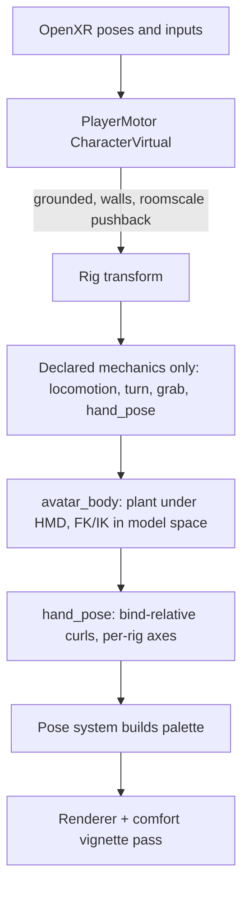

# VR Engine Player Overhaul

## Root causes found (evidence from the code, not guesses)

- **White box underfoot** - the meshless `__player` capsule (`Application::create_player_body`, tag `player`) falls through `VisualTagTable` to the grey placeholder cube in [Renderer.cpp](engine/runtime/src/render/Renderer.cpp) (~2132). Meshless `player_rig` / `player_hand_*` scene entities can hit the same path.
- **Body left behind / offset / 90 degrees** - `plant_on_rig` in [AvatarBodyMechanic.cpp](engine/runtime/src/mechanics/builtin/avatar_body/AvatarBodyMechanic.cpp) puts the body at `ctx.locomotion->position()` (stage origin) with rig yaw only. Physical walking moves the HMD, never the body. No correction for the GLB's own forward axis (glTF +Z / arbitrary vs OpenXR -Z).
- **Arms flailing with still controllers** - `apply_bone_rotation` writes a WORLD delta as a LOCAL rotation, and `joint_world` reads last frame's palette. The "from" direction comes from last frame's solved pose, so frames alternate between solved and near-identity: a two-frame oscillation. `drive_head` has the same replace-local bug.
- **Finger bugs 3.1-3.4** - `HandPoseMechanic::apply` calls `set_joint_rotation(joint, angleAxis(...))`, REPLACING each joint's bind rotation, with hard-coded X/Y axes and a left-hand sign flip that only fit the procedural `make_hand_fixture.py` hands. Any real rig bends backward or sideways. Thumb uses thumbrest/face buttons because `/input/thumbstick/touch` is never bound in [XrSession.cpp](engine/runtime/src/xr/XrSession.cpp).
- **Duplicate teleport / snap / menus** - `Application::ensure_player_locomotion_bindings()` (~838) injects teleport, both slides, snap turn, hand_pose, avatar_body whenever the exact builtin id is absent, blind to `generated.*` copies. Builtin teleport arms on stick magnitude; the generated one arms on forward Y, so straight-forward shows two arcs. The startup menu is on because `locomotion_menu` defaults to `true` in [SceneLoader.cpp](engine/runtime/src/scene/SceneLoader.cpp) (line 87).
- **Black flicker** - `generated.snap_turn` draws a black `ctx.draw->marker` in front of the head; the injected builtin snap has no latch, so holding keeps turning without blink.
- **Climbing into the air** - `LocomotionService::translate` adds whatever Y `slide_character` returns into `rig_.pos_y`; no gravity, no ground snap. The generated head slide sweeps twice and forwards Y.
- **Walls pass-through from behind/side** - walls are solid 0.45 m boxes. The player capsule is teleported to the HMD via `move_kinematic` with no sweep; `slide_character` fails open (`return delta`) when wedged ([PhysicsWorld.cpp](engine/runtime/src/physics/PhysicsWorld.cpp) ~689).
- **Random giant guns** - NOT LOD bounds (LODs match within 0.1%). [WorldGen.cpp](engine/worldgen/src/WorldGen.cpp) (~207) hard-codes `target_scale_meters: 1.0` for `place_object`; scene_compile keeps it; the world ALSO placed `training_pistol` / `training_rifle` / racks that duplicate scene_spec's 0.24 / 0.78 copies; `Renderer::request_stream` caches GPU meshes by path only, so whichever scale streams first wins.
- **Guns upside down when grabbed (4.1)** - `grip_hold_from_socket` in [GrabMechanic.cpp](engine/runtime/src/mechanics/builtin/grab/GrabMechanic.cpp) maps the socket frame (+Z = barrel, per `glb_sockets.cpp`) directly onto the OpenXR grip frame (-Z = forward), with no convention conversion or aim-pose alignment. This is my likely root cause, to confirm with a test.
- **Only center guns grabbable (4.5)** - the world copies carry the `grabbable` tag but no bindings.
- Equip-slot / asset-contract plan (file 4) is already implemented (`EquipSlotSpec`, `SceneLoader` `equip_slots`, audio reconcile, board fingerprint); this plan builds on it.

## Frame order after the overhaul

## WS1 - Skeleton and input foundations (engine)

- [MechanicContext.h](engine/runtime/include/ptv/api/MechanicContext.h) `ISkeleton`: add `joint_bind_local(entity, j)`, `joint_bind_model(entity, j)`, `evaluate_model(entity, j)` (fresh FK from the CURRENT local pose, not the stale palette), `set_joint_local_rotation_relative_to_bind(entity, j, q)`. Implement in `SkeletonService` (Application.cpp ~2460) and [Skeleton.cpp](engine/runtime/src/ecs/Skeleton.cpp); account for entity scale.
- Input: bind `/input/thumbstick/touch`, `/input/a|b|x|y/touch` for `oculus/touch_controller` and `meta/touch_controller_plus`; add `thumbstick_touched` and face-touch fields to [InputSnapshot.h](engine/runtime/include/ptv/api/InputSnapshot.h).
- New `HandRig` analyzer (`engine/runtime/src/animation/HandRig.{h,cpp}`): per hand, resolve finger chains via [BodySlots.cpp](engine/runtime/src/animation/BodySlots.cpp) names, falling back to topology/geometry (5 chains off the wrist; thumb = chain off the palm plane). Compute the palm normal from wrist / index1 / pinky1 with handedness, then a per-joint local curl axis = `cross(bone_dir, palm_normal)` in joint-local space, a thumb adduction axis toward index1, and a wrist-to-grip alignment quaternion. Works for Mixamo, Tripo, any future full-finger rig, and the default hand.

## WS2 - Player motor: grounded, collides from every direction

- Replace the custom capsule sweep with Jolt `JPH::CharacterVirtual` in [PhysicsWorld.cpp](engine/runtime/src/physics/PhysicsWorld.cpp): `ExtendedUpdate` (stick-to-floor, walk-stairs, 50 deg max slope), gravity, `EBackFaceMode::CollideWithBackFaces`, penetration recovery. Remove fail-open.
- Each frame, desired motion = roomscale HMD XZ delta + stick delta. Any blocked HMD portion is pushed back onto the rig, so the head/body can never enter a wall from any angle. Capsule height follows real head height (crouch).
- `ILocomotion`: `translate()` becomes horizontal-only by contract. Add `move_horizontal`, `is_grounded`, `jump(v)`, `set_vertical_mode(Grounded|Free)`, so jump and fly stay possible but only when a mechanic asks.
- Hide `__player`, `player_rig`, locomotion hosts: add `player`, `player_rig`, `player_system` to hidden-when-meshless in [VisualTagTable.cpp](engine/runtime/src/render/VisualTagTable.cpp). scene_compile tags meshless player entities `player_system`.

## WS3 - No hidden mechanics; one owner per role

### Built-ins vs roles (terminology)

- A **built-in** is concrete C++ code registered with `PTV_REGISTER_MECHANIC` (for example `builtin.hand_pose`). It is what `scene.json` binds and what runs every frame.
- A **role** is a job slot, not code: "the one thing in this game that does X". It exists only so the pipeline can check that at most one mechanic does each job. A role is filled either by its stock built-in or by a generated replacement (`builtin+config_code_edit` inherits its base built-in's role and REPLACES it; the stock built-in is then not added).
- Roles use a `role:` prefix so they can never be mistaken for mechanic ids.

### Role registry

Declared in [engine_catalog.py](apps/orchestrator/ptv_orchestrator/engine_catalog.py). Host entity = the entity whose `mechanic_bindings` list carries the binding.

- `role:fingers` - filled by `builtin.hand_pose`. Curls whichever hands the player has: the default rigged hands in Hands Only, or the avatar's own finger bones in Full Player Avatar. Host: `player_rig`.
- `role:body` - filled by `builtin.avatar_body`. Plants and poses the player's full avatar body. Host: the `player_avatar` entity (the avatar GLB), matching the existing `bind_avatar_body` in [stage_scene_compile.py](apps/orchestrator/ptv_orchestrator/pipeline/stage_scene_compile.py). Never `player_rig`.
- `role:teleport` - `builtin.locomotion.teleport`. Host: `player_rig`.
- `role:slide_head` - `builtin.locomotion.slide.head_relative`. Host: `player_rig`.
- `role:slide_controller` - `builtin.locomotion.slide.controller_relative`. Host: `player_rig`.
- `role:snap_turn` - `builtin.locomotion.snap_turn`. Host: `player_rig`.
- `role:smooth_turn` - `builtin.locomotion.smooth_turn` (new). Host: `player_rig`.
- `role:movement_settings_menu` - `builtin.movement_settings_menu` (new; replaces the hardcoded startup locomotion menu). Host: `player_rig`.

### What gets added to every game, and what depends on the prompt

Nothing about movement is assumed. The BuildSpec `movement` block (WS12) is the single source of truth, decided from the prompt and its context. The reconcile adds exactly what it says:

- **Always, every game:** `role:fingers` (`builtin.hand_pose`). Both experience modes have controllable hands.
- **By experience choice:** `role:body` (`builtin.avatar_body`) only in Full Player Avatar; never in Hands Only.
- **Locomotion, from `movement.modes`** (a list that may be EMPTY): one role per listed mode (`teleport`, `slide_head`, `slide_controller`). Empty means a stationary game: no teleport, no slide.
- **Turning, from `movement.turning`** (may be EMPTY): `snap` and/or `smooth`. When both are listed, the default comes from `movement.default_turn` and the player can switch in the settings menu.
- **Settings menu, from `movement.settings_menu`:** added when the prompt asks for a settings/comfort menu, or when the game offers more than one locomotion mode or more than one turn mode to choose between. It shows only the options that exist in that game, so a stationary bow game shows just "Turning: Snap / Smooth" (plus the vignette toggle for smooth turning if requested).
- **Vignette:** never its own built-in. It is `vignette.enabled` on the slide and smooth-turn bindings, `false` unless the prompt requests comfort settings.

Examples the pipeline must handle:

- Beat Saber style: `modes: []`, `turning: []`, `settings_menu: false`. Only `builtin.hand_pose` is bound. The player still moves physically in their playspace (WS2 motor keeps them grounded and out of walls).
- "Stationary bow game, choose snap or smooth turn in the Settings Menu": `modes: []`, `turning: [snap, smooth]`, `settings_menu: true`. Binds hand_pose, snap_turn, smooth_turn, movement_settings_menu. No teleport or slide.
- The same bow game with "teleport only": `modes: [teleport]`, same turning. Adds teleport; the menu still offers only turning because there is one locomotion mode.
- Prompt says nothing about movement in a game that clearly involves travelling: default `modes: [teleport, slide_head, slide_controller]`, `turning: [snap]`, `settings_menu: true`.

### Engine changes

- Delete `ensure_player_locomotion_bindings` injection (Application.cpp ~838) and the Application-hardcoded startup menu; `locomotion_menu` defaults to `false` in [SceneLoader.cpp](engine/runtime/src/scene/SceneLoader.cpp).
- A scene with a player and no locomotion or turning bindings is a VALID stationary game. The engine logs no error and no warning for it.
- Runtime guard: if two bound mechanics claim the same role, log once naming both (defence in depth; the pipeline should already have failed).

### Pipeline changes

- Deterministic reconcile in `stage_mechanic_plan.py`, driven by the BuildSpec `movement` block and the experience choice:
  - add each required role's stock built-in to `mechanic_plan.json` when no plan item fills that role;
  - collapse duplicates per role (a generated replacement wins over its base built-in);
  - REMOVE locomotion/turning items the BuildSpec does not allow (for example an LLM-planned teleport in a stationary game), logging why.
- `stage_scene_compile.py`: binds each planned role onto its host entity above, and hard-fails if any role is bound more than once anywhere in the scene (counted across ALL entities, not just `player_rig`), or if a bound locomotion/turning role contradicts the BuildSpec `movement` block.

### Built-in updates

- teleport ([TeleportMechanic.cpp](engine/runtime/src/mechanics/builtin/teleport/TeleportMechanic.cpp), [TeleportArc.cpp](engine/runtime/src/mechanics/builtin/teleport/TeleportArc.cpp)): arms only inside a forward cone (y > 0.5, within about 35 degrees). Aim-pose pitch maps monotonically to distance (up = farther, down = closer, clamped at 45 degrees, `max_range_m` param). No fade.
- snap turn ([SnapTurnMechanic.cpp](engine/runtime/src/mechanics/builtin/snap_turn/SnapTurnMechanic.cpp)): one snap per flick (re-arm below 0.3), never a blink.
- NEW `builtin.locomotion.smooth_turn` with deadzone and speed.
- NEW `builtin.movement_settings_menu` (panel on a configurable button). Sections are generated from what the scene actually binds: locomotion mode (only if 2+ modes), turn mode (only if both snap and smooth), vignette toggles (only while a slide mode or smooth turn is active, and only if the prompt enabled vignette options). A game with nothing to choose never gets the menu.
- Turn-mode gating (`ILocomotion::turn_mode()`), mirroring `active_mode`, so only the selected turn mechanic reacts to the right stick.

## WS4 - Comfort vignette per Meta guidance (only when requested)

- New `IComfort` service (`ctx.comfort->request_vignette(strength)`), aggregated per frame.
- Renderer: per-eye fullscreen pass after the scene, defined in DEGREES (inner FOV + feather) from the view ray vs eye forward, so it looks the same on any headset. Driven by linear speed, angular speed and acceleration; fades out after motion stops with a short wait (matches Meta `LocomotionTunneling` / IWSDK guidance).
- Slide and smooth-turn builtins take `vignette: {enabled:false, strength, inner_fov_deg, feather_deg}`. Snap turn and teleport never use it. `player.comfort` string removed in favour of these params.

## WS5 - Default rigged hands (Hands Only) and delete the old hands

- New build tool `engine/tools/prepare_default_hands.py`: reads [default_rigged_hand_model.glb](Default_Models/default_rigged_hand_model.glb) (single hand, `Bone.0xx` names, armature S=100 / -90 deg X; finger layout suggests a RIGHT hand, and the tool verifies it). It bakes the transforms, renames joints to canonical BodySlots names (`hand_r`, `thumb_01_r`...), orients to the grip frame, and writes `default_hand_right.glb` plus a mirrored `default_hand_left.glb` (negate X, flip winding, mirror joints and inverse-bind matrices).
- Wire it into [engine/runtime/CMakeLists.txt](engine/runtime/CMakeLists.txt) (~95-130) and `_package_engine_assets` in [stage_quest_build.py](apps/orchestrator/ptv_orchestrator/pipeline/stage_quest_build.py). Delete `engine/tools/make_hand_fixture.py` and every reference (docs, HandPose comments). Keep `make_rigged_fixture.py` (skinning tests).
- scene.json `player.hands: {source: "default" | "avatar"}`. `create_hand_entities` loads default hands only for `default`. For `avatar` it creates meshless hand anchors, so grab still works and no second pair of hands ever appears.

## WS6 - hand_pose rewrite (Problems 3.1-3.4 for default hands AND any finger-rigged avatar)

### The issue this replaces (from the Uthana test)

The restored [HandPoseMechanic.cpp](engine/runtime/src/mechanics/builtin/hand_pose/HandPoseMechanic.cpp) only curls `ctx.hands->hand_entity(h)`, the engine's own hand models (lines ~118-155). When a finger-rigged avatar is the player's body, those models are hidden and the avatar's real fingers are never touched, so they stay frozen. The test-time patch "also curl the avatar when `index_1_l` / `index_1_r` resolve" kept driving hidden hands, found the avatar by a tag search, latched resolution once, reused the wrong curl math, and left the thumb on thumbrest/face buttons.

Note: that issue description assumed body, head and arm IK already worked. The on-device findings show they did not (see root causes); WS7 fixes them. WS6 is only about fingers.

### The real fix: one finger target per hand, chosen explicitly

- New `IHands` API in [MechanicContext.h](engine/runtime/include/ptv/api/MechanicContext.h): `finger_target(h)` and `set_finger_target(h, entity)`. The finger target is the skeleton whose fingers the player actually sees on that hand. The Application implements it next to `hand_entity`.
- Who sets it:
  - `player.hands.source = "default"` (Hands Only): the Application sets each hand's target to the default rigged hand entity it created (WS5).
  - `player.hands.source = "avatar"` (Full Player Avatar): `builtin.avatar_body` sets both hands' target to the `player_avatar` entity once `HandRig` finds finger chains on that side. The engine hand anchors are meshless in this mode, so nothing hidden is ever driven.
  - Avatar with no finger bones (Tripo wrist-only): the target stays unset for that hand, fingers do not curl, and one info line says so. No substitute hand meshes (WS7).
- `builtin.hand_pose` drives exactly `finger_target(h)` for each hand. No tag searches, no curling two skeletons at once.
- Resolution is per hand and re-runs whenever the target entity changes or its skeleton first appears (skeletons attach after load), instead of the current one-shot `resolved_` latch that can freeze fingers for a whole session.
- Order: `builtin.avatar_body` runs before `builtin.hand_pose` in the Simulate phase (explicit order key in the mechanic registry). The wrist is placed first; the finger curls are then applied on top in the same frame.
- `hand_pose` writes only finger joints, so body clips (idle/walk) on the same avatar keep playing.

### Curl math and inputs

- Uses `HandRig` for every driven skeleton (default hands or avatar hands). Every curl is `bind_local * angleAxis(amount, curl_axis_local)`, never a replacement.
- Thumb uses the new thumbstick-touch input from WS1, which removes the old "thumbstick touch is not exposed" limitation.
- Mapping (defaults):
  - nothing touched: relaxed open pose
  - grip: middle, ring and little fingers close into the palm
  - trigger: index curls
  - grip + trigger: full fist
  - thumbstick touch: thumb lowers toward the index/palm side
  - trigger touch: slight index rest curl
  - holding an item: grip fingers pinned
  - `thumb_sources` param defaults to `["thumbstick"]`; `thumbrest` and `face_buttons` only when the prompt asks.
- Hand placement: wrist world rotation = grip pose * `HandRig` alignment * per-profile trim (default tuned for Touch Plus). Add a `PTV_DEBUG_HAND_AXES` overlay for on-device calibration of Problem 3.1B (tilt).
- Grip released drops the item unless it is equipped (keep [GrabRelease.h](engine/runtime/src/mechanics/builtin/grab/GrabRelease.h) rule; add a test).

## WS7 - Full-body first-person avatar (avatar_body rewrite)

- Resolve: detect avatar forward from the bind pose (shoulder line x up) and store a facing correction; bone lengths from the bind model pose.
- Plant every frame under the HMD: root XZ = head XZ minus body-forward * neck offset (scaled), Y = motor ground. Body yaw follows head yaw with a 35-45 degree deadzone plus smoothing, and snaps with rig turns. It never stays at the stage origin, so physical walking carries the body.
- Height calibration: uniform avatar scale = user eye height / avatar eye height at start and recenter (param `height_calibration: auto|off`).
- Head/neck: bind-relative rotations split 35/65 from the HMD; the head subtree stays hidden via existing `CSelfViewHide`. The camera sits at the avatar's eyes, so looking down shows chest, legs and feet.
- Arms: fresh FK each frame from bind, model-space two-bone IK ([TwoBoneIk.h](engine/runtime/src/mechanics/builtin/TwoBoneIk.h)), world-to-local via the parent inverse, recompute the child after writing the parent, elbow pole down/back/out, light clavicle assist. Wrist = controller rotation * `HandRig` alignment. No more oscillation.
- Hands: always the avatar's own hands. Fingers curl when finger bones exist (WS6); a Tripo wrist-only rig keeps its rigid hands and logs that fingers are unavailable. No substitute hand meshes.
- Legs: existing idle/walk clip selector; feet stay on the motor ground.
- `builtin.avatar_body` (`role:body`) is declared explicitly by scene_compile on the `player_avatar` entity itself (existing `bind_avatar_body`), never on `player_rig` and never injected by the engine.

## WS8 - Grabbed objects oriented correctly

- Define the hold convention in `GrabMechanic`: a socket's +Z (barrel/forward) maps to the controller's AIM forward, and the socket's +Y maps to hand-up, positioned at the grip pose. Convert explicitly between the socket and OpenXR frames.
- `glb_sockets.cpp`: derive the grip up-axis from geometry (handle/magazine hang below the barrel axis) instead of assuming +Y. Allow an optional manifest `hold_rotation_offset` override.
- Desktop test: grabbing `range_pistol` / `range_rifle` with an upright controller gives barrel · aim-forward > 0.95 and gun-up · hand-up > 0.9.

## WS9 - GLB size identical every launch

- `stage_asset_optimize.py`: compute `unit_scale` (meters per GLB unit) once from LOD0 and write it into `asset_normalization.json`. Validate every LOD longest axis within 2% of LOD0, else rebuild that LOD without `--sloppy`.
- scene_compile writes `mesh.unit_scale` for every mesh. [GltfMeshLoad.cpp](engine/runtime/src/render/GltfMeshLoad.cpp) (~362) applies it instead of re-measuring per file. `Renderer::request_stream` / `resident_slot` cache key becomes `(path, unit_scale)`.
- WorldGen `place_object` receives manifest `target_scale_meters` (no hard-coded 1.0); `_repoint_world_meshes_to_lods` overrides from the manifest.
- Consistency pass (implements the existing BuildSpec INTERACTION RULES default): world instances of an asset that scene_spec made interactive get the same bindings and physics. The world-builder prompt receives the gameplay-owned asset list and must not duplicate those props or racks.

## WS10 - VR environment collision

- `_WORLD_BUILDER_TMPL` in [prompts.py](apps/orchestrator/ptv_orchestrator/pipeline/prompts.py) (~1844): barriers are `Collision::Box` solids, at least 0.3 m thick, overlapping at corners, no gaps; walk-through (`Collision::None`) only when the prompt asks.
- stage_world_generation validation: warn/fail on barrier walls without collision or thinner than 0.2 m. Paired with WS2 (no fail-open, roomscale pushback, back-face collision).

## WS11 - "User Experience": Hands Only vs Full Player Avatar (end to end)

- Schema: `PlayerExperience {hands_only, full_avatar}` on `ProjectState` (source of truth) and a `BuildSpec` mirror; re-export `packages/schemas/json/*.schema.json`.
- API: `CreateProjectRequest.player_experience`, `routes.create_project`, `storage.create`. New `pipeline/player_experience.py` sync helper plus run-start reconcile in `orchestrator.py` (clone of `target_device.py` / `_reconcile_build_spec_device`).
- Frontend: [NewProjectPage.tsx](apps/web/src/pages/NewProjectPage.tsx) gets "User Experience" buttons (Hands Only / Full Player Avatar) under Target device; [client.ts](apps/web/src/api/client.ts) types; [ProjectDetailPage.tsx](apps/web/src/pages/ProjectDetailPage.tsx) pill.
- Hands Only:
  - `stage_build_spec` forces `player_avatar.coverage=hands_only` and no player-avatar asset.
  - `stage_asset_manifest` drops `character_role == player_avatar` (audio-reconcile pattern), so no reference image, Tripo, rig or animation for a body.
  - Hand-shaped props (for example gauntlets) are still generated and placed as normal props, tagged with a new `AssetItem.wearable_region` ("hands"/"forearms") so a future hand-rig update can adopt them.
  - scene_compile emits `player.hands.source=default`, binds `builtin.hand_pose` on `player_rig`, no avatar entity, no head mesh, no `role:body`.
- Full Player Avatar: current Image-to-Tripo path; the avatar is always rigged, animated only when the prompt needs it; `first_person_avatar` + `head_visibility` unchanged. `player.hands.source=avatar`; `builtin.hand_pose` bound on `player_rig`, `builtin.avatar_body` bound on the `player_avatar` entity. Note: no `third_person_avatar` perspective exists today; none is added unless you ask.

## WS12 - Stage prompt updates

- BUILD_SPEC: new `movement` block, decided from the prompt and its context:
  - `modes`: list of `teleport` / `slide_head` / `slide_controller`; MAY BE EMPTY for stationary games (rhythm games like Beat Saber, fixed-position archery, turret games).
  - `default_mode`: required only when `modes` has 2+ entries.
  - `turning`: list of `snap` / `smooth`; may be empty; `default_turn` when both.
  - `vignette`: `{slide: bool, smooth_turn: bool}`, false unless the prompt asks for comfort options.
  - `settings_menu`: true when the prompt asks for a settings/comfort menu or offers a choice between modes.
  - Replace the current "every game with player movement should include a locomotion menu" rule with: infer whether the game needs travel at all; honour explicit restrictions ("completely stationary", "teleport only"); default to all three modes + snap only when the game clearly involves travelling and the prompt is silent. Include the bow-game and Beat Saber examples from WS3 in the prompt.
  - Plus experience-aware body rules (WS11).
- MECHANIC_PLAN: plan exactly the roles the `movement` block implies (none for a stationary game). Locomotion, turning, settings menu, hand_pose and avatar_body are `builtin` / `builtin+config`, never `config_code_edit` unless the prompt needs behaviour the params cannot express; one owner per role. Replace the current "emit THREE plan items ... plus snap_turn" rule (prompts.py ~703) with this.
- SCENE_SPEC: hands-only rules; declare locomotion, turning, menu and hand_pose bindings on `player_rig`, and `builtin.avatar_body` on the `player_avatar` entity.
- CODE_TASK: use `move_horizontal` / `jump` / `set_vertical_mode`, `ctx.comfort` for vignette, never draw blink markers, never feed Y into horizontal moves.
- ASSET_MANIFEST: hands-only avatar rule, `wearable_region`.
- WORLD_BUILDER: WS9 and WS10 rules.

## WS13 - Migration, tests, docs, verification

- Migrate [samples/starter-room/scene.json](samples/starter-room/scene.json) and `Uthana_Test/.../scene.json` to explicit bindings and `player.hands`.
- Tests:
  - C++ smoke (fingers): with `hands.source=avatar` and a Mixamo-named finger rig, trigger curls the AVATAR's index finger and no other skeleton changes; with `hands.source=default`, the default hands curl; a skeleton that attaches a few frames late still gets curled; a wrist-only rig curls nothing and logs once.
  - C++ smoke: bind-relative curls, FK freshness, avatar plants under a moved HMD, no duplicate roles, grounded slide on a ramp, wall pushback from four directions, unit_scale LOD parity, grab orientation.
  - Python: player_experience sync, avatar drop in hands-only, role uniqueness across all entities (including a second body mechanic on `player_avatar`), `avatar_body` hosted on `player_avatar` not `player_rig`, world scale override, UI stage parity.
  - Movement reconcile: stationary Beat Saber style (only hand_pose bound, no menu), stationary bow with snap+smooth (turn roles + menu, no teleport/slide), teleport-only bow (teleport + turn roles, menu shows turning only), silent travelling game (three modes + snap + menu), and an LLM-planned teleport removed from a stationary BuildSpec.
  - C++ smoke: a scene with a player and no locomotion bindings loads with no error or warning.
- Docs: `docs/locomotion.md`, `docs/architecture.md`, `docs/input-and-bindings.md`, stage READMEs, `AGENTS.md`.
- Re-run the shooting-range project (from `mechanic_plan` so the generated locomotion copies are replaced by builtins), `quest_build`, and verify on Quest 3 against the checklist below.

## Checklist coverage

- GLB avatar is the player's body (head, hands, arms follow HMD and controllers): WS1, WS7, WS3 (explicit binding).
- No white box, feet visible looking down: WS2 (hide `__player`), WS7 (plant under HMD, eye alignment, calibration).
- No climbing while sliding; follows terrain: WS2 (CharacterVirtual, horizontal-only translate), WS12 (codegen rules).
- No injected duplicate builtins: WS3.
- Stationary games (no locomotion at all) and games restricted to specific modes or turn types, decided by the BuildSpec from the prompt: WS3, WS12.
- Pitch-controlled teleport distance, single forward-only arc: WS3.
- No flicker on snap turn or teleport; no comfort effects on them: WS3, WS4, WS12.
- Proper Meta-style vignette for slide and smooth turn only when requested: WS4, WS3 (menu toggles), WS12.
- Thumbstick-touch drives the thumb: WS1 (binding), WS6.
- UI Hands Only / Full Player Avatar with the described backend behaviour: WS11, WS12.
- Problems 3.1-3.4 fixed for default hands and any finger-rigged avatar: WS1 (`HandRig`), WS5, WS6.
- Walls fully collidable from every direction unless the prompt asks otherwise: WS2, WS10.
- GLB objects the same size every launch: WS9.
- Extra from `main_problems.md`: grabbed guns oriented correctly (WS8); world weapons grabbable and consistent (WS9).
