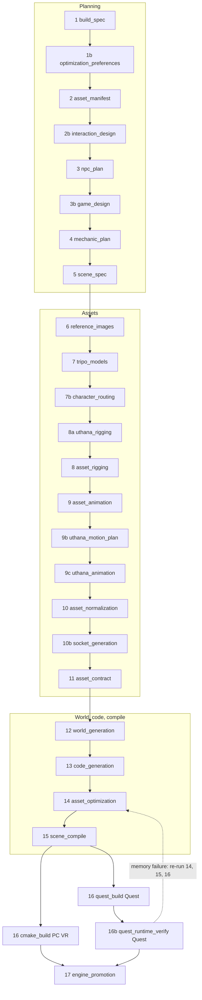

# All Stages Documentation

Personal relearning system for the **Prompt-to-VR pipeline**. Each stage has its own folder with a `README.md` containing a **Main stage summary** (quick relearn) and a **Detailed stage deep dive** (how it works internally).

Authoritative pipeline order: `_SHARED_STAGES`, `_PCVR_TAIL` and `_QUEST_TAIL` in [`apps/orchestrator/ptv_orchestrator/pipeline/orchestrator.py`](../../apps/orchestrator/ptv_orchestrator/pipeline/orchestrator.py).

## Pipeline at a glance



Stages **1–15** and **17** are identical for PC VR and Quest. The build tail branches on `ProjectState.target_device` (mirrored into `BuildSpec.target_device`): PC VR runs **16 `cmake_build`**; Quest runs **16 `quest_build`** then **16b `quest_runtime_verify`**.

Two ordering facts that matter when reading older notes:

- **World generation runs before code generation.** Gameplay code needs the ids of the doors, rooms, levers and spawn zones the world builder actually declared; the world builder links no gameplay code, so nothing flows the other way.
- **All rigging and animation (Tripo and Uthana) runs before normalization**, so every later stage validates, sockets, decimates and compiles the animated GLB.

## Stage index

| # | Stage ID | One-line purpose | Doc folder |
|---|----------|------------------|------------|
| 1 | `build_spec` | Prompt → structured BuildSpec | [PC](PC_VR_Stages/01_build_spec/README.md) · [Quest](Quest_Stages/01_build_spec/README.md) |
| 1b | `optimization_preferences` | User's optimization requests → validated locks | [PC](PC_VR_Stages/01b_optimization_preferences/README.md) · [Quest](Quest_Stages/01b_optimization_preferences/README.md) |
| 2 | `asset_manifest` | Plan 3D objects (not environment, not audio) | [PC](PC_VR_Stages/02_asset_manifest/README.md) · [Quest](Quest_Stages/02_asset_manifest/README.md) |
| 2b | `interaction_design` | How every item is held, its sockets, how weapons fire | [PC](PC_VR_Stages/02b_interaction_design/README.md) · [Quest](Quest_Stages/02b_interaction_design/README.md) |
| 3 | `npc_plan` | NPC roles, factions, animate vs slide, population | [PC](PC_VR_Stages/03_npc_plan/README.md) · [Quest](Quest_Stages/03_npc_plan/README.md) |
| 3b | `game_design` | Health, lives, respawn, objectives, end screens | [PC](PC_VR_Stages/03b_game_design/README.md) · [Quest](Quest_Stages/03b_game_design/README.md) |
| 4 | `mechanic_plan` | Reuse-first mechanics, bindings, CodeTask DAG | [PC](PC_VR_Stages/04_mechanic_plan/README.md) · [Quest](Quest_Stages/04_mechanic_plan/README.md) |
| 5 | `scene_spec` | Wire entities, mechanics, spawns per scene | [PC](PC_VR_Stages/05_scene_spec/README.md) · [Quest](Quest_Stages/05_scene_spec/README.md) |
| 6 | `reference_images` | Gemini reference images for Tripo | [PC](PC_VR_Stages/06_reference_images/README.md) · [Quest](Quest_Stages/06_reference_images/README.md) |
| 7 | `tripo_models` | Tripo V3 image → textured PBR GLB | [PC](PC_VR_Stages/07_tripo_models/README.md) · [Quest](Quest_Stages/07_tripo_models/README.md) |
| 7b | `character_routing` | Tripo or Uthana for each character | [PC](PC_VR_Stages/07b_character_routing/README.md) · [Quest](Quest_Stages/07b_character_routing/README.md) |
| 8a | `uthana_rigging` | Uthana auto-rig with fingers | [PC](PC_VR_Stages/08a_uthana_rigging/README.md) · [Quest](Quest_Stages/08a_uthana_rigging/README.md) |
| 8 | `asset_rigging` | Tripo rig-check + rig | [PC](PC_VR_Stages/08_asset_rigging/README.md) · [Quest](Quest_Stages/08_asset_rigging/README.md) |
| 9 | `asset_animation` | Tripo animation retarget + clip contract | [PC](PC_VR_Stages/09_asset_animation/README.md) · [Quest](Quest_Stages/09_asset_animation/README.md) |
| 9b | `uthana_motion_plan` | Choose each character's Uthana motions | [PC](PC_VR_Stages/09b_uthana_motion_plan/README.md) · [Quest](Quest_Stages/09b_uthana_motion_plan/README.md) |
| 9c | `uthana_animation` | Resolve, download and merge Uthana clips | [PC](PC_VR_Stages/09c_uthana_animation/README.md) · [Quest](Quest_Stages/09c_uthana_animation/README.md) |
| 10 | `asset_normalization` | Validate GLBs, record metadata | [PC](PC_VR_Stages/10_asset_normalization/README.md) · [Quest](Quest_Stages/10_asset_normalization/README.md) |
| 10b | `socket_generation` | Find each item's sockets on the mesh (vision + geometry + verify) | [PC](PC_VR_Stages/10b_socket_generation/README.md) · [Quest](Quest_Stages/10b_socket_generation/README.md) |
| 11 | `asset_contract` | Merge sockets + holds, character model frames | [PC](PC_VR_Stages/11_asset_contract/README.md) · [Quest](Quest_Stages/11_asset_contract/README.md) |
| 12 | `world_generation` | C++ VR environment → `world.scene.json` | [PC](PC_VR_Stages/12_world_generation/README.md) · [Quest](Quest_Stages/12_world_generation/README.md) |
| 13 | `code_generation` | Multi-agent C++ gameplay + compile-verify | [PC](PC_VR_Stages/13_code_generation/README.md) · [Quest](Quest_Stages/13_code_generation/README.md) |
| 14 | `asset_optimization` | LODs, KTX2 textures, performance profile, memory fit | [PC](PC_VR_Stages/14_asset_optimization/README.md) · [Quest](Quest_Stages/14_asset_optimization/README.md) |
| 15 | `scene_compile` | Merge world + gameplay + weapons → `scene.json` | [PC](PC_VR_Stages/15_scene_compile/README.md) · [Quest](Quest_Stages/15_scene_compile/README.md) |
| 16 | `cmake_build` / `quest_build` | **PC:** Windows exe · **Quest:** Android APK | [PC](PC_VR_Stages/16_cmake_build/README.md) · [Quest](Quest_Stages/16_quest_build/README.md) |
| 16b | `quest_runtime_verify` | Quest only: on-headset checks + memory correction loop (skipped without a headset) | [Quest](Quest_Stages/16b_quest_runtime_verify/README.md) |
| 17 | `engine_promotion` | Index generated modules for reuse | [PC](PC_VR_Stages/17_engine_promotion/README.md) · [Quest](Quest_Stages/17_engine_promotion/README.md) |

### Markers (not separate doc folders)

| ID | Meaning |
|----|---------|
| `created` | Project exists; no stages run yet |
| `cmake_configure` | Sub-phase of PC stage 16 (configure vs build) |
| `quest_install` | Post-build adb install (Quest); see Quest stage 16 doc |
| `ready_to_launch` | Pipeline finished; exe/APK ready |
| `failed` | Terminal failure state |

## How to relearn a stage

1. Open the stage folder for your target ([PC_VR_Stages](PC_VR_Stages/) or [Quest_Stages](Quest_Stages/)).
2. Read **Main stage summary** first (~5–10 minutes) — defines terms inline (DAG, socket, LOD, etc.).
3. Read **Detailed stage deep dive** when you need file paths, agents, or failure behavior.
4. Follow **See also** links to the topic docs (`codegen-agents.md`, `world-generation.md`, …).
5. When a stage grows past ~3,500 words, split new detail into sibling files in the same folder.

## Folder layout

```
All_Stages_Docs/
├── README.md                       ← you are here
├── PC_VR_Stages/
│   ├── 01_build_spec/ … 15_scene_compile/   ← shared stages
│   ├── 16_cmake_build/                       ← PC-only build doc
│   └── 17_engine_promotion/
└── Quest_Stages/
    ├── 01_build_spec/ … 15_scene_compile/   ← shared: same content + shared note
    ├── 16_quest_build/                       ← Quest-only build doc
    ├── 16b_quest_runtime_verify/             ← Quest-only on-headset verification
    └── 17_engine_promotion/
```

**Maintenance:** Stages 1–15 and 17 are duplicated in both trees. The Quest copy starts with a one-line "Shared content" note; everything below it is identical. When you change a shared stage, update **both** copies.

## Related documentation (outside this tree)

| Topic | Doc |
|-------|-----|
| System architecture | [`docs/architecture.md`](../architecture.md) |
| Codegen board + DAG | [`docs/codegen-agents.md`](../codegen-agents.md) |
| World builder | [`docs/world-generation.md`](../world-generation.md) |
| NPC runtime | [`docs/npc-and-ai.md`](../npc-and-ai.md) |
| Game loop (lives, endings, menus) | [`docs/game-flow.md`](../game-flow.md) |
| Weapons | [`docs/weapons.md`](../weapons.md) |
| Sockets | [`docs/sockets.md`](../sockets.md) |
| Uthana rigging + motions | [`docs/uthana.md`](../uthana.md) |
| Navigation | [`docs/navigation.md`](../navigation.md) |
| Rendering / LOD budgets | [`docs/rendering.md`](../rendering.md) |
| Quest optimization + memory | [`docs/quest-optimization.md`](../quest-optimization.md) |
| Engine catalog growth | [`docs/engine-growth.md`](../engine-growth.md) |
| Quest packaging | [`docs/quest-build.md`](../quest-build.md) |
| Build and launch (PC) | [`docs/build-and-run.md`](../build-and-run.md) |
| Overview (pipeline summary) | [`docs/overview.md`](../overview.md) |
| Runtime subsystems | [`docs/runtime-subsystems.md`](../runtime-subsystems.md) |

## Source of truth in code

| Concern | Location |
|---------|----------|
| Stage order | `orchestrator.py` → `_SHARED_STAGES`, `_PCVR_TAIL`, `_QUEST_TAIL` |
| Memory correction loop | `orchestrator.py` → `_verify_with_memory_corrections` |
| Stage enum | `packages/schemas/ptv_schemas/project_state.py` → `ProjectStage` |
| UI labels | `apps/web/src/lib/stages.ts` |
| Per-project artifacts | `projects/<project_id>/` |
