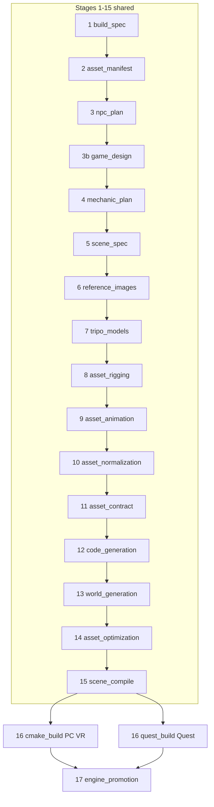

# All Stages Documentation

Personal relearning system for the **Prompt-to-VR pipeline**. Each stage has its own folder with a `README.md` containing a **Main stage summary** (quick relearn) and a **Detailed stage deep dive** (how it works internally).

Authoritative pipeline order: [`apps/orchestrator/ptv_orchestrator/pipeline/orchestrator.py`](../../apps/orchestrator/ptv_orchestrator/pipeline/orchestrator.py).

## Pipeline at a glance



Stages **1–15** and **17** are identical for PC VR and Quest. Only **stage 16** branches on `ProjectState.target_device` (mirrored into `BuildSpec.target_device`).

## Stage index

| # | Stage ID | One-line purpose | Doc folder |
|---|----------|------------------|------------|
| 1 | `build_spec` | Prompt → structured BuildSpec | [PC](PC_VR_Stages/01_build_spec/README.md) · [Quest](Quest_Stages/01_build_spec/README.md) |
| 2 | `asset_manifest` | Plan 3D objects (not environment) | [PC](PC_VR_Stages/02_asset_manifest/README.md) · [Quest](Quest_Stages/02_asset_manifest/README.md) |
| 3 | `npc_plan` | NPC roles, factions, animate vs slide | [PC](PC_VR_Stages/03_npc_plan/README.md) · [Quest](Quest_Stages/03_npc_plan/README.md) |
| 3b | `game_design` | Health, lives, respawn, objectives, end screens | [PC](PC_VR_Stages/03b_game_design/README.md) · [Quest](Quest_Stages/03b_game_design/README.md) |
| 4 | `mechanic_plan` | Reuse-first mechanics + CodeTask DAG | [PC](PC_VR_Stages/04_mechanic_plan/README.md) · [Quest](Quest_Stages/04_mechanic_plan/README.md) |
| 5 | `scene_spec` | Wire entities, mechanics, spawns per scene | [PC](PC_VR_Stages/05_scene_spec/README.md) · [Quest](Quest_Stages/05_scene_spec/README.md) |
| 6 | `reference_images` | Gemini reference images for Tripo | [PC](PC_VR_Stages/06_reference_images/README.md) · [Quest](Quest_Stages/06_reference_images/README.md) |
| 7 | `tripo_models` | Tripo V3 image/text → GLB | [PC](PC_VR_Stages/07_tripo_models/README.md) · [Quest](Quest_Stages/07_tripo_models/README.md) |
| 8 | `asset_rigging` | Tripo auto-rig (~30 credits/asset) | [PC](PC_VR_Stages/08_asset_rigging/README.md) · [Quest](Quest_Stages/08_asset_rigging/README.md) |
| 9 | `asset_animation` | Retarget clips + clip contract | [PC](PC_VR_Stages/09_asset_animation/README.md) · [Quest](Quest_Stages/09_asset_animation/README.md) |
| 10 | `asset_normalization` | Validate GLBs, record metadata | [PC](PC_VR_Stages/10_asset_normalization/README.md) · [Quest](Quest_Stages/10_asset_normalization/README.md) |
| 11 | `asset_contract` | Derive sockets (muzzle, grip, …) | [PC](PC_VR_Stages/11_asset_contract/README.md) · [Quest](Quest_Stages/11_asset_contract/README.md) |
| 12 | `code_generation` | Multi-agent C++ + compile-verify | [PC](PC_VR_Stages/12_code_generation/README.md) · [Quest](Quest_Stages/12_code_generation/README.md) |
| 13 | `world_generation` | C++ VR environment → world.scene.json | [PC](PC_VR_Stages/13_world_generation/README.md) · [Quest](Quest_Stages/13_world_generation/README.md) |
| 14 | `asset_optimization` | LOD decimation + performance profile | [PC](PC_VR_Stages/14_asset_optimization/README.md) · [Quest](Quest_Stages/14_asset_optimization/README.md) |
| 15 | `scene_compile` | Merge world + gameplay → scene.json | [PC](PC_VR_Stages/15_scene_compile/README.md) · [Quest](Quest_Stages/15_scene_compile/README.md) |
| 16 | `cmake_build` / `quest_build` | **PC:** Windows exe · **Quest:** Android APK | [PC](PC_VR_Stages/16_cmake_build/README.md) · [Quest](Quest_Stages/16_quest_build/README.md) |
| 17 | `engine_promotion` | Index generated modules for reuse | [PC](PC_VR_Stages/17_engine_promotion/README.md) · [Quest](Quest_Stages/17_engine_promotion/README.md) |

### Markers (not separate doc folders)

| ID | Meaning |
|----|---------|
| `created` | Project exists; no stages run yet |
| `cmake_configure` | Sub-phase of PC stage 16 (configure vs build) |
| `quest_install` | Post-build adb install (Quest); see Quest stage 16 doc |
| `ready_to_launch` | Pipeline finished; exe/APK ready |
| `failed` | Terminal failure state |

## How to relearn a stage

1. Open the stage folder for your target ([PC_VR_Stages](PC_VR_Stages/) or [Quest_Stages](Quest_Stages/)).
2. Read **Main stage summary** first (~5–10 minutes) — defines terms inline (DAG, socket, LOD, etc.).
3. Read **Detailed stage deep dive** when you need file paths, agents, or failure behavior.
4. Follow **See also** links to legacy deep docs (`codegen-agents.md`, `world-generation.md`, …).
5. When a stage grows past ~3,500 words, split new detail into sibling files listed under **Extend this folder** (e.g. `concepts-dag.md`).

## Folder layout

```
All_Stages_Docs/
├── README.md                 ← you are here
├── PC_VR_Stages/
│   ├── 01_build_spec/
│   │   └── README.md
│   ├── …
│   ├── 16_cmake_build/
│   └── 17_engine_promotion/
└── Quest_Stages/
    ├── 01_build_spec/        ← shared stages: same content + shared note
    ├── …
    ├── 16_quest_build/       ← Quest-only build doc
    └── 17_engine_promotion/
```

**Maintenance:** Stages 1–15 and 17 are duplicated in both trees. When you change a shared stage, update **both** PC and Quest copies (or edit PC first, then re-copy).

## Related documentation (outside this tree)

| Topic | Doc |
|-------|-----|
| System architecture | [`docs/architecture.md`](../architecture.md) |
| Codegen board + DAG | [`docs/codegen-agents.md`](../codegen-agents.md) |
| World builder | [`docs/world-generation.md`](../world-generation.md) |
| NPC runtime | [`docs/npc-and-ai.md`](../npc-and-ai.md) |
| Game loop (lives, endings, menus) | [`docs/game-flow.md`](../game-flow.md) |
| Navigation | [`docs/navigation.md`](../navigation.md) |
| Rendering / LOD budgets | [`docs/rendering.md`](../rendering.md) |
| Engine catalog growth | [`docs/engine-growth.md`](../engine-growth.md) |
| Quest packaging | [`docs/quest-build.md`](../quest-build.md) |
| Build and launch (PC) | [`docs/build-and-run.md`](../build-and-run.md) |
| Overview (pipeline summary) | [`docs/overview.md`](../overview.md) |
| Runtime subsystems | [`docs/runtime-subsystems.md`](../runtime-subsystems.md) |

## Source of truth in code

| Concern | Location |
|---------|----------|
| Stage order | `orchestrator.py` → `_SHARED_STAGES`, `_PCVR_TAIL`, `_QUEST_TAIL` |
| Stage enum | `packages/schemas/ptv_schemas/project_state.py` → `ProjectStage` |
| UI labels | `apps/web/src/lib/stages.ts` |
| Per-project artifacts | `projects/<project_id>/` |
