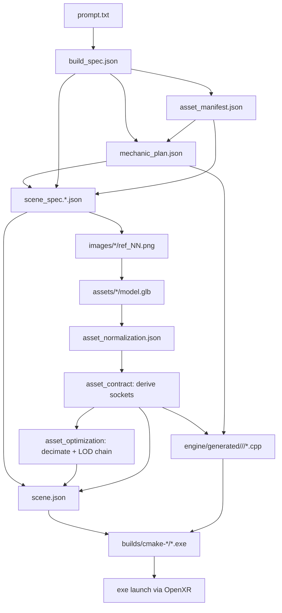

# Architecture

## High-level

```
+----------------+       +--------------------+       +-----------------+
| Web (Vite/TS)  |<----->| Orchestrator (FastAPI) |<->| Provider APIs   |
|                |  SSE  |                    |  HTTP | Anthropic        |
| projects / UI  |       | pipeline / storage |       | Google (Imagen) |
+----------------+       +----------+---------+       | Tripo            |
                                    |                  +-----------------+
                                    |  writes to projects/<id>/
                                    v
                      +---------------------------+
                      | Local filesystem         |
                      | JSON artifacts, images,  |
                      | GLB assets, generated    |
                      | C++, logs, builds        |
                      +---------------------------+
                                    |
                                    |  scene.json + generated C++
                                    v
                     +-------------------------------+
                     | Engine runtime (C++/Vulkan/XR) |
                     | ptv_starter_room.exe           |
                     | ptv_<project>.exe              |
                     +-------------------------------+
                                    |
                                    v
                        Meta Quest Link (OpenXR)
                        Quest 3 as PC VR HMD
```

## Why this split?

- The **engine core is stable and hand-authored**. Rendering, XR, memory, and
  ECS are never touched by generated code.
- The **pipeline is deterministic where possible**. The only places we allow
  LLM non-determinism are the planning stages and the `engine/generated/`
  C++ modules, both of which are bounded and schema-validated.
- **Schema-first** means each downstream stage reads a validated JSON
  artifact, not the original prompt. This prevents drift and lets the user
  resume a partial run.

## Data flow (per project)



## Engine subsystems

| Subsystem | Files | Responsibility |
|---|---|---|
| Platform | `src/platform/Window.cpp` | GLFW mirror window |
| Render | `src/render/VulkanContext.cpp` | Instance / device / queue / VMA |
| XR | `src/xr/XrSession.cpp` | Instance / session / action set / swapchains / frame loop |
| ECS | `src/ecs/World.h` | EnTT registry + stable id map |
| Transform FX | `src/ecs/TransformOffset.cpp` | Draw-time visual offsets (recoil kick, flinch) that never touch physics |
| Skeletal | `src/ecs/Skeleton.cpp` + `src/render/GltfSkinnedLoad.cpp` | Rig loading, clip sampling, procedural joint override, joint palettes |
| Scene | `src/scene/SceneLoader.cpp` | JSON scene → ECS |
| Physics | `src/physics/PhysicsWorld.cpp` | Jolt PhysicsSystem |
| Mechanics | `src/mechanics/MechanicRegistry.cpp` + `src/mechanics/builtin/<mechanic>/` | Data-driven mechanics; each built-in is its own `IMechanic` module |
| Debug | `src/debug/DebugUI.cpp` | Dear ImGui overlay (mirror-window only) |
| Save | `src/save/SaveSystem.cpp` | JSON world snapshot / load |
| Application | `src/core/Application.cpp` | Main loop |

Every subsystem exposes its public API through `engine/runtime/include/ptv/`.
Generated C++ may only include headers rooted at `ptv/api/`, `ptv/ecs/`,
`ptv/scene/`, `ptv/math/`, `ptv/mechanics/`, `ptv/dialogue/`, `ptv/ai/`,
plus common STL and well-known third-party prefixes (`glm/`, `entt/`,
`nlohmann/`).

## The socket contract

A **socket** is a named local transform on an asset -- "the muzzle is here,
pointing that way". Sockets exist because of a hard constraint in the
pipeline: the code-generation agent never sees the GLB, so it cannot know
where any particular barrel ends, and a pistol, a rifle and a rocket launcher
all differ. Three stages each own one third of the answer, and no single stage
can hold the whole thing:

| Clause | Owner | Artifact |
|---|---|---|
| "this mechanic needs a muzzle" | `mechanic_plan` -> `CodeTask.required_sockets` | `mechanic_plan.json` |
| "this asset's muzzle is at (x, y, z)" | `asset_contract` (deterministic, `ptv_glb_sockets`) | `asset_contract.json` |
| "this mechanic is bound to this entity" | `scene_spec` | `scene_spec.*.json` |

`scene_compile` is the only stage that runs after all three, so it is both the
join point (writing `mesh.sockets` in metres) and the validator: a mechanic
requiring a socket its asset cannot supply fails the build with every
violation listed at once.

Socket positions are stored in `asset_contract.json` in **unit space**
(normalised by the mesh's longest-axis extent) and converted to metres at
compile time by multiplying `target_scale_meters` -- the same convention
`bounds_radius_m` already uses. Unit space is what makes a socket survive the
LOD chain, since decimation shifts the AABB slightly.

Generated C++ reads them through `ctx.sockets->socket_world(entity, "muzzle")`
and never hard-codes an offset. An unknown socket falls back to the front of
the entity's bounding sphere rather than identity.

## Skinning

A socket is a fixed point on a rigid mesh. A **skin** is the other case: the
mesh itself deforms. Rigged assets carry a joint hierarchy, per-vertex bone
indices and weights, and inverse bind matrices; the engine renders them through
a second Vulkan pipeline that skins in the vertex shader off a shared
joint-matrix storage buffer.

The chain is deliberately narrow so a static scene pays nothing:

| Stage | Owner | Result |
|---|---|---|
| Parse skin, hierarchy, `JOINTS_0`/`WEIGHTS_0`, IBMs, clips | `GltfSkinnedLoad.cpp` | `SkinnedVertex` (48 B) + `SkeletonData` |
| Preserve the rig through decimation | `ptv_glb_optimize` | LOD chain with a byte-identical skeleton at every level |
| Record that an asset is rigged | `asset_optimization` → `scene_compile` | `mesh.skinned` / `mesh.joint_count` in `scene.json` |
| Attach the rig, evaluate the pose | `Application::attach_skeletons`, `tick_animators` | `CSkeleton` / `CAnimator`, joint palette per frame |
| Draw | `scene_skinned.vert` | Skinned geometry |

Two rules make the pieces fit:

- **Vertices stay in skin space.** Per the glTF spec a skinned mesh node's
  transform is ignored, since the joint matrices already place the mesh. The
  palette is therefore `jointWorld * inverseBind` with no mesh-node term, which
  has the useful property that a bind-pose palette is the identity — so a
  rigged mesh drawn un-posed is pixel-identical to the same mesh loaded as
  static geometry, and that is exactly what the smoke tests assert.
- **Joint indices are never renumbered.** They match the source skin's `joints`
  array, because `JOINTS_0` references that ordering; a parent-first traversal
  order is carried alongside instead.

Generated C++ poses a rig through `ctx.skeleton`, either by playing a baked
clip or by writing individual joints each frame from live input. See
[runtime-subsystems.md](runtime-subsystems.md#skeletal-animation-ptvtick_animators)
and [rendering.md](rendering.md#skinned-geometry-scene_skinnedvert).

## Threading

The orchestrator runs stages in a FastAPI background task. The native engine
has a single main thread for rendering + XR + ECS + mechanics; Jolt spawns its
own worker threads internally.

## Resumability

Every stage is idempotent: rerunning it rewrites its artifacts. The
orchestrator's `resume_pipeline()` skips stages whose last `StageRecord`
status is `succeeded`. See
[`apps/orchestrator/ptv_orchestrator/pipeline/orchestrator.py`](../apps/orchestrator/ptv_orchestrator/pipeline/orchestrator.py).
