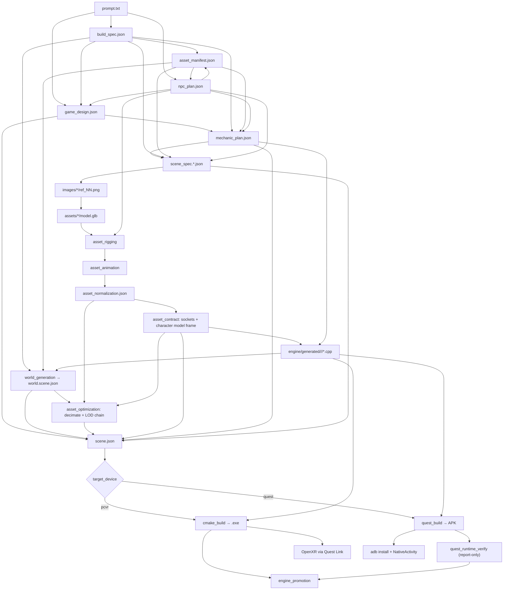

# Architecture

## High-level

```
+----------------+       +--------------------+       +-----------------+
| Web (Vite/TS)  |<----->| Orchestrator (FastAPI) |<->| Provider APIs   |
|                |  SSE  |                    |  HTTP | Anthropic        |
| projects / UI  |       | pipeline / storage |       | Google (Imagen) |
+----------------+       +----------+---------+       | Tripo            |
                                    |                  +-----------------+
                                    |  writes to projects/<id>/
                                    v
                      +---------------------------+
                      | Local filesystem         |
                      | JSON artifacts, images,  |
                      | GLB assets, generated    |
                      | C++, logs, builds        |
                      +---------------------------+
                                    |
                                    |  scene.json + generated C++
                                    v
                     +-------------------------------+
                     | Engine runtime (C++/Vulkan/XR) |
                     | ptv_starter_room.exe (PC VR)   |
                     | ptv_<project>.exe / Quest APK  |
                     +-------------------------------+
                                    |
                                    v
                        Meta Quest 3 (Link or standalone APK)
```

## Why this split?

- The **engine core is stable and hand-authored**. Rendering, XR, memory, and
  ECS are never touched by generated code.
- The **pipeline is deterministic where possible**. The only places we allow
  LLM non-determinism are the planning stages and the `engine/generated/`
  C++ modules, both of which are bounded and schema-validated.
- **Schema-first** means each downstream stage reads a validated JSON
  artifact, not the original prompt. This prevents drift and lets the user
  resume a partial run.

## Data flow (per project)



**Stage-by-stage docs:** [`All_Stages_Docs/README.md`](All_Stages_Docs/README.md)

## Engine subsystems

| Subsystem | Files | Responsibility |
|---|---|---|
| Platform | `src/platform/Window.cpp` | GLFW mirror window |
| Render | `src/render/VulkanContext.cpp` | Instance / device / queue / VMA |
| XR | `src/xr/XrSession.cpp` | Instance / session / action set / swapchains / frame loop |
| ECS | `src/ecs/World.h` | EnTT registry + stable id map |
| Transform FX | `src/ecs/TransformOffset.cpp` | Draw-time visual offsets (recoil kick, flinch) that never touch physics |
| Skeletal | `src/ecs/Skeleton.cpp` + `src/render/GltfSkinnedLoad.cpp` | Rig loading, clip sampling, procedural joint override, joint palettes |
| Scene | `src/scene/SceneLoader.cpp` | JSON scene → ECS |
| Physics | `src/physics/PhysicsWorld.cpp` | Jolt PhysicsSystem; capsules, character sweep, overlap queries |
| Navigation | `src/nav/NavGraph.cpp` | Walkable regions + portals declared by the world builder; A* routing |
| Mechanics | `src/mechanics/MechanicRegistry.cpp` + `src/mechanics/builtin/<mechanic>/` | Data-driven mechanics; each built-in is its own `IMechanic` module |
| Debug | `src/debug/DebugUI.cpp` | Dear ImGui overlay (mirror-window only) |
| Save | `src/save/SaveSystem.cpp` | JSON world snapshot / load |
| Text | `src/render/TextAtlas.cpp` + `src/render/TextRenderer.cpp` | SDF glyph atlas (stb_truetype, bundled Atkinson Hyperlegible, OFL) and world-space text pass |
| Weapons | `src/gameplay/EffectsSystem.cpp`, `ProjectileSystem.cpp`, `WeaponBoard.h`, `CombatRules.h` + `src/render/FxRenderer.cpp` | Procedural FX (flashes, tracers, beams, impacts, decals, flash lights), the projectile pool (swept casts, stick / bounce / explode), the shared weapon state / hit board -- see [weapons.md](weapons.md) |
| Application | `src/core/Application.cpp` | Main loop |

Every subsystem exposes its public API through `engine/runtime/include/ptv/`.
Generated C++ may only include headers rooted at `ptv/api/`, `ptv/ecs/`,
`ptv/scene/`, `ptv/math/`, `ptv/mechanics/`, `ptv/dialogue/`, `ptv/ai/`,
plus common STL and well-known third-party prefixes (`glm/`, `entt/`,
`nlohmann/`).

Gameplay reaches subsystems only through `MechanicContext`, never directly.
Beyond the original locomotion / physics / draw / hands / fx / haptics /
sockets / skeleton set, it now carries `contacts` (overlap queries),
`spawn` (clone a scene template at runtime), `attach` (parent an entity to a
socket or joint), `combat` (health, damage, factions), `perception`
(who can I see) and `nav` (how do I get there). Those six exist so that
characters authored by different CodeTasks share one model of damage,
targeting and movement — see [npc-and-ai.md](npc-and-ai.md) and
[navigation.md](navigation.md). `game` (the loop run by `builtin.game_flow`:
state, lives, objectives, `gameplay_active`), `text` (world-space SDF text)
and `app` (Leave Game, fades, respawn placement) complete it — see
[game-flow.md](game-flow.md). `weapons` (weapon state, hits, NPC triggers),
`projectiles` (the projectile pool and the scene's designed projectiles) and
`vfx` (procedural effects) are what the weapon built-ins run on and what
generated code reacts through — see [weapons.md](weapons.md).

## The character model frame

Character sources disagree about where the origin is and which way a model
faces: Tripo rigs stand on their origin (soles at y = 0) and face +X; Uthana
characters are centred at the hips and face +Z. The engine faces -Z and
stands a character's capsule on its centre. `asset_contract` measures every
character's frame from its skeleton and skinned bind pose
(`pipeline/model_frame.py`: sole = mesh bottom, height, forward = up x the
shoulder line, confirmed by the toes), `scene_compile` emits it as
`mesh.model_frame` with `foot_offset_m` = half the height and a height-based
`unit_scale`, and the skinned loader folds a pivot (yaw onto -Z, soles to
-height/2) into the root joints exactly like a non-joint ancestor node -- so
the palette, `joint_world`, sockets and attachments all agree. A skinned
character without a frame fails `scene_compile`. Facing uses one formula,
`ptv/api/Facing.h` (`yaw_from_forward(f) = atan2(-f.x, -f.z)`).

## The socket contract

A **socket** is a named local transform on an asset -- "the muzzle is here,
pointing that way". Sockets exist because of a hard constraint in the
pipeline: the code-generation agent never sees the GLB, so it cannot know
where any particular barrel ends, and a pistol, a rifle and a rocket launcher
all differ. Three stages each own one third of the answer, and no single stage
can hold the whole thing:

| Clause | Owner | Artifact |
|---|---|---|
| "this item is held by its handle, fires from its barrel" | `interaction_design` -> per-item `sockets` + `hold` | `interaction_design.json` |
| "this mechanic needs a muzzle" | `mechanic_plan` -> `CodeTask.required_sockets` | `mechanic_plan.json` |
| "this asset's muzzle is at (x, y, z), bore 9 mm" | `socket_generation` (vision segmentation + geometry solvers + render-and-verify) -> `asset_contract` | `asset_contract.json` |
| "this mechanic is bound to this entity" | `scene_spec` (weapons: `scene_compile` from the design) | `scene_spec.*.json` |

With an interaction design the sockets are found per item on the real mesh
(see [sockets.md](sockets.md)); projects from before it keep the legacy
deterministic `ptv_glb_sockets` derivation described below.

`scene_compile` is the only stage that runs after all three, so it is both the
join point (writing `mesh.sockets` in metres) and the validator: a mechanic
requiring a socket its asset cannot supply fails the build with every
violation listed at once.

The validator distinguishes two cases, because `required_sockets` means
"sockets this mechanic reads on `self`". A bound entity that HAS a mesh must
supply every one of them, or the build fails -- that is the original
protection. A bound entity with NO mesh cannot be reading `self`: a shooting
hub bound to the player's hand resolves the weapon at runtime and guards with
`ctx.sockets->has_socket(weapon, "muzzle")`. For those, the requirement is
that *some asset referenced by the scene* provides the socket -- satisfied
emits a warning naming the providers, unsatisfiable is still a hard failure.
The guarantee "this socket exists somewhere in this game" survives; the false
positive that failed every correctly written hub does not.

Which assets get sockets at all is decided by category. The implicit
`muzzle` + `grip` fallback applies to **`prop`** assets only, because a
socket is a point on a mesh: characters attach via rig joints and the
`BodySlots` taxonomy, UI attaches to a body slot, and FX are spawned *at*
another asset's socket. Explicit `socket_hints` override the category in
either direction. An asset with no sockets records a `reason` rather than a
bare `{}`, and `asset_contract` fails loudly when a socket gameplay depends
on could not be derived -- silently empty contracts are what let a broken
build reach the headset.

Socket positions are stored in `asset_contract.json` in **unit space**
(normalised by the mesh's longest-axis extent) and converted to metres at
compile time by multiplying `target_scale_meters` -- the same convention
`bounds_radius_m` already uses. Unit space is what makes a socket survive the
LOD chain, since decimation shifts the AABB slightly.

Generated C++ reads them through `ctx.sockets->socket_world(entity, "muzzle")`
and never hard-codes an offset. An unknown socket falls back to the front of
the entity's bounding sphere rather than identity.

## Skinning

A socket is a fixed point on a rigid mesh. A **skin** is the other case: the
mesh itself deforms. Rigged assets carry a joint hierarchy, per-vertex bone
indices and weights, and inverse bind matrices; the engine renders them through
a second Vulkan pipeline that skins in the vertex shader off a shared
joint-matrix storage buffer.

The chain is deliberately narrow so a static scene pays nothing:

| Stage | Owner | Result |
|---|---|---|
| Add a skeleton to a generated creature | `asset_rigging` (Tripo rig-check + rig) | `model_rigged.glb` |
| Retarget preset clips onto that skeleton | `asset_animation` (Tripo retarget) | `model_animated.glb` + intent→clip map |
| Parse skin, hierarchy, `JOINTS_0`/`WEIGHTS_0`, IBMs, clips | `GltfSkinnedLoad.cpp` | `SkinnedVertex` (48 B) + `SkeletonData` |
| Preserve the rig through decimation | `ptv_glb_optimize` | LOD chain with a byte-identical skeleton at every level |
| Record that an asset is rigged | `asset_optimization` → `scene_compile` | `mesh.skinned` / `mesh.joint_count` in `scene.json` |
| Attach the rig, evaluate the pose | `Application::attach_skeletons`, `tick_animators` | `CSkeleton` / `CAnimator`, joint palette per frame |
| Draw | `scene_skinned.vert` | Skinned geometry |

Two rules make the pieces fit:

- **Vertices stay in skin space.** Per the glTF spec a skinned mesh node's
  transform is ignored, since the joint matrices already place the mesh. The
  palette is therefore `jointWorld * inverseBind` with no mesh-node term, which
  has the useful property that a bind-pose palette is the identity — so a
  rigged mesh drawn un-posed is pixel-identical to the same mesh loaded as
  static geometry, and that is exactly what the smoke tests assert.
- **Joint indices are never renumbered.** They match the source skin's `joints`
  array, because `JOINTS_0` references that ordering; a parent-first traversal
  order is carried alongside instead.

Generated C++ poses a rig through `ctx.skeleton`, either by playing a baked
clip or by writing individual joints each frame from live input. See
[runtime-subsystems.md](runtime-subsystems.md#skeletal-animation-ptvtick_animators)
and [rendering.md](rendering.md#skinned-geometry-scene_skinnedvert).

Two rigs come from different places, and the split is not arbitrary:

- **Creatures** are rigged by Tripo in the `asset_rigging` stage. Its rig
  types (`biped`, `quadruped`, `hexapod`, `octopod`, `avian`, `serpentine`,
  `aquatic`) all describe a whole animal, and the free `rig-check` call gates
  the paid one.
- **The player's default hands** (Hands Only games) come from
  `Default_Models/default_rigged_hand_model.glb`, a single pre-rigged hand.
  [engine/tools/prepare_default_hands.py](../engine/tools/prepare_default_hands.py)
  renames its joints to the BodySlots vocabulary and mirrors it for the other
  hand at build time. They are ordinary ECS entities carrying the rigged mesh,
  so the same skinned pipeline draws them, and `builtin.hand_pose` curls their
  fingers from the controller. They are drawn `player.hands.scale_m` long
  (default 0.27 m, the size of a Full Player Avatar's hands). The skinned
  loader sizes every rig from its bind pose AS DRAWN (`bind_palette_gain`):
  this Sketchfab export's inverse binds leave out its 100x "Armature" node,
  and sizing it from the raw vertices drew the hand 20 m long -- invisible
  from inside. A hand that still loads absurdly sized falls back to block
  hands, a non-finite finger pose resets to rest, and `ptv_smoke_default_hands`
  checks size, alignment and visibility on every build.
- **Full Player Avatar** games use the avatar's OWN hands. The engine creates
  only invisible hand anchors, and `builtin.hand_pose` curls the avatar's
  finger bones when its rig has them. No substitute hands are ever drawn.

## The clip contract

Sockets solved "the codegen agent cannot see the mesh". Animation clips have
the identical problem one layer up: **Tripo's retargeter names the clips**, so
a generated mechanic writing `play_clip(self, "walk")` would be guessing.

The fix is the same shape. `AssetItem.animations` holds semantic intents;
`asset_animation` maps each to a preset, retargets, then reads back the names
that are really in the returned GLB and records intent → real name;
`scene_compile` writes that map as `mesh.animations`; and
`ISkeleton::play_clip` resolves through it before falling back to an exact
name match.

| Clause | Owner | Artifact |
|---|---|---|
| "this enemy needs to walk and shoot" | `npc_plan` → `NpcSpec.animation_intents`, reconciled onto `AssetItem.animations` | `npc_plan.json` |
| "walk is the clip called Walk_01 on this asset" | `asset_animation` | `asset_animation.json` |
| "a walk on a 1.8 m biped looks like 1.4 m/s" | `scene_compile` → `mesh.animation_speeds` | `scene.json` |
| "this asset is on this entity" | `scene_spec` | `scene_spec.*.json` |

An asset that ships an `idle` clip starts it looping the moment the scene
loads. That is the one clip choice with an obvious answer, and without it a
room of enemies holds its bind pose until some mechanic thinks to start
them — which reads as broken rather than idle.

Clip changes cross-fade rather than cut. `play_clip` takes a `fade_s` that
defaults to a short blend, because a hard switch between idle and walk is a
visible snap on every gait change; pass 0 when the cut is the point, as for a
hit reaction.

The third row is what stops feet from sliding. Tripo retargets in place, so a
walk clip has no root motion to measure — nothing in the file says how fast it
*looks* like it is going. The scene compiler derives that from the character's
height, and `builtin.character_locomotion` divides real speed by it to set
playback rate. See [npc-and-ai.md](npc-and-ai.md).

## Grabbing by the grip socket

`builtin.grab` used to freeze whatever relative pose an object happened to
have when the player squeezed, so a weapon approached from above stayed held
from above. It now solves for the pose that puts the asset's derived `grip`
socket in the hand:

```
local_rotation = inverse(socket.rotation)
local_offset   = -(inverse(socket.rotation) * (scale * socket.position))
```

The hand cancels out of that solve entirely, which is the point: the object
lands the same way no matter how it was reached for. An asset with no `grip`
socket keeps the old relative hold, and `snap_to_grip: false` opts out for
things with no correct orientation (a ball, a rock).

Socket frames are now the OpenXR grip frame of the hand holding them, and
the item's `mesh.hold` profile picks the solve (`builtin/grab/HoldSolver.h`):
hand-frame (swords, tools), aim-aligned (guns: the barrel follows the aim
pose, because the Touch handle is angled), `two_hand_line` (rifle grip plus
handguard -- the line between the hands steers the item), `two_hand_wrap`
(a pistol's support hand wrapped around the shooting hand) and
`forearm_strap` (a shield along the forearm). The hand is drawn on the
socket it holds (`IHands::set_hand_anchor`). Full maths and frame
conventions: [sockets.md](sockets.md).

## Equip slots: the other half of attachment

A **socket** is a point on an item ("the pistol's grip is here"). An **equip
slot** is a place on a wearer ("a holster hangs at the right hip"). Holstering
needs both, and only one of them existed as authored data.

`CEquipSlots` and `EquipMechanic::pick_slot_near()` shipped in the runtime,
but nothing ever populated the component from `scene.json`, so every wearer in
every generated game offered zero candidate slots and an authored holster
silently accepted nothing. The chain is now declared end to end:

| Link | Where |
|---|---|
| planner is told a slot belongs on the WEARER, never on the holster prop | `SCENE_SPEC_SYSTEM` |
| the agent can actually emit one | `EquipSlotSpec` in `scene_spec.py` **and** mirrored in the strict wire model |
| slots reach the runtime document | `scene_compile` writes `entity.equip_slots[]` |
| the document becomes a component | `SceneLoader` emplaces `CEquipSlots` |

The wire mirror is load-bearing rather than duplication: strict structured
output permits only the declared surface, so a field the wire schema omits is
one the agent is physically unable to produce.

`scene_compile` fails loudly on the two ways this goes wrong quietly -- a
`builtin.equip` binding naming a slot nothing declares, and two entities
declaring the same slot name.

On the engine side, `Scene.h` carries its own plain-data `EquipSlotSpec`
rather than including `ptv/ecs/World.h`, and `SceneLoader.cpp` converts. That
is the same split `HealthProps` / `CHealth` already uses, and it exists
because the scene document is also parsed by `ptv_worldgen`, which links no
ECS.

## Threading

The orchestrator runs stages in a FastAPI background task. The native engine
has a single main thread for rendering + XR + ECS + mechanics; Jolt spawns its
own worker threads internally.

## Resumability

Every stage is idempotent: rerunning it rewrites its artifacts. The
orchestrator's `resume_pipeline()` skips stages whose last `StageRecord`
status is `succeeded`. See
[`apps/orchestrator/ptv_orchestrator/pipeline/orchestrator.py`](../apps/orchestrator/ptv_orchestrator/pipeline/orchestrator.py).
