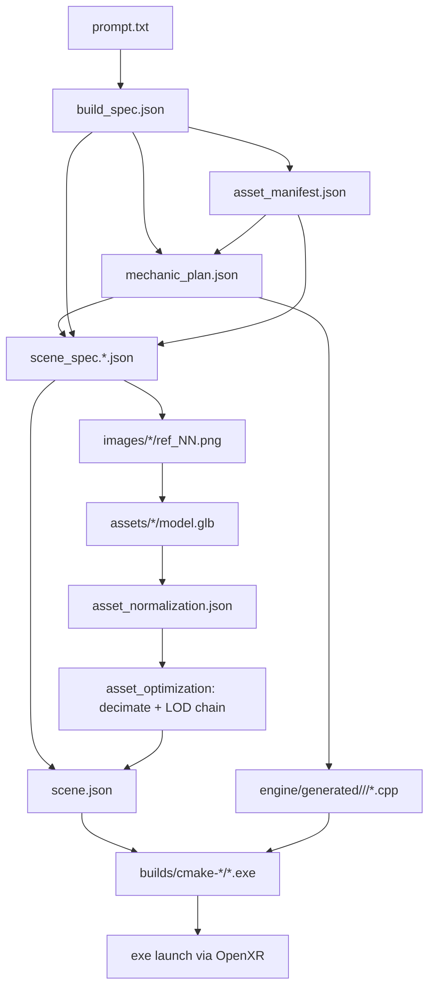

# Architecture

## High-level

```
+----------------+       +--------------------+       +-----------------+
| Web (Vite/TS)  |<----->| Orchestrator (FastAPI) |<->| Provider APIs   |
|                |  SSE  |                    |  HTTP | Anthropic        |
| projects / UI  |       | pipeline / storage |       | Google (Imagen) |
+----------------+       +----------+---------+       | Tripo            |
                                    |                  +-----------------+
                                    |  writes to projects/<id>/
                                    v
                      +---------------------------+
                      | Local filesystem         |
                      | JSON artifacts, images,  |
                      | GLB assets, generated    |
                      | C++, logs, builds        |
                      +---------------------------+
                                    |
                                    |  scene.json + generated C++
                                    v
                     +-------------------------------+
                     | Engine runtime (C++/Vulkan/XR) |
                     | ptv_starter_room.exe           |
                     | ptv_<project>.exe              |
                     +-------------------------------+
                                    |
                                    v
                        Meta Quest Link (OpenXR)
                        Quest 3 as PC VR HMD
```

## Why this split?

- The **engine core is stable and hand-authored**. Rendering, XR, memory, and
  ECS are never touched by generated code.
- The **pipeline is deterministic where possible**. The only places we allow
  LLM non-determinism are the planning stages and the `engine/generated/`
  C++ modules, both of which are bounded and schema-validated.
- **Schema-first** means each downstream stage reads a validated JSON
  artifact, not the original prompt. This prevents drift and lets the user
  resume a partial run.

## Data flow (per project)



## Engine subsystems

| Subsystem | Files | Responsibility |
|---|---|---|
| Platform | `src/platform/Window.cpp` | GLFW mirror window |
| Render | `src/render/VulkanContext.cpp` | Instance / device / queue / VMA |
| XR | `src/xr/XrSession.cpp` | Instance / session / action set / swapchains / frame loop |
| ECS | `src/ecs/World.h` | EnTT registry + stable id map |
| Scene | `src/scene/SceneLoader.cpp` | JSON scene → ECS |
| Physics | `src/physics/PhysicsWorld.cpp` | Jolt PhysicsSystem |
| Mechanics | `src/mechanics/MechanicRegistry.cpp` + `src/mechanics/builtin/<mechanic>/` | Data-driven mechanics; each built-in is its own `IMechanic` module |
| Debug | `src/debug/DebugUI.cpp` | Dear ImGui overlay (mirror-window only) |
| Save | `src/save/SaveSystem.cpp` | JSON world snapshot / load |
| Application | `src/core/Application.cpp` | Main loop |

Every subsystem exposes its public API through `engine/runtime/include/ptv/`.
Generated C++ may only include headers rooted at `ptv/api/`, `ptv/ecs/`,
`ptv/scene/`, `ptv/math/`, `ptv/mechanics/`, `ptv/dialogue/`, `ptv/ai/`,
plus common STL and well-known third-party prefixes (`glm/`, `entt/`,
`nlohmann/`).

## Threading

The orchestrator runs stages in a FastAPI background task. The native engine
has a single main thread for rendering + XR + ECS + mechanics; Jolt spawns its
own worker threads internally.

## Resumability

Every stage is idempotent: rerunning it rewrites its artifacts. The
orchestrator's `resume_pipeline()` skips stages whose last `StageRecord`
status is `succeeded`. See
[`apps/orchestrator/ptv_orchestrator/pipeline/orchestrator.py`](../apps/orchestrator/ptv_orchestrator/pipeline/orchestrator.py).
