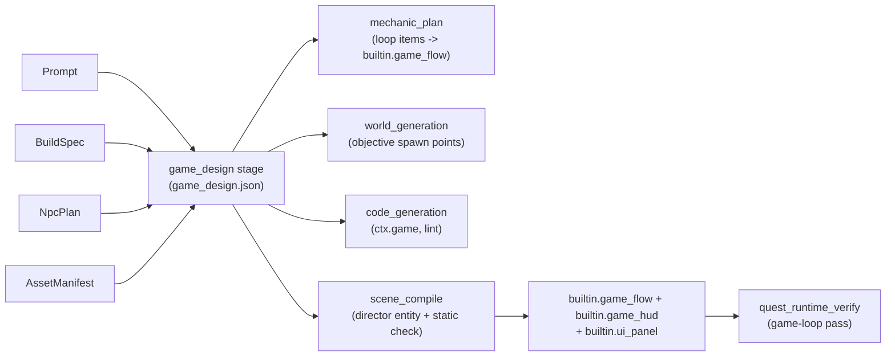
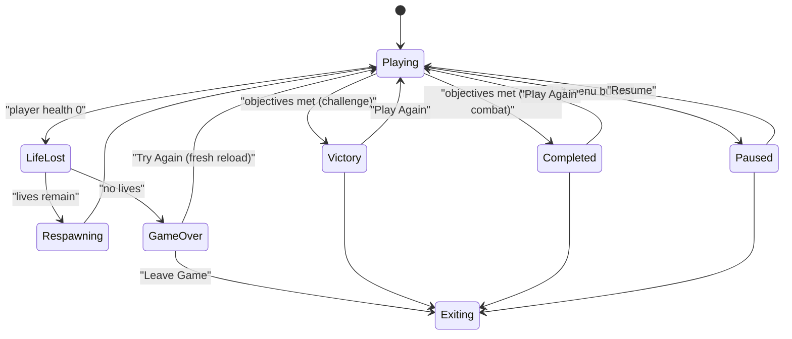

# Game flow: health, lives, objectives, endings

Every game the pipeline builds gets a complete, designed game loop: what can
hurt the player, what happens when they die, what they are trying to do, how
the game ends, and what every button on the end screen does. Nothing is left
to per-game generated code.

## Why it is an engine system

Before this, each game's codegen invented its own run flow. The
humans-vs-aliens APK showed the result: the player's health reached zero,
the generated run flow paused the NPC director, its results screen was wired
to a contract nothing called, and the engine had no way to draw text, revive
the player, restart a scene or quit. The player stood in a frozen arena with
no way out.

## The pieces

### 1. `game_design` stage (after `npc_plan`, before `mechanic_plan`)

An Agents-SDK designer (`gpt-5.6-sol`, reasoning `high`, no tools) reads:

- the original prompt, which is where explicit rules live ("3 lives",
  "survive 3 minutes") and the text every `prompt_quote` must match;
- the BuildSpec (`game_type`, target device, player experience, mechanics,
  HUD summary, scenes, acceptance tests);
- the NpcPlan (who is hostile to the player, how much damage, which waves);
- the AssetManifest (so `collect` / `interact` objectives name real items).

It writes `game_design.json` (`packages/schemas/ptv_schemas/game_design.py`):

| Section | Meaning |
| --- | --- |
| `experience` | combat, puzzle, exploration, narrative, sandbox, score_attack, simulation, media |
| `player_vitality` | whether the player has health, its maximum, regen, invulnerability |
| `lives` | a count, or `null` for unlimited |
| `on_life_lost` | respawn point (spawn / checkpoint / last safe), delay, health restored, loadout kept, invulnerability, enemy policy |
| `objectives` | `survive_time`, `defeat_count`, `clear_waves`, `reach_location`, `collect`, `interact`, `custom` |
| `victory`, `failure` | how the game is won or lost |
| `end_screens` | `game_over` / `victory` / `completed`, each with buttons `try_again`, `play_again`, `keep_playing`, `leave_game` |
| `pause_menu` | left menu button; `resume`, `restart`, `leave_game` |
| `reset_policy`, `hud` | what a restart puts back; which HUD items exist |
| `free_play`, `omitted` | no ending at all; the systems deliberately left out, with why |

Every decision carries `provenance`: `explicit` (with the prompt's exact
words) or `inferred` (with a one-line rationale). Explicit always wins.

A deterministic validate-and-repair loop
(`pipeline/game_design_rules.py`) checks the design and sends problems back
to the designer up to `game_design_max_repair_rounds` times:

- an explicit quote must appear in the prompt (otherwise it is downgraded);
- NPCs that attack the player require player health, unless the prompt says
  the player is invulnerable;
- lives require health; a finite number of lives requires a `lives_exhausted`
  failure and a Game Over screen with Try Again;
- every terminal state has a screen and every screen has a button;
  something always offers Leave Game;
- `survive_time` needs a duration, `defeat_count` a count and real NPC types,
  `clear_waves` an encounter, `collect` real assets, `reach_location` a named
  spawn point;
- a game with no way to end is `free_play`.

Whatever is still incomplete is repaired deterministically, completing only
what the design chose. Nothing is invented: a book reader keeps no health, no
lives and no Game Over. Without an OpenAI key the stage falls back to a
conservative design derived from the NPC plan.

### 2. Planning and codegen

- `mechanic_plan` is told the loop is decided and runs on the engine, and
  `reconcile_game_flow_items` (`pipeline/game_flow_plan.py`) converts any
  generated run flow, lives, respawn, player-health or end-screen item into
  `builtin+config` of `builtin.game_flow`, and a plain health / lives / timer
  HUD into `builtin.game_hud`. A HUD with game-specific content (ammo, waves)
  stays generated and is told not to redraw what `builtin.game_hud` shows.
  The same reconcile runs at the start of `code_generation`, so a resume
  from codegen applies it to an old plan.
- `world_generation` is told the spawn-point ids `reach_location` objectives
  need.
- The codegen API reference documents `ctx.game`, `ctx.text` and `ctx.app`.
  `codegen_contracts.py` (API contract v4 and later) rejects, in projects with a game
  design, a private lives counter, a private respawn that teleports the
  player, and generated restarts / revives.

### 3. `scene_compile`

`pipeline/game_flow_scene.py` binds ONE director entity
(`ptv_game_director`) carrying `builtin.ui_panel` (`ptv_game_flow` panel),
`builtin.game_flow` (the design as params, plus the scene's spawn and named
spawn points) and, when the HUD has anything to show, `builtin.game_hud`.
Any other `builtin.game_flow` / `builtin.game_hud` binding is moved onto it,
because two flows would each spend a life.

A static check then fails the stage if the loop cannot complete in this
scene: a `reach_location` spawn point the world did not declare, `clear_waves`
without an encounter, a `collect` target not in the scene, unknown buttons,
a finite-lives game without a Game Over screen, or nothing offering Leave Game.

### 4. Runtime

`builtin.game_flow` (`engine/runtime/src/mechanics/builtin/game_flow/`) runs:

- Death is noticed through `ctx.combat`. The player's body is never removed
  on death, and `ICombat::revive` brings them back.
- Respawn fades to black (`IApp::request_fade`), places the player with
  `IApp::place_player` (not distance-capped like a teleport), revives them
  with invulnerability, and applies the enemy policy (clear nearby hostiles,
  or reset the wave).
- End screens are `builtin.ui_panel` panels with an SDF-text title,
  subtitle (time, kills, score) and labelled buttons, world-locked 1.4 m away
  and slightly below eye level. The sticks are locked, encounters are paused
  and the player is invulnerable while one is up.
- Try Again / Play Again call `ISceneTransition::restart_current(fresh)`,
  which reloads the scene at a frame boundary without restoring saved deltas,
  so health, lives, loadout, NPCs and world state all start over. The attempt
  counter survives the reload.
- Leave Game calls `IApp::request_exit`: `xrRequestExitSession`, the session
  ends at STOPPING, the loop stops at EXITING, and on Quest
  `ANativeActivity_finish` is called before `android_main` returns so the app
  can be launched again (KhronosGroup/OpenXR-SDK-Source#329).
- Generated code reads `ctx.game` (`state`, `state_seq`, `gameplay_active`,
  `lives`, `elapsed_s`, `time_remaining_s`, `score`) and reports
  game-specific objectives with `add_progress` / `complete` / `fail`.
- `builtin.game_hud` draws health, lives, timer, score and the current
  objective on the left wrist (never head-locked).

Every transition is logged as `flow: state=... from=... why=... attempt=...
lives=...`, plus `flow: button=...` and `flow: objective=... complete`.

### 5. On-headset verification (Quest only, report-only)

`quest_runtime_verify` runs a second launch with `debug.ptv.verify_flow=1`
when the project has a game design. In that mode the player is NOT
protected, and `builtin.game_flow` scripts the run:

1. Attempt 1: if the player can die, every life ends (after ~12 s if the
   enemies have not managed it); Game Over; Try Again is clicked.
2. Attempt 2: the player is kept alive, timers run 10x, non-timer objectives
   are forced after ~15 s; victory; Play Again is clicked.
3. Attempt 3: pause, then Leave Game.

The checks are derived from the design: health 0 costs a life, the player
respawns, Game Over follows the last life, Try Again restarts and resets
lives, winning shows the victory screen, Play Again restarts, Leave Game ends
the process, and the app launches again afterwards. A game that cannot kill
the player is checked for never dying instead. As before, the stage is
skipped (never failed) without a headset.

## Worked examples

- Goblin Shooter, "survive the goblin waves for 3 minutes, you have 3
  lives": combat; health 100; lives 3 (explicit); respawn at spawn with the
  blaster, 3 s invulnerable, nearby goblins cleared; objective
  `survive_time` 180 s (explicit); Game Over [Try Again, Leave Game]; You Win!
  [Play Again, Leave Game]; HUD health, lives, timer.
- VR book reader: media; no health, lives, failure or HUD; ends in
  `completed` "The End" if the book has an ending, otherwise `free_play` with
  Leave Game in the pause menu; `omitted` says why.
